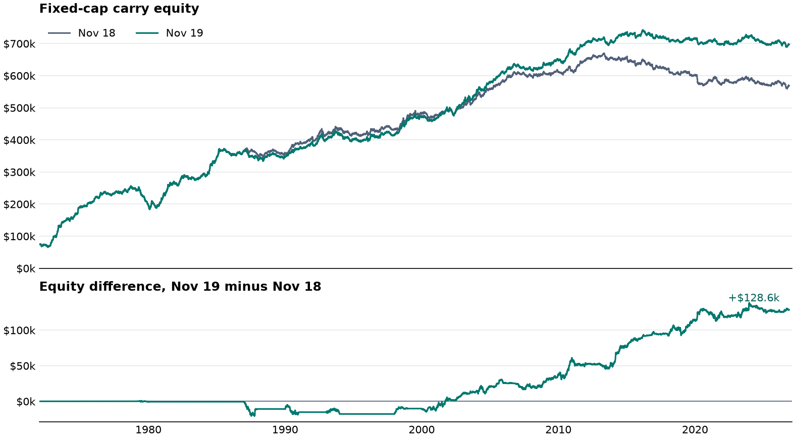

# Carry zero-roll and P&L audit, November 19, 2026

The latest complete carry run finished at **$697,026.50**, up **$128,634.70**
from the previous complete run with the same scenario settings. Both saved
runs already exclude exact zero spreads from the forecast. On dates when the
same symbol was active in both runs, the cash forecasts matched exactly,
including missing values, and net P&L fell by **$27,695**. Dates when a symbol
was active in exactly one run contributed **+$156,930**. Rows inactive in
both runs contributed **−$600**.

The latest smoother **restarts on the first valid observation after a zero
spread**. The signal excludes that observation and the execution path holds
the existing position while the target is missing. These are two distinct
behaviors. If the intended smoothing is to omit the observation and retain
the EWMA state through the gap, the latest saved run does not implement it.

## Runs and evidence

- Latest complete run `selection_run_20261119_184649`, compared with
  `selection_run_20261118_083034`. Five intervening directories have no saved
  portfolio curve. The two complete runs use fixed $75,000 capital, 20% target
  volatility, 15% instrument and 50% book margin caps, annual selection,
  `topdown_classif` weighting, and 256-session forecast probation with 0.50
  and 0.25 thresholds and two weak reviews.
- The previous forecast panel ends on March 29, 2024. The latest includes
  stitched forecasts through November 18, 2026. Both cash curves reach that
  same November 18 session. Instrument coverage, rule eligibility and some
  eligible speed lists differ. This comparison measures the combined effect
  of these changes on selection and execution.
- The November 17 complete runs inspected also label zero spreads as missing.
  Older November 12 curves use different selector settings and do not have
  daily raw carry in their saved reports. A saved zero-input control for the
  current scenario could not be verified. The zero-input comparison below
  uses the latest saved prices and forecasts as a controlled smoothing
  diagnostic.

## What goes null

The production test is on the exact price difference before public report
rounding. Use `carry_excl = "zero_raw_roll"` to count it. The public
`raw_roll` column is rounded to four decimals and displays zero for some
nonzero FX spreads. In the latest forecast panel, **34,128** rows displayed
`raw_roll = 0`, while **17,524** carried the exact-zero exclusion, including
repeated as-of rows and executable aliases. After restricting to same-session
observations and collapsing executable aliases that share the same source
timestamp, history code, contract pair and prices, there are **16,505 exact
zeros in 983,002 curve observations (1.68%)** across 170 history codes. All
exact-zero rows have null raw carry and null combined forecast.

| Source recorded in curve | Same-session observations | Exact zero | Rate |
|---|---:|---:|---:|
| Unlabeled reference fallback | 810,361 | 8,540 | 1.05% |
| PST segment in stitched history | 144,439 | 6,893 | 4.77% |
| IB segment in stitched history | 28,202 | 1,072 | 3.80% |
| **Total** | **983,002** | **16,505** | **1.68%** |

The weekday rates are 1.68% Monday, 1.65% Tuesday, 1.66% Wednesday, 1.73%
Thursday and 1.67% Friday. Every same-session observation is dated on a
weekday. Only **two** exact-zero observations carried a weekend source
timestamp, both Sunday. Christmas Day had 11 zeros in 223 available
instrument observations (4.93%), so there is a local holiday concentration
in that small sample. The broad weekday distribution gives little support
for a weekend-driven effect. In 2026, 577 of 32,231 such observations were
exact zeros (1.79%).

| Pattern versus prior observation for the same executable route | Exact-zero observations |
|---|---:|
| Same contract pair, both reported marks moved | 14,137 |
| Same pair, neither mark moved | 1,044 |
| Same pair, just the current mark moved | 471 |
| Same pair, just the carry mark moved | 162 |
| Contract pair changed | 645 |
| First observation for the route | 10 |
| Prior pair unavailable for comparison | 36 |

The rate varies materially by market. JGB-SGX-mini had **2,219 of 6,351**
(34.9%), BBCOMM **1,029 of 4,815** (21.4%) and MUMMY **519 of 2,063** (25.2%).
BBCOMM had consecutive equal-mark observations on 250 saved IB sessions from
July 5, 2024 through July 2, 2025, and on 236 from July 7, 2025 through
June 11, 2026. Long runs like these have a different shape from an isolated
curve crossing. The price movements and repeat patterns alone cannot identify
how the provider obtained the two marks.

### Missing legs and source-price checks

- For 15,433 reference-side zero observations, a read-only join to the local
  PST sidecar confirmed **14,472** had exactly equal prices in the upstream
  `raw.multiple_prices` row at the saved source timestamp and contract IDs.
  The other **961** had no row for that source day in the VM sidecar, so their
  raw provenance is unresolved. Across the matched source days, **2,538** had
  an alternate same-day row with a nonzero spread for the same pair and
  **1,057** had a same-pair row with one missing price. Those counts can
  overlap. The PST daily projection chooses the last complete source row, so
  a same-day alternate quote can differ from the selected daily observation.
- IB looks up the carry month in the configured roll cycle and joins a
  separate mark on the same date and contract month. An absent leg remains
  null. The saved IB segment has **3,167 invalid-price observations** in
  addition to its 1,072 equal-price observations. The importer has no
  fallback that copies the current price into a missing carry leg.
- Across the full executable forecast report, there are **11,168**
  `invalid_price` rows, **1,153** `invalid_point_vol` rows and **89,994**
  rows with no as-of carry observation. Those counts use report rows and
  include repeated source observations, so they have a different denominator
  from the same-session table.

## What smoothing and execution do

`build_raw_carry_frame` retains the exact zero `raw_roll` for diagnostics
and sets `ann_roll` and `raw_carry` to null. `build_carry_components`
breaks its EWMA segment at the invalid row and at the next valid row. In the
latest saved data, **all 7,613 executable-route transitions** from an exact
zero to a valid same-session raw observation changed segment ID and started
the 120-session smoother at that day's raw carry. This discards the
pre-gap state even for a one-day zero.

The ZL/MZL example is present in the saved forecast panel and the raw PST
sidecar. The daily quote on January 8 is a Friday 23:00 observation, with
a March mark of 11.95 and a January mark of 11.95. Both prices moved from
the previous day, and the sidecar has one source row that day.

| Session | Current mark | Carry mark | Raw carry | Carry 5 before scaling | Carry 120 before scaling | Combined forecast |
|---|---:|---:|---:|---:|---:|---:|
| 1971-01-07 | 11.57 | 11.65 | 0.1726 | 0.2228 | 1.1776 | 1.8038 |
| 1971-01-08 | 11.95 | 11.95 | null | null | null | null |
| 1971-01-11 | 12.05 | 12.10 | 0.1012 | 0.1012 | 0.1012 | 0.3734 |

In the actual cash ledger, **1,987 active symbol-days** matched an exact-zero
exclusion in the forecast panel, including 1,978 on the same source date.
All 1,987 had a null executable forecast and a null target. **879** had a
nonzero held position. There were **zero position-changing trades** on these
rows and every P&L row was valid. Held exposure still earned **−$2,593.45
gross** and **−$3,119.92 net**, including roll fees. The execution engine
keeps the prior position while an active symbol's target is missing. A
selection exit is governed by its own membership rule.

### Saved and same-input forecast comparisons

Of 1,005,263 matched symbol-date rows from the two saved forecast panels,
14,113 had an exact-zero exclusion in both runs. Both had null raw carry
and null combined forecast on all 14,113. There were no raw carry or point
change disagreements on matched, non-null observations. Among 893,900
jointly valid forecasts, 11,507 values differed, average absolute difference
was 0.00260, sign agreement was 99.97%, and final cap-hit frequency was 26.68%
previously and 26.84% in the latest. The saved speed lists changed for MZC,
V2TX and MET. For example MZC gained Carry5 and moved from FDM 1.03 to 1.23.

For the same-input diagnostic, the two comparison smoothers keep the latest
eligible speeds, weights, scalar 3 and per-rule/final caps. Both reset at
source boundaries, other missing inputs and gaps longer than seven days.
One feeds a zero into each speed on a zero-spread day. The other skips the
observation with `ignore_nulls=True`, preserves state and leaves that day's
forecast missing. The calculation uses the saved rounded, same-session raw
carry values and holds the input history fixed. It produces forecasts only.

| Comparison | Jointly valid rows | Mean absolute difference | 95th percentile | Sign agreement |
|---|---:|---:|---:|---:|
| Saved reset versus zero input | 1,010,837 | 0.0595 | 0.3350 | 97.37% |
| Saved reset versus skip and retain state | 1,010,837 | 0.0615 | 0.3469 | 97.25% |
| Skip and retain state versus zero input | 1,010,837 | 0.0044 | 0.0197 | 99.86% |
| Saved reset versus zero input on first valid day after a zero | 7,532 | 0.4834 | 1.7184 | 62.76% |
| Saved reset versus skip and retain state on first valid day after a zero | 7,532 | 0.5176 | 1.7997 | 61.84% |

A zero fed into the EWMA usually leaves a nonzero forecast because earlier
observations retain weight. The counterfactual mean absolute combined
forecast on zero-spread days was 0.3374. The large difference after a zero
comes primarily from restarting the smoother. The P&L effect of substituting
either same-input alternative remains unmeasured.

## Portfolio curves and attribution

Both runs have 14,318 complete active-book return sessions from January 3,
1972 to November 18, 2026, with no duplicate dates, duplicate cash ledger
keys, incomplete active-book dates or invalid active cash rows. Risk
statistics use saved percentage-point returns and a 256-session year.
Drawdown uses the saved net equity against its running peak, floored at
initial equity. Fixed-cap adjusted Calmar divides annualized arithmetic
return by the absolute equity drawdown percentage.

| $75,000 fixed cap | Nov 18 | Nov 19 |
|---|---:|---:|
| End equity | $568,391.80 | $697,026.50 |
| Net P&L, cumulative curve | $493,391.80 | $622,026.50 |
| Gross P&L, cash ledger | $565,784.68 | $694,724.04 |
| Trade fees, cash ledger | $42,485.56 | $42,664.75 |
| Roll fees, cash ledger | $29,907.14 | $30,032.21 |
| Total fees as share of gross P&L | 12.79% | 10.46% |
| Total fees as share of net P&L | 14.67% | 11.69% |
| Annualized arithmetic return on fixed sizing capital | 11.76% | 14.83% |
| Annualized volatility | 18.56% | 18.47% |
| Sharpe | 0.634 | 0.803 |
| Max percentage drawdown | −28.10% | −28.33% |
| Max dollar drawdown | −$110,956 | −$72,494 |
| Fixed-cap adjusted Calmar | 0.419 | 0.523 |
| Cash ledger net less sum of rounded daily curve net | +$0.09 | +$0.23 |
| Gross less fees less reported net, cash ledger | +$0.19 | +$0.59 |

Both percentage drawdowns reached their lows on February 5, 1980 from a
September 22, 1978 peak. The largest dollar drawdown fell on September 24,
2026 in the Nov 18 run and on February 5, 1980 in the Nov 19 run. Signed
cash-ledger fees were converted to positive costs in the table. The
reconciliation residuals reflect the separate rounding of the saved
instrument and portfolio reports.

Books changed membership in **32 of 55** yearly reviews and changed size in
20. Mean book count rose from 12.11 to 12.42, within the same range of 4–18.
Mean candidate count rose from 47.45 to 48.67, while static subsystem
eligibility fell from 126 of 168 to 119 of 177. Insufficient carry coverage
rose from 40 to 57 exclusions. Full hierarchy coverage was satisfied in
two previous reviews and one latest review. Final class/subclass/book count
deficits summed to 18/55/178 previously and 30/68/167 in the latest.
At the latest saved book, class coverage remained at six, subclass coverage
went from seven to eight, the five largest weights rose from 47.22% to
49.99%, and effective instrument count fell from 12.52 to 12.35.
The 2026 review swapped I for BTS and kept 15 names.

Of 149,403 cash observations where the same symbol was active in both
runs, 3,918 had a missing executable forecast in both. All remaining
forecasts matched at saved precision. Held contracts differed on 4,316
rows and targets on 10,491 jointly non-null rows, consistent with changing
book weights and position histories. The largest symbol deltas were I
**+$66,454**, LE **+$36,703**, W **+$26,440**, SB **+$23,993**, SOFR3
**−$29,158** and ZW **−$16,757**. I and W were absent from the prior
candidate report. Agriculture contributed **+$91,358** of the change, bonds
**+$33,993** and FX **+$8,628**, while equities and metals detracted
**−$4,054** and **−$1,290**. Total fees rose by about $304.

The latest curve trailed by roughly $10,821 at the end of 1989, led by
$36,218 at the end of 2009, and led by $113,943 at the end of 2019. The
largest annual improvements include 2014 (+$26,291), 2010 (+$22,352) and
2019 (+$17,973). Through November 18, 2026, fixed-cap net return improved
from −14.97% to −10.96%. These are saved out-of-sample slices, with the
2026 slice ending at the last complete-book session.

### Annual out-of-sample slices

Returns divide saved net cash P&L by the fixed $75,000. Within-year drawdown
uses prior year-end equity as its opening peak baseline. Adjusted Calmar
uses the 256-session annualized arithmetic rate for the year and the
absolute within-year drawdown. Gross, fees and the cumulative equity
difference are in USD.

| Year | Nov 18 return | DD | Sharpe | Adj. Calmar | Gross | Fees | Nov 19 return | DD | Sharpe | Adj. Calmar | Gross | Fees | Cumulative equity difference |
|---|---:|---:|---:|---:|---:|---:|---:|---:|---:|---:|---:|---:|---:|
| 1972 | 18.15% | -13.14% | 1.26 | 1.36 | 15,220 | 1,607 | 18.15% | -13.14% | 1.26 | 1.36 | 15,220 | 1,607 | +0 |
| 1973 | 81.92% | -5.72% | 4.72 | 14.04 | 62,204 | 765 | 81.92% | -5.72% | 4.72 | 14.04 | 62,204 | 765 | +0 |
| 1974 | 54.10% | -6.19% | 2.78 | 8.57 | 41,375 | 802 | 54.10% | -6.19% | 2.78 | 8.57 | 41,375 | 802 | +0 |
| 1975 | 24.89% | -2.83% | 1.58 | 8.64 | 20,011 | 1,347 | 24.88% | -2.83% | 1.58 | 8.63 | 20,011 | 1,349 | -2 |
| 1976 | 30.88% | -3.33% | 1.91 | 9.07 | 24,396 | 1,237 | 30.88% | -3.33% | 1.91 | 9.07 | 24,396 | 1,237 | -2 |
| 1977 | 5.10% | -3.75% | 0.31 | 1.34 | 5,521 | 1,696 | 5.10% | -3.75% | 0.31 | 1.34 | 5,521 | 1,698 | -4 |
| 1978 | 18.53% | -4.26% | 1.14 | 4.28 | 15,049 | 1,149 | 18.53% | -4.26% | 1.14 | 4.28 | 15,049 | 1,149 | -4 |
| 1979 | -72.22% | -22.47% | -3.49 | -3.15 | -53,126 | 1,040 | -73.32% | -22.81% | -3.57 | -3.15 | -54,026 | 960 | -824 |
| 1980 | 27.75% | -10.54% | 1.14 | 2.57 | 21,574 | 759 | 28.07% | -10.56% | 1.15 | 2.60 | 21,809 | 756 | -586 |
| 1981 | 64.77% | -3.61% | 2.47 | 17.58 | 49,609 | 1,031 | 64.77% | -3.62% | 2.47 | 17.53 | 49,609 | 1,034 | -590 |
| 1982 | 22.20% | -4.77% | 1.11 | 4.56 | 17,532 | 882 | 22.20% | -4.78% | 1.11 | 4.55 | 17,532 | 883 | -590 |
| 1983 | 12.19% | -3.43% | 0.87 | 3.50 | 9,709 | 566 | 12.19% | -3.44% | 0.87 | 3.49 | 9,709 | 566 | -590 |
| 1984 | 72.27% | -3.23% | 2.87 | 21.96 | 55,011 | 810 | 72.27% | -3.23% | 2.87 | 21.91 | 55,011 | 810 | -590 |
| 1985 | 16.09% | -4.55% | 0.82 | 3.47 | 13,161 | 1,096 | 16.09% | -4.55% | 0.82 | 3.46 | 13,161 | 1,097 | -592 |
| 1986 | 11.17% | -2.13% | 0.74 | 5.14 | 9,284 | 906 | 11.17% | -2.14% | 0.74 | 5.13 | 9,284 | 908 | -593 |
| 1987 | -18.18% | -5.91% | -1.10 | -3.02 | -12,756 | 881 | -31.66% | -7.12% | -1.61 | -4.36 | -22,785 | 957 | -10,699 |
| 1988 | 19.05% | -3.34% | 1.18 | 5.59 | 15,270 | 979 | 18.89% | -3.45% | 1.17 | 5.37 | 15,150 | 982 | -10,821 |
| 1989 | -10.27% | -5.16% | -0.66 | -1.96 | -6,396 | 1,308 | -10.27% | -5.31% | -0.66 | -1.90 | -6,396 | 1,308 | -10,821 |
| 1990 | 37.95% | -2.32% | 1.99 | 16.05 | 29,384 | 923 | 31.44% | -2.58% | 1.62 | 11.94 | 24,572 | 991 | -15,701 |
| 1991 | 28.96% | -1.69% | 1.95 | 16.85 | 23,022 | 1,303 | 29.61% | -1.75% | 1.99 | 16.57 | 23,542 | 1,335 | -15,213 |
| 1992 | 10.20% | -5.66% | 0.41 | 1.76 | 9,670 | 2,022 | 10.20% | -5.86% | 0.41 | 1.70 | 9,670 | 2,022 | -15,213 |
| 1993 | 23.62% | -2.89% | 1.06 | 8.01 | 19,067 | 1,351 | 20.08% | -3.19% | 0.94 | 6.18 | 16,545 | 1,481 | -17,866 |
| 1994 | -21.18% | -5.71% | -1.08 | -3.65 | -14,413 | 1,472 | -21.08% | -5.95% | -1.08 | -3.49 | -14,317 | 1,494 | -17,792 |
| 1995 | 9.60% | -2.84% | 0.66 | 3.33 | 8,893 | 1,691 | 9.60% | -2.97% | 0.66 | 3.19 | 8,893 | 1,691 | -17,792 |
| 1996 | 8.06% | -3.12% | 0.33 | 2.52 | 8,222 | 2,176 | 8.06% | -3.26% | 0.33 | 2.42 | 8,222 | 2,179 | -17,795 |
| 1997 | 1.27% | -3.03% | 0.08 | 0.41 | 2,657 | 1,706 | 1.27% | -3.16% | 0.08 | 0.39 | 2,657 | 1,706 | -17,796 |
| 1998 | 57.37% | -3.53% | 2.28 | 15.95 | 45,016 | 1,988 | 67.55% | -3.73% | 2.70 | 17.75 | 52,610 | 1,950 | -10,164 |
| 1999 | 5.60% | -3.31% | 0.32 | 1.66 | 5,582 | 1,378 | 5.60% | -3.38% | 0.32 | 1.63 | 5,582 | 1,378 | -10,164 |
| 2000 | -4.27% | -4.24% | -0.23 | -0.99 | -1,716 | 1,484 | -6.34% | -3.82% | -0.35 | -1.63 | -3,244 | 1,510 | -11,718 |
| 2001 | 18.09% | -1.88% | 1.08 | 9.42 | 14,409 | 845 | 38.73% | -2.32% | 2.00 | 16.38 | 29,970 | 926 | +3,762 |
| 2002 | 16.16% | -4.39% | 0.94 | 3.62 | 13,346 | 1,222 | 25.63% | -4.90% | 1.40 | 5.13 | 20,505 | 1,286 | +10,857 |
| 2003 | 40.87% | -3.40% | 1.79 | 11.79 | 31,763 | 1,111 | 44.64% | -2.73% | 1.93 | 16.04 | 34,683 | 1,204 | +13,685 |
| 2004 | 34.12% | -2.88% | 1.35 | 11.58 | 26,569 | 979 | 43.98% | -2.25% | 1.84 | 19.11 | 34,129 | 1,147 | +21,077 |
| 2005 | 32.59% | -1.06% | 1.98 | 30.41 | 25,778 | 1,337 | 38.33% | -0.91% | 2.40 | 41.51 | 30,168 | 1,420 | +25,383 |
| 2006 | 30.82% | -1.37% | 1.66 | 22.07 | 24,178 | 1,065 | 30.19% | -1.49% | 1.63 | 19.97 | 23,722 | 1,077 | +24,916 |
| 2007 | -9.10% | -2.63% | -0.54 | -3.40 | -5,713 | 1,112 | -16.89% | -2.63% | -1.03 | -6.29 | -11,521 | 1,147 | +19,073 |
| 2008 | 11.42% | -1.38% | 0.57 | 8.08 | 9,060 | 492 | 22.70% | -1.06% | 1.23 | 20.99 | 17,588 | 561 | +27,533 |
| 2009 | 2.63% | -1.47% | 0.16 | 1.76 | 2,424 | 452 | 14.21% | -1.51% | 0.73 | 9.20 | 11,165 | 508 | +36,218 |
| 2010 | 9.26% | -2.30% | 0.52 | 3.95 | 7,921 | 977 | 39.06% | -1.95% | 1.92 | 19.68 | 30,347 | 1,051 | +58,571 |
| 2011 | 42.94% | -1.48% | 2.34 | 28.57 | 33,027 | 822 | 35.46% | -1.63% | 1.85 | 21.40 | 27,449 | 857 | +52,957 |
| 2012 | 16.05% | -1.31% | 1.00 | 12.05 | 13,726 | 1,686 | 16.33% | -1.26% | 1.05 | 12.72 | 13,951 | 1,700 | +53,168 |
| 2013 | -10.21% | -3.23% | -0.62 | -3.10 | -6,218 | 1,436 | -14.35% | -3.51% | -0.83 | -4.01 | -9,356 | 1,406 | +50,059 |
| 2014 | 3.61% | -2.00% | 0.19 | 1.77 | 5,013 | 2,304 | 38.67% | -0.81% | 2.13 | 46.57 | 31,469 | 2,469 | +76,350 |
| 2015 | -25.35% | -4.54% | -1.03 | -5.47 | -17,271 | 1,744 | -10.14% | -2.71% | -0.43 | -3.67 | -5,919 | 1,682 | +87,763 |
| 2016 | -23.28% | -4.89% | -1.19 | -4.67 | -15,295 | 2,165 | -12.24% | -3.61% | -0.63 | -3.32 | -6,960 | 2,222 | +96,041 |
| 2017 | 0.64% | -2.31% | 0.04 | 0.27 | 2,507 | 2,024 | -2.42% | -2.01% | -0.17 | -1.19 | 263 | 2,080 | +93,742 |
| 2018 | -14.32% | -3.52% | -0.91 | -3.99 | -8,940 | 1,797 | -11.34% | -1.85% | -0.83 | -6.01 | -6,591 | 1,917 | +95,970 |
| 2019 | -10.22% | -2.66% | -0.62 | -3.77 | -5,593 | 2,069 | 13.75% | -1.35% | 0.87 | 10.02 | 12,350 | 2,038 | +113,943 |
| 2020 | -21.60% | -5.78% | -0.99 | -3.65 | -14,391 | 1,805 | -9.37% | -2.83% | -0.52 | -3.24 | -5,418 | 1,609 | +123,113 |
| 2021 | -10.55% | -4.43% | -0.52 | -2.34 | -6,084 | 1,828 | -12.35% | -2.67% | -0.77 | -4.53 | -7,982 | 1,284 | +121,759 |
| 2022 | -0.65% | -2.24% | -0.04 | -0.29 | 826 | 1,316 | -1.15% | -1.62% | -0.07 | -0.70 | 479 | 1,340 | +121,387 |
| 2023 | 10.56% | -2.27% | 0.58 | 4.59 | 9,904 | 1,986 | 31.48% | -1.48% | 1.73 | 20.95 | 25,370 | 1,760 | +137,080 |
| 2024 | -13.34% | -3.63% | -0.78 | -3.59 | -9,045 | 959 | -25.32% | -3.50% | -1.53 | -7.07 | -18,014 | 975 | +128,095 |
| 2025 | 6.10% | -1.60% | 0.40 | 3.73 | 6,031 | 1,456 | 2.81% | -1.19% | 0.19 | 2.32 | 3,553 | 1,448 | +125,625 |
| 2026 | -14.97% | -4.35% | -0.90 | -3.83 | -10,178 | 1,051 | -10.96% | -3.01% | -0.68 | -4.05 | -7,241 | 977 | +128,635 |

## Artifact locations

The saved files are under
`/home/dev/data/fin/misc/results/selection_v1/carry/` in the two run
directories listed above. Both use the scenario directory
`carry_tv0p2_im15_bm50_wi0p2_st0p9_minmaxpos1_fal256_fap0p5_fah0p25_far2_ic20_minc1_mins1_mb15_cw50_sw25_cl3_roll1_topdown_classif_capfixed_selyearly_hg31_eh0_mhnone`.
The relevant filenames are `carry_selection_{forecasts,forecast_audit,cash_pnl,portfolio_curve,candidates,reviews,book}_<run timestamp>.parquet`.
Raw PST checks read
`/home/dev/fin/db/pysystemtrade_reference.duckdb`, table
`raw.multiple_prices`. The audit did not modify the source runs or caches.
