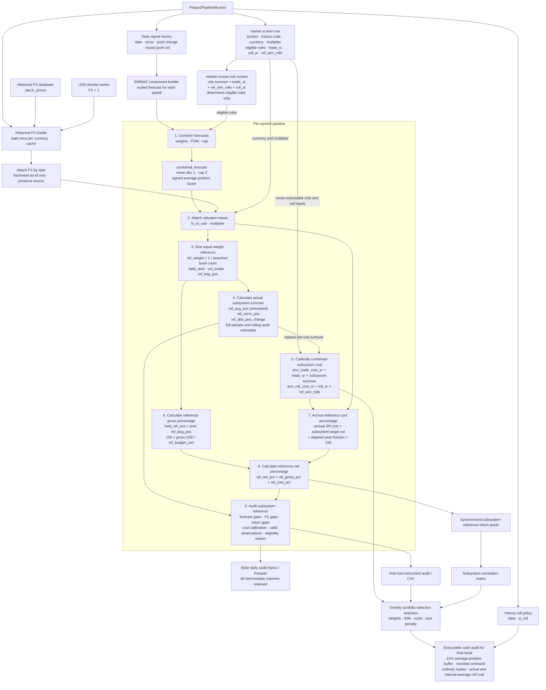

# Futures executable costs and instrument selection

Research date: 2026-10-04.

This is the executable-universe and static-selection companion to
[pysystemtrade-data.md]../futures-data/pysystemtrade-data.md. Its phases are independent of
the data import, hybrid-history, and carry phases in that document:

1. The live snapshot resolves executable contracts and caches the IB-dependent
   quote, FX, spread, volume, and current-risk inputs.
2. The rule-cache stage combines that snapshot with historical pooled EWMAC
   turnover and cost statistics. It is expensive but independent of account
   capital, target volatility, and portfolio-construction parameters.
3. The selection stage applies its built-in cost, size, liquidity, data, and
   execution filters, saves the accepted candidates, and selects a diversified
   static book using the AFTS greedy procedure.

The data report remains authoritative for source lineage, history construction,
overlap validation, and the data-side implementation phases. This document
owns executable economics and instrument selection.

## Executable-contract cost and granularity screen

`futures-cost-risk` is the executable-universe companion to the broad Carver
research panel. It resolves the dated IBKR contract that would actually be
traded and reports its current notional, Carver mixed volatility, daily and
annual dollar volatility per contract, account-specific IB what-if commission
and margin, live and historical bid/ask width when available, and one-way cost
as a fraction of annual dollar volatility. Configured commission remains an
explicit fallback only for offline and legacy snapshots.

The default volatility source is the full roll-neutral pysystemtrade history.
The shared core helper calculates the *Advanced Futures Trading* specification:
an `adjust=True` EWM standard deviation of daily point changes with span 32,
an `adjust=True` EWM mean of that fast volatility with span `10 × 256`, and
`mixed_vol = 0.7 × fast_vol + 0.3 × slow_vol`. The output exposes both
components, their blend, observation count, and effective history years. In
the current 252-instrument panel every history produces a mixed estimate, but
93 have fewer than ten years of fast-volatility observations and are labelled
accordingly rather than treated as fully warmed up.

Percentage volatility divides historical mixed point volatility by the raw
current-contract price at the same history endpoint (`ref_price`).
For a live audit the fast return-volatility component comes from up to one year
of daily bars on today's resolved dated IB contract, while the slow component
is Carver's long-history point-volatility anchor divided by its contemporaneous
price. The 70/30 blend is then applied to today's IB price. If the dated request
does not produce the minimum observations, the complete Carver mixed return
volatility is scaled to today's price and flagged as a fallback. Thus
`daily_pt_vol`, dollar volatility, and notional share a current
price level, while `ref_mixed_point_vol` remains the auditable historical
input. `ref_cur_price_ratio` and `vol_source` expose the handoff.

IB dated (`--vol-source dated`) and continuous (`--vol-source continuous`)
history remain explicit comparison modes. Continuous is never the default
because its adjustment and roll behavior disagrees with the repository's
Globex construction.

The bundled Carver-to-IB registry contains all 584 configured futures mappings
and covers all 252 usable histories. It retains Carver instrument code,
`IBSymbol`, exchange, broker currency, broker multiplier, price magnifier, and
weekly-expiry flag. The packaged file is pinned to upstream pysystemtrade
commit `b4a25e6e1e33a54a3ecfb45c0f6db5e2b60b84f8`. Candidate mapping does not imply that the connected US
IBKR account has trading permission or market data: live qualification writes
that result separately. The effective IB point value
`IBMultiplier / priceMagnifier` matches imported `point_size` for all 584
mappings.

The cost report deliberately retains all 252 usable histories, including rows
excluded from pooled signal calibration, and adds seven local execution
overlays absent from Carver: the CBOT grain micros `MZC`, `MZS`, `MZW`, `MZL`,
and `MZM`, plus the Treasury micros `MTN` and `MWN`. The resulting 259 rows
include economic family, roll policy, duplicate group,
pooling role, representative, default-pool inclusion, decision basis, and
`history_instrument_code`. This lets the same CSV compare execution economics
without allowing size variants to multiply their weight in the EWMAC
normalization sample.

The overlays retain their own IB symbols, raw broker multipliers, effective
point values, and commissions. Their research history and roll transactions
come from a compatible Carver parent: `MZC→CORN_mini`,
`MZS→SOYBEAN_mini`, `MZW→WHEAT_mini`, `MZL→SOYOIL`,
`MZM→SOYMEAL`, `MTN→US10U`, and `MWN→US30`. The first three use the
all-listed-month mini history rather than the full contract's seasonal
November/December policy. `MTN` follows the price-quoted Ultra 10-Year (`TN`),
not standard 10-Year (`ZN`), while `MWN` follows Ultra Bond (`UB`). Because
Carver has no observed spread for these micros, an overlay's spread stays
unknown until IB supplies historical BID_ASK data or a snapshot; it never
inherits the parent's spread silently.

The default cost audit estimates separate Carver-style research baselines for
EWMAC 4/16, 8/32, 16/64, 32/128, and 64/256 from the 228 reviewed
representatives. Each rule reuses its mapping- and range-keyed EWMAC cache,
applies the causal pooled forecast scalar, delays each forecast by one
observation, and earns the canonical matched-contract point change against
lagged 70/30 mixed point volatility. Mean, median, history-weighted, and
observation-stacked pre-cost Sharpes remain diagnostics. They do not determine
whether a rule or instrument is affordable.

Forecast turnover is estimated separately for every representative and speed as
`256 × mean(abs(change in forecast))`; the mean-absolute-one forecast scale
makes the former target divisor equal to one. It is then pooled with Carver's
history-length weighting. Each execution row uses that speed's pooled rule
turnover, its own one-way spread, commission, point value, FX conversion, and
current-price-scaled dollar volatility. The selected research representative's
current configured hold cycle supplies `ann_rolls`; full-history and recent
observed rates remain audit fields and never silently override that
configuration. `ann_trades` is Carver's one-way rule turnover and excludes
rolls. The report keeps the two cost streams separate instead of inventing a
combined transaction count:

```text
trade_sr
    = selected one-way cash cost / annual dollar volatility

roll_sr
    = estimated complete roll cost / annual dollar volatility

trade_ann_cost_sr(speed)
    = trade_sr × ann_trades(speed)

roll_ann_cost_sr(speed)
    = roll_sr × ann_rolls

tot_ann_cost_sr(speed)
    = trade_ann_cost_sr(speed) + roll_ann_cost_sr(speed)
```

#### Turnover units and AFTS reconciliation

The market screen Parquet report uses `ann_trades` for Carver's one-way strategy trades and
`ann_rolls` for complete roll events. It deliberately has no `total_tx`
column. Under the Carver-style `calendar_spread` roll-cost model:

```text
trade_sr = (one spread crossing + one commission) / annual dollar volatility
roll_sr = (one spread crossing + two commissions) / annual dollar volatility
```

A physical futures roll has two one-way legs: close the old contract and open
the new contract. A calendar-spread order executes both legs with one spread
crossing but pays commission on both legs. That complete event cost is
contained in `roll_sr`; `ann_rolls` remains an event count and is never doubled
or added to `ann_trades`. The selected outright half-spread is the fallback
proxy for the calendar-spread execution cost until a direct spread quote is
available.

The selected event rate is now the number of months in the current configured
hold cycle, matching pysystemtrade's `rolls_per_year_in_hold_cycle()`. The CSV
also reports full-history and recent observed rates, their differences from
configuration, the recent window, and `ref_strategy_roll_rate_audit`. Fallback
to recent and then full-history observation occurs only when the configured
cycle is unavailable and is explicit in `ref_strategy_roll_rate_source`.

This distinction corrected a real undercount in the earlier report.
`CORN_mini` and its `MZC` overlay used 132 transitions over the entire
1970–2024 history, or `2.4622` events/year, even though the current `HKNUZ`
cycle and every complete 2016–2023 year imply five. For MZC 64/256, the
forward inputs are therefore `ann_trades=5.5685` and `ann_rolls=5`; its annual
cost is `trade_sr × 5.5685 + roll_sr × 5`. Full-size `CORN` retains its
configured annual `Z` cycle and therefore one roll event/year.

#### CORN roll-policy performance ablation

The EWMAC performance columns must be interpreted separately from the forward
roll-cost correction. A full-history `CORN_mini` score mixes two materially
different histories: the early sample rolled mostly between September and
December, while every complete 2016–2023 year used the current five-month
`HKNUZ` path. `MZC` borrows that mini history. A high full-history mini score
therefore cannot by itself justify either two or five future rolls.

[`pysystemtrade_corn_roll_ablation.py`](../scripts/pysystemtrade_corn_roll_ablation.py)
calculates all five EWMAC forecasts using the complete history for warm-up,
then evaluates full-size annual-December `CORN` and `CORN_mini` before and
after 2016. These are matched-era comparisons of the two available held
contract paths, not a causal same-market roll experiment:

| Rule | Pre-2016 annual Z SR | Pre-2016 early-mini SR | Mini minus annual | 2016–2024 annual Z SR | 2016–2024 five-roll mini SR | Mini minus annual |
|---|---:|---:|---:|---:|---:|---:|
| 4/16 | 0.255 | 0.443 | +0.188 | 0.028 | 0.034 | +0.006 |
| 8/32 | 0.396 | 0.538 | +0.142 | 0.226 | 0.168 | -0.058 |
| 16/64 | 0.439 | 0.537 | +0.098 | 0.332 | 0.229 | -0.102 |
| 32/128 | 0.333 | 0.379 | +0.046 | 0.349 | 0.258 | -0.091 |
| 64/256 | 0.175 | 0.169 | -0.006 | 0.265 | 0.234 | -0.031 |

The result explains the apparent full-history advantage of `CORN_mini`: it is
concentrated in the long early regime, especially in the fast and medium
rules. In the approximately eight-year post-2016 sample, annual December is
ahead for 8/32 through 64/256, but the paired mini-minus-annual differential
Sharpes are only `-0.065`, `-0.118`, `-0.117`, and `-0.004`. Their approximate
standard errors are about `0.35`; the evidence is far too weak to infer that
annual December is the superior current strategy. The post-2016 daily P&L
correlations remain 0.78–0.85, so this is mostly a close variant comparison.

Changing the roll allowance also does not change MZC's rule set in the
referenced live audit. At its `0.0054` one-way SR cost per trade and the pooled
turnovers used by that report, 16/64 costs approximately `0.089`, `0.100`, and
`0.132` SR units with one, two, and five annual rolls respectively; all pass
the `0.15` ceiling. Rule 8/32 costs approximately `0.162` even with only one
roll, so an annual contract would not make it eligible. The current five-roll
MZC still retains 16/64, 32/128, and 64/256.

The operational default should therefore remain the configured five-month
MZC/`CORN_mini` path. Annual December is useful as a sensitivity benchmark,
not as a selected replacement. A causal roll-policy choice requires building
same-date Z-only, U/Z, and HKNUZ histories from contract-level prices and
comparing them net of month-specific spreads and liquidity. The two imported
held paths cannot isolate roll policy from contract size, construction, and
era effects. The source-neutral Globex provider now supports these
contract-level counterfactuals through explicit, run-local roll-policy
overrides; the next performance comparison should use those generated paths,
not add another raw market-data table.

This market screen calculation matches pysystemtrade's current **rule affordability**
contract: [`get_SR_cost_for_instrument_forecast`](https://github.com/pst-group/pysystemtrade/blob/b4a25e6e1e33a54a3ecfb45c0f6db5e2b60b84f8/systems/accounts/account_costs.py#L14-L33)
adds forecast transaction cost to holding cost, and
[`get_SR_holding_cost_only`](https://github.com/pst-group/pysystemtrade/blob/b4a25e6e1e33a54a3ecfb45c0f6db5e2b60b84f8/systems/accounts/account_costs.py#L183-L190)
defines holding turnover as `2 × rolls_per_year`. Its cost per trade is
one-way; multiplying one-way turnover by a round-trip cost would recreate the
historical factor-of-two error noted in the
[pysystemtrade changelog](https://github.com/pst-group/pysystemtrade/blob/b4a25e6e1e33a54a3ecfb45c0f6db5e2b60b84f8/CHANGELOG.md).

The published AFTS static selector uses a different cost contract. Its
[`calculate_trading_cost`](https://github.com/pst-group/pysystemtrade/blob/b4a25e6e1e33a54a3ecfb45c0f6db5e2b60b84f8/systems/provided/static_small_system_optimise/optimise_small_system.py#L292-L300)
multiplies combined `subsystem_turnover` by one-way SR cost per trade; it
does not call `get_SR_cost_given_turnover` and therefore does not add a
separate holding-roll term. portfolio selection must reproduce that definition for its
exact AFTS baseline. It should also report a clearly labelled
`afts_plus_rolls` sensitivity using
`trade_sr × subsystem_turnover + roll_sr × ann_rolls`. The market screen per-rule total is
neither of those portfolio selection inputs: it screens individual rules before their
forecasts are combined.

Each rule passes when total annual SR cost is no greater than `0.15`, the AFTS
rule-selection ceiling. `--rule-cost-limit-sr` exposes that fixed SR-unit
threshold. An instrument remains eligible when at least one speed passes; it
is not compared with an empirically fitted individual or pooled Sharpe. The
older one-third-of-pooled-Sharpe reports are retained as historical artifacts
but are no longer the selection contract.

Eleven usable histories carry Carver's `IgnoreWeekly` flag. The generic live
resolver does not guess among their weekly/daily expiries; it retains their
offline cost/risk rows but marks live qualification unavailable until a
product-specific expiry filter is supplied.

An IB-connected phase-one audit requests `BID_ASK` history on the exact dated
contract. `--spread-duration` is passed to
`IBPySync.get_historical_bars(duration=...)` independently of the daily-price
history duration and defaults to `5 D × 15 mins`. A 60-second timeout stops
all further historical probes for that contract. Delayed data can step down
after an immediate non-timeout failure, but a timeout never cascades into more
requests. The successful duration and bar size remain explicit report fields.
Spread history uses RTH by default; `--spread-all-hours` opts into the entire
futures session. For IB `BID_ASK` bars, `open` is average bid and `close` is
average ask, so `close - open` is the full quoted point spread for that bar.
The selected execution estimate is half the median width over the five-day
window. This is robust to repeated stale quotes from the period before a dated
contract becomes actively traded; mean and p90 remain visible as liquidity
diagnostics. The CSV reports **all** spread statistics as one-way points:
`ib_hspread_mean_pts`,
`ib_hspread_median_pts`, `ib_hspread_p90_pts`, `snap_spread_pts`,
`ref_spread_pts`, and `spread_pts` are therefore directly
comparable and must not be halved again. Observation count, date range,
successful bar size, attempts, and failures are retained under the compact
`ib_hspread_*` prefix.

Timestamped market screen filenames and the report fields `report_ts_ct`,
`snap_quote_timestamp_ct`, `ib_hspread_start`, and `ib_hspread_end` use the
daylight-saving-aware `America/Chicago` timezone. This aligns report review
with CME hours; each ISO timestamp retains its explicit `-05:00` or `-06:00`
offset. Raw IB bar timestamps are not mutated.

The current quote is an availability preflight as well as a price source. In
automatic mode the audit retains errors from every attempted mode for audit,
but eligibility for history is determined only by the quote attempt ultimately
selected. Thus an initial live error `354` does not veto history when the next
type-3 delayed request returns usable data. Before any historical call, both a
type-3 delayed quote and a type-4 delayed-frozen quote explicitly reset IB to
type 3, because delayed—not delayed-frozen—is the historical-data mode. The
report separates `snap_error_codes` (all attempts) from
`snap_selected_error_codes` and records `ib_hist_mkt_data_type`.

Quote and historical availability are not identical for delayed data. The AEX
mini, for example, can return `10168` from delayed `reqMktData` while a type-3
`reqHistoricalData(..., whatToShow="BID_ASK")` request succeeds. Consequently
`354`, `10167`, and `10168` still describe the selected quote attempt but no
longer veto a type-3 historical probe for a qualified contract. Error `200`
continues to block the probe because it means the contract itself is invalid.
`ib_hist_requests_allowed` therefore means the audit may attempt the
endpoint, not that IB has already proven the data available. Actual timeout or
empty-history failures remain recorded and fall back to the snapshot or
configured Carver spread. With the default `pysystemtrade` volatility source,
failed recent IB history similarly falls back to the Carver mixed point
volatility scaled as a return at the Carver reference price.

If delayed `reqMktData` supplies no mark, the audit first requests one day of
five-minute `BID_ASK` history and uses the midpoint of the latest time-average
bid and ask; daily `TRADES` is the secondary mark fallback. This permits the
AEX mini historical path demonstrated by IB even though its delayed snapshot
returns `10168`.

If dated history is unavailable, the same IB root's continuous future is tried
as a spread-only fallback. It never supplies the executable contract or signal
history. A dated-contract timeout suppresses this second historical attempt,
because retrying the same service through a continuous contract normally adds
two more 60-second waits rather than new information. Non-timeout failures can
still use the continuous fallback. A current snapshot is the next fallback;
Carver's configured one-way
spread is last. Missing bid/ask data remain **unknown**, never zero. A Carver
zero is labelled `static_config_zero_spread`, still includes commission, and
must not be interpreted as evidence of free live execution. Historical IB
spread requests require entitlements and are pacing-sensitive, so a complete
259-row collection should be run deliberately rather than as an incidental
notebook refresh.

IB error `162` with “API historical data query cancelled” after the wrapper's
60-second timeout is not an entitlement response. The asynchronous request has
timed out and the cancellation is the server acknowledgement for that request
ID. These rows need smaller, paced requests or a retry; they must not be
labelled as missing subscriptions. All observed timeout spellings (`timeout`,
`timed out`, and `query cancelled`) suppress the continuous-contract retry so
one failed dated request does not cascade into more 60-second waits. When a
continuous spread fallback is appropriate after a non-timeout failure, its
currency is inherited from the qualified dated contract or the instrument's
native currency; an empty Carver broker-currency field must not default a EUR
Eurex contract such as GBM to USD.

Carver's `BB3M` history remains usable for research, but its mapped CME BSBY
future is not a current execution candidate: CME converted and permanently
delisted the contract in October 2024. The live audit therefore records BB3M as
retired without sending an invalid `BSBY` security-definition request to IB.

Phase one also ranks candidates within each asset class separately by one-way
SR cost, current notional, and current annual dollar volatility. The report
assigns rank 1 to the lowest value: the cheapest risk-adjusted trading cost,
smallest contract risk, and smallest notional appear first in their respective
rankings.
The report includes the notional and annual dollar volatility of four contracts and
`min_capital_full_weight_idm1 = 4 × annual dollar vol / target vol`. This is a
capital-independent, one-instrument lower bound rather than the portfolio
affordability result.

The portfolio scenario defaults to `$100,000`, `IDM=1`, four average contracts,
and at least 15 ordinary instruments. Fifteen is the lower end of Carver's
[15-to-30 instrument guidance](https://qoppac.blogspot.com/2021/06/static-optimisation-of-best-set-of.html)
for adequate futures diversification. Its equal-weight risk budget is
`capital × target vol × IDM / minimum main instruments`; the report contains the
resulting average contracts and the capital required to reach four. The seven
main asset classes are `equity, ags, vol, energy, fx, metals, bond`. Crypto and
`other` are special additions: they retain affordability metrics but do not
satisfy the minimum-15 breadth count. The US home-price future uses
`other/housing`; EPRA-Europe and Sector instruments are classified as equity.
Portfolio construction should
first try to cover all seven main classes, then fill the remaining main slots;
coverage is a preference when contract granularity makes a class infeasible.
These figures are deliberately a market screen stress scenario. Four contracts and
15 instruments must not become simultaneous hard admission gates in portfolio selection:
that would reject diversification before allowing its higher IDM to reduce the
capital needed per instrument.

Rule-cost screening uses the same `ann_dvol` as contract-risk sizing and the
liquidity screen. There is no separate cost-volatility selector or duplicate
cost dollar-volatility field. Consequently `trade_sr` and `roll_sr` can always
be reproduced directly from the reported cash costs and `ann_dvol`.

```bash
.venv/bin/futures-cost-risk \
  --instruments all-pysystemtrade \
  --vol-source pysystemtrade \
  --spread-duration '5 D' \
  --fast-vol-span 32 \
  --slow-vol-years 10 \
  --slow-vol-weight 0.30 \
  --cost-ewmac-fast-spans 4,8,16,32,64 \
  --rule-cost-limit-sr 0.15 \
  --affordability-capital-usd 100000 \
  --affordability-idm 1 \
  --affordability-min-contracts 4 \
  --affordability-min-main-instruments 15 \
  --affordability-main-asset-classes equity,ags,vol,energy,fx,metals,bond
```

Use `--skip-ewmac-cost-baseline` only when a quick volatility/contract audit
is wanted without the pooled strategy calculation. EWMAC speeds,
mixed-volatility inputs, scalar warm-up, and the SR cost ceiling have separate
`--cost-ewmac-*` and `--rule-cost-limit-sr` flags. Their defaults match the five
AFTS EWMAC speeds and the 32-session/ten-year/30% mixed volatility, while
remaining independently overridable for research.

Load the newest timestamped market screen report and show the top five instruments
in every asset class from a notebook with:

```python
from derivatives_bt_engine.data.futures_cost_rankings import (
    display_asset_class_rankings,
    load_latest_market_screen_cost_report,
    top_n_by_asset_class,
)

report_path, market_screen = load_latest_market_screen_cost_report(".")
print(report_path)

rankings = top_n_by_asset_class(market_screen, n=5, rank_by="cost")
display_asset_class_rankings(rankings)
```

Set `rank_by` to `"affordability"` or `"notional"` for the other market screen
rankings. Pass `asset_classes=["Equity", "Rates"]` to show selected classes,
or `columns=None` to retain all report columns in each returned frame.

### market screen operational modes and public output

`--offline` writes the complete 259-row comparison without connecting to IB.
Prices and volatility then end at the imported Carver history boundary, live
spreads remain null, and non-USD conversions use the latest FX observation in
that database. Omit `--offline` to qualify current IB contracts and request
current quotes; this is the step that tests real account availability.

An online audit requests each required cash-FX pair from IB once before the
futures loop. `cur_fx_to_usd`, `cur_fx_src`, `cur_fx_pair`,
`cur_fx_mkt_data_type`, and `cur_fx_asof` identify the conversion actually
used for notional, dollar volatility, and costs. The imported Carver rate is
retained later as `ref_fx_to_usd`/`ref_fx_asof`. If IB cannot supply the pair,
the reference rate becomes the selected `cur_fx_to_usd` and
`cur_fx_src=pysystemtrade_reference_fallback` makes that substitution
explicit. Contract construction, quote fallback, rejection handling, and the
USD quotation convention live in `IBPySync`: AUD/EUR/GBP/NZD use `CCYUSD`;
other currencies use `USDCCY` and are inverted, with legacy `MXP` mapped to
IB's current `MXN` code. The cost report does not probe both orientations.

The same online acquisition previews a one-contract market order on both the
BUY and SELL side with IB's `whatIfOrder` endpoint. A blank order TIF is set to
`DAY`, avoiding account presets that silently convert an API order to `GTC`.
The selected `comm`/`comm_ccy` is the more conservative side and `comm_usd`
is converted using the commission currency returned by IB. Margin changes are
account-level values, so `init_margin` and `maint_margin` use the account base
`margin_ccy`, independently of the commission currency. Their USD values are
`init_margin_usd` and `maint_margin_usd`.

What-if orders require an account. Prefer `--ib-account-name taxable` (or
`roth`): the friendly name is resolved to its private IB identifier through
the JSON path in `ACCOUNTS_FILE`, loaded from `.env`. For example:

```bash
# Accounts
ACCOUNTS_FILE="${FIN_DATA_ROOT}/broker/ib/accounts/all/accounts.json"
```

The account JSON is a name-to-ID object. Only the friendly name is added to
the snapshot filename, for example
`futures_market_snapshot_taxable_20261013_120000.parquet`; neither the
account ID nor the mapping is persisted. `--ib-account` remains available for
an explicit raw ID. When both options are omitted, the runner uses the first
entry returned by TWS `managedAccounts`. Explicit IDs are validated against
that list. TWS ordering, rather than account type, defines the default, so pass
an account name when margin and retirement accounts share one login and the
distinction matters. Account-margin currency
defaults to USD because `managedAccounts` does not expose base currency; use
`--ib-account-currency CHF` (or another three-letter ISO code) for a non-USD
account. Both BUY and SELL previews must succeed. A failed preview is
`whatif_elig=false` and does not silently restore the stale configured
commission. `--skip-what-if` is the explicit compatibility mode for
old/offline behavior.

Rejected previews retain IB's request IDs, error codes, full messages, and a
stable `whatif_reject_reason` in both the cached market snapshot and public
screen. An insufficient-net-liquidity error is classified as
`account_margin_insufficient`; its quoted resulting account requirement is not
misrepresented as incremental one-contract margin, and the instrument is
excluded before the greedy search. IB error 460 and generic error 201 carrying
`No Trading Permission, Regulatory Restriction` are both classified as
`no_trading_permissions` and excluded without trying another expiry:
permissions apply to the account and product rather than one delivery month.
A `physical_delivery_restricted` rejection on an automatically selected expiry
instead advances the minimum-days cutoff past that contract and retries the
next listed expiry, up to four contracts.
`whatif_expiry_attempts`, `whatif_retry_n`, and `whatif_retry_error` preserve
that path. Explicitly configured expiries are never silently replaced.

The public report is ordered around one primary calculation path, so it does not
repeat a `selected_*` prefix. Current price, FX, volatility, dollar risk,
spread, cash cost, and SR cost come first. Point-in-time quote alternatives use
`snap_*`; unused Carver inputs and fallbacks use `ref_*` at the diagnostic
tail. Primary `notional` and `dvol` values are USD per row contract; native
amounts retain `_native`. Common abbreviations include `con`, `pos`, `instr`,
`exec`, `elig`, `ann`, `dvol`, `sr`, `pct`, `avg`, `min`, `max`, and `n`.

For an IB-connected audit, the command defaults to `--market-data-type auto`:
it tries real-time (`1`), then delayed (`3`), then delayed-frozen (`4`), and
stops at the first valid bid/ask. The CSV records both the successful mode and
the attempted sequence. Explicit `live`, `delayed`, and `delayed-frozen`
settings disable fallback. IB errors 354/10168 indicate quote entitlement,
not a failed futures contract
mapping. Rejected requests are recorded in `snap_error_codes` and cleaned up
locally without a redundant cancellation request. Contract-definition lookups
are bounded to eight seconds by default (`--contract-details-timeout`) so a
stale mapping cannot stall the broad-universe audit for the wrapper's normal
30-second request timeout.

Saved public reports round monetary notional, commission, cash-cost, and dollar-
volatility fields to two decimal places. Other floating-point diagnostics are
rounded to four decimal places; identifiers and observation counts are left
unchanged.

### Selection liquidity and candidate pre-filter

The IB-connected audit also saves the exact executable contract's mean daily
volume over its latest 20 valid daily `TRADES` bars as `avg_daily_volume`.
This is deliberately contract volume, not volume borrowed from the signal
history. Risk normalization reuses the selected mixed annual dollar volatility
already used for production sizing; the screen does not introduce a separate
short-window volatility definition:

```text
risk_traded_usd_day = init_capital_usd * target_vol * liquidity_ann_trades / 250
mkt_risk_vol_usd_day = avg_daily_volume * ann_dvol
pct_mkt_volume = 100 * risk_traded_usd_day / mkt_risk_vol_usd_day
```

This makes the article's `$1.25 million` a scenario result, not a universal
floor. With `$500,000`, a 25% target, and 25 annual trades, daily strategy risk
traded is `$12,500`; a 1% participation limit therefore requires at least
`$1.25 million` of market risk volume per day. The later `$25,000` Eurodollar
numerator in the article is inconsistent with that construction; the report
uses the stated `$12,500` calculation.

The 100-contract condition remains an independent construction check. Passing
the percentage test does not rescue a contract with 100 or fewer contracts of
average daily volume, even if each contract has very large annual dollar
volatility.
The defaults are `--min-daily-volume 100`, `--max-market-volume-pct 1`,
`--liquidity-ann-trades 25`, `--volume-lookback-days 20`,
`--initial-capital-usd 100000`, and `--target-vol 0.20`.

The rule cache retains every row without applying these scenario assumptions.
The selection runner adds separate cost, one-contract risk-size,
contract-volume, and relative-risk-volume flags. `selection_elig` also
requires at least one affordable EWMAC rule, an allowed execution profile, and
a qualified IB contract. `selection_excl` records all failed gates. The
`selection_search_universe()` notebook helper reads only eligible rows before the
greedy search; it does not destructively condense the saved audit. The size
gate compares the production mixed annual dollar volatility per contract with
`init_capital_usd * target_vol`; futures notional is reported but is not a
capital-eligibility test.

`sel_bucket` mirrors Carver's three-way triage. Missing executable
price, FX, multiplier, or 20-day close/volume data is `dont_add_no_data`;
there is no numeric substitute for a missing data subscription. Rows with
data that fail cost, dollar-vol size, or either liquidity gate are
`add_later`. Rows passing those four numeric gates are `add_first`.
`selection_elig` is intentionally narrower than `add_first`, because the
actual search must also respect the EWMAC-rule and execution-family checks.

### Snapshot, rule cache, and selection pipeline

The saved rule-cache Parquet is the durable historical-statistics handoff, not
a throwaway display table. Keep every audited row in that file, then have each
selection scenario derive and save its smaller candidate universe:

```text
pysystemtrade histories + reviewed economic classification + local execution overlays
    -> resolve the exact dated IB contract
    -> current price and FX, executable spread, IB commission, and margin
    -> 20-day mean contract volume
    -> mixed production volatility and one-contract dollar risk
    -> reusable live market snapshot
    -> per-rule EWMAC performance, turnover, rolls, and cost eligibility
    -> scenario-neutral rule-cache Parquet
    -> selection cost, size, liquidity, data, and execution gates
    -> candidate Parquet with sel_bucket, selection_elig, and selection_excl
    -> combined forecast and subsystem return for each surviving instrument
    -> trial-book correlations, top-down classification weights, and IDM
    -> portfolio-specific positions, turnover, cost, and market participation
    -> greedy AFTS selection with core-class coverage and score tolerance
```

#### Target portfolio selection pipeline runner

The complete path has one explicit runner that coordinates narrow data and
calculation stages. Each stage appends the columns it owns to the same
daily frame; it must not hide intermediate values in a private calculation.
In particular, forecast combination does not own FX retrieval, position
sizing does not own P&L conversion, and the audit does not reconstruct values
that should already be present in the daily frame.



The same ownership in terminal-readable form is:

```text
1. Load market screen row and daily signal history.
2. Build and combine eligible EWMAC forecasts.
3. Load historical FX once per currency and attach multiplier and
   backward-as-of FX to the frame. A later live runner may append IB history,
   but it must not backfill a current quote through old P&L dates.
4. Convert mixed point volatility, multiplier, and dated FX to daily dollar
   volatility per contract. Give every candidate the fixed structural weight
   `1 / tie_ref_book_n`, apply the fixed reference IDM and `max_weight_idm`
   cap, and calculate continuous reference average and target positions.
5. Calculate the actual combined-subsystem turnover from normalized desired-
   position changes using the continuous reference target and smoothed
   reference average position. This replaces, rather than averages, the
   individual-rule turnover estimates used by the market screen.
6. Reuse market screen `trade_sr`, `roll_sr`, and `ref_ann_rolls` to calculate the
   combined subsystem's annual trading cost and holding-roll cost.
7. Lag the continuous reference target, calculate its cash change through the
   multiplier and dated FX, and divide by `ref_budget_usd` to obtain the
   candidate's normalized gross subsystem percentage.
8. Convert the annual SR-cost estimate into a pro-rata subsystem percentage
   using the same budget and elapsed year fraction; add it to gross percentage
   to obtain the net subsystem-reference percentage.
9. Audit the wide daily frame and write the compact instrument summary.
10. Align valid net subsystem-reference returns, estimate correlations, and
    run the greedy portfolio search.
11. For the selected book, apply its final weight and IDM; apply the
    pysystemtrade forecast buffer to the continuous contract target; and use
    the resulting whole-contract position for cash P&L and event costs.
```

The market screen `cur_fx_to_usd` value is a point-in-time cost and sizing snapshot;
it must never be filled backward through the historical subsystem frame. The
FX loader records the pair and observation date of every rate. USD receives
an explicit identity series.

#### Cost ownership, backtests, and live selection

market screen calculates two different kinds of cost information. The executable
contract supplies the reusable per-event inputs `trade_sr` and `roll_sr`, plus
the saved reference roll frequency `ref_ann_rolls`. The individual EWMAC rule turnovers are screening
inputs only. They answer whether each rule is cheap enough to enter the
combined forecast; their annual costs must not be summed, averaged, or carried
forward as the combined subsystem cost.

After portfolio selection combines the eligible rules, it measures the resulting position
turnover and replaces the market screen rule-turnover estimate:

```text
ann_trade_cost_sr = trade_sr * subsystem_turnover
ann_roll_cost_sr  = roll_sr * ref_ann_rolls
ann_cost_sr       = ann_trade_cost_sr + ann_roll_cost_sr
```

There are then two deliberate consumers. The published AFTS selection score
uses `ann_trade_cost_sr` only. The subsystem-reference curve uses the full
`ann_cost_sr`, including holding rolls, and spreads it across the return index
as a loss proportional to elapsed year fraction and the annual target risk of
the subsystem. Multiplier and historical FX convert point movement to cash
before division by `ref_budget_usd`. Persist `ref_gross_pct`, `ref_cost_pct`,
and `ref_net_pct` separately; the default correlation panel uses
`ref_net_pct`.

This pro-rata series does not make the cost estimate rolling or causal by
itself. Carver's standard SR-cost account curve uses a full-sample turnover
scalar and a terminal recent-cost calibration. Using one market screen snapshot over
an entire historical run has the same fixed-calibration interpretation: it is
valid as an explicitly stated cost stress, but it is not a walk-forward cost
backtest. A causal historical selection run must cut all histories off at each
selection date and rerun market screen and portfolio selection as of that date. For a live
selection, the current market screen snapshot and all history ending at the run date
are causal at that date; keep that annual cost calibration until the next
scheduled selection refresh rather than backfilling a later snapshot into
earlier live results.

The implemented runner carries `trade_sr`, `roll_sr`, and `ref_ann_rolls`
through Step 1. The synchronized correlation panel uses the equal-weight net
subsystem-reference return after the full annual SR cost. By default the
published AFTS greedy score retains Carver's trade-only objective. Pass
`--include-roll-cost-in-score` to deduct both
`trade_sr * subsystem_turnover` and `roll_sr * ref_ann_rolls` from every
instrument's gross SR during singleton ranking and every n+1 trial. Each trial
persists `roll_cost_in_score`, `score_cost_sr`, and both cost components, so
the sensitivity cannot be confused with the baseline.

After the final book is selected, a separate executable cash audit fixes the
selected list, structural weights, final `limit_weight`, and IDM. It then uses
one lagged net-equity state shared by the whole book. Our sizing fields are:

```text
init_vol_scalar[i,t]
  = initial_capital × target_vol × limit_weight[i] × IDM / ann_dvol[i,t]

cap_scalar[t]
  = prior_net_equity[t] / initial_capital

vol_scalar[i,t]
  = init_vol_scalar[i,t] × cap_scalar[t]

tgt_pos[i,t]
  = vol_scalar[i,t] × comb_fcst[i,t] / target_abs_forecast
```

`init_vol_scalar` remains a daily series because `ann_dvol` changes; it
isolates the initial-capital position baseline. `cap_scalar` isolates only
compounded book equity. Keeping both makes `vol_scalar` changes reproducible
without mixing market volatility with capital growth. Sizing uses prior net
equity, never same-day P&L, so all instruments on a date receive the same
causal capital state. This capital loop is the engine's selected-book
accounting policy; it is not imported from another backtest framework.

The default band on each date is `tgt_pos ± 0.10 × abs(vol_scalar)`.
The continuous target and band edges are rounded only when forming the
whole-contract boundaries and executable position. The previous executable
position is retained while it remains within the band; a breach trades to the
nearest edge by default. Use `--buffer-size` and `--no-buffer-trade-to-edge`
for explicit sensitivities. This buffer affects
the executable cash path only: the AFTS score continues to use the unbuffered
`system.accounts.subsystem_turnover()` convention.

Ordinary position changes are charged with the market screen one-way trade cost.
By default, each history-policy `is_roll` date resets the executable position
to the rounded target instead of carrying the buffered position through the
roll. Use `--no-rebalance-on-roll` to preserve the buffered holding. The
`roll_con` quantity is the same-direction overlap between the prior holding
and the new executable position; the remaining size change stays in
`trade_con`. For example, moving from 8 to 7 contracts records 7 rolls and one
ordinary reduction. The cash audit persists per-contract trade and roll cost
inputs alongside actual quantities and debits, so each cost can be reproduced
directly. `net_pnl_usd` is gross P&L plus ordinary trade costs plus actual roll
cost; cumulative USD and percentage-point columns use this single realized
execution path. Current snapshot costs are applied to the full history as a
clearly labelled sensitivity; no live contract is queried again during
portfolio selection.

The live-data boundary is a reusable, full-precision Parquet snapshot. Acquire
contract qualification, current quotes and FX, dated-contract spread and
volume statistics, account-specific what-if commission and margin, and current
volatility inputs once:

```bash
futures-market-snapshot \
  --instruments all-pysystemtrade \
  --vol-source pysystemtrade \
  --ib-account-name taxable \
  --snapshot-output results/futures_market_snapshot.parquet
```

Omitting both account options selects `managedAccounts[0]`. Pass an account
name explicitly when commission tiers, current positions, or margin differ
across accounts. The snapshot stores results and currencies, not the account
identifier.

The snapshot presents `commission_amount`, `commission_currency`,
`commission_usd`, and `commission_source` beside the primary contract fields.
An eligible account-specific preview therefore appears as
`commission_source=ib_what_if`. The older configured amount is retained only
as `ref_config_commission_usd` near the end of the snapshot, together with
`snap_ref_config_cost_usd`; these are audit fallbacks and do not override a
successful what-if preview. A failed attempted preview remains
`ib_what_if_failed` rather than silently selecting the reference amount.

The command appends a Chicago-time timestamp. It does not calculate pooled
EWMAC costs or selection gates. Those calculations can therefore be rerun
later without IB.

Each live acquisition also writes the `ib_insync` warnings and errors to a
separate timestamped file beside the snapshot, for example
`futures_market_snapshot_taxable_ib_20261013_120000.log`. This preserves
the complete IB request-error text without mixing broker diagnostics into the
pipeline log. Use `--ib-log-output path/to/ib.log` to choose a different base
path; the account alias and run timestamp are still appended.

Build the expensive, reusable historical rule/cost cache from that snapshot:

```bash
futures-rule-cache \
  --snapshot-input results \
  --cost-ewmac-fast-spans 4,8,16,32,64 \
  --rule-cost-limit-sr 0.15 \
  --history-db /home/dev/fin/db/pysystemtrade_reference.duckdb \
  --output results/multi_speed_ewmac_rule_cache.parquet
```

Passing a directory to `--snapshot-input` selects its newest timestamped
`*_market_snapshot_*.parquet`; passing a file pins exact-run reproduction. The
result is `multi_speed_ewmac_rule_cache_<timestamp>.parquet`. It retains all market
snapshot inputs plus pooled EWMAC turnover/cost statistics, `trade_sr`,
`roll_sr`, `ref_ann_rolls`, and the eligible rule list. It deliberately has no
`init_cap_usd`, `target_vol`, market-participation calculation, or final
candidate flag.

Rerun this cache when the market snapshot changes or when changing EWMAC
speeds, forecast-scalar/turnover methodology, volatility methodology,
commission/spread/roll assumptions, or `--rule-cost-limit-sr`. Capital, target
volatility, the generic instrument cost limit, liquidity assumptions, margin
limits, weights, and cluster limits do not require a new rule cache.

The selection command owns those inexpensive scenario filters and the greedy
search:

```bash
futures-build-selection \
  --report-dir results \
  --output-dir results/selection_baseline \
  --history-db /home/dev/fin/db/pysystemtrade_reference.duckdb \
  --ib-history-db /home/dev/fin/db/ib_futures_history.duckdb \
  --ib-history-live missing \
  --globex-db /home/dev/fin/db/globex_mdp_3.0.duckdb \
  --initial-capital-usd 75000 \
  --target-vol 0.20 \
  --instrument-cost-limit-sr 0.01 \
  --liquidity-ann-trades 25.6 \
  --liquidity-business-days 256 \
  --min-daily-volume 100 \
  --max-market-volume-pct 1 \
  --weight-policy topdown_classif
```

`futures-build-selection` discovers the newest rule cache before legacy
selection-screen files. `--report-dir` controls input discovery, while the
optional `--output-dir` is a parent output root. Each invocation creates a
`selection_run_<timestamp>/<parameters>` directory below it and places the
candidate report and every complete-selection report there. The parameter
directory uses the same compact tokens as the grid, such as
`tv0p2_im20_bm50_wi0p2_st0p9_cl2_roll1_topdown_classif`; active contract
penalties or tie rules append their parameter tokens. Without `--output-dir`,
reports remain beside the input cache. The command first derives `max_ann_dvol`,
daily risk traded, market-risk volume, participation percentage, and all hard
gate flags. It saves the accepted rows as
`multi_speed_ewmac_selection_candidates_<timestamp>.parquet`, then runs forecast
combination and greedy selection and saves the final book plus all normal audit
artifacts. Use `--candidates-only` to stop after the filtered candidate file.
The old `futures-selection-screen`, `futures-cost-risk`, and
`futures-select-selection` commands remain compatibility entry points.

The candidate Parquet repeats the resolved scenario inputs `init_cap_usd`,
`target_vol`, `cost_lim_sr`, `rule_cost_lim_sr`, `liq_ann_trades`, `liq_days`,
`min_daily_volume`, and `max_pct_mkt_volume`, together with every gate and
`selection_excl`. `topdown_classif` is the default weight policy;
`legacy_handcraft` and `equal` remain explicit research comparators.
Complete-selection reports persist the choice as `wt_policy` and record
`asset_cls`, `econ_subcls`, and the resulting class path for each book member
on every accepted pass.

Use `--max-instr-margin-pct P` to prevent any one instrument from consuming
more than `P%` of initial capital in margin during the complete selection.
`--max-margin-pct` remains an alias for existing scripts. Each trial first
calculates Carver's continuous maximum-forecast position, then rounds it to
whole contracts with the allocator's deterministic half-up rule (`0.5` becomes
one contract). It multiplies that `max_cons` value by IB's one-contract
`init_margin_usd`. A position above the individual allowance is rejected as
`instrument_margin_limit`.

The selector also tracks the sum of those rounded instrument margins as the
book grows. When the individual gate is enabled, total available book margin
defaults to 100% of initial capital; `--max-book-margin-pct` can impose a lower
total. A trial exceeding that cumulative allowance is rejected as
`portfolio_margin_limit`. Thus a `$75,000` account with
`--max-instr-margin-pct 20` allows at most `$15,000` for one instrument and
`$75,000` for the book, not `$15,000` for the entire book.

The allocation audit retains `max_position` and `cont_margin_at_max_usd`
beside `max_cons`, `margin_at_max_usd`, `instr_margin_limit_usd`, and
`book_margin_limit_usd`. `book_margin_remaining_usd` records the unused amount
after every hypothetical addition, so the practical constraints can be
compared directly with the fractional Carver baseline. The columns have these
specific meanings:

- `cont_margin_at_max_usd` is the row's fractional `max_position` multiplied
  by its saved one-contract initial margin. It preserves the continuous sizing
  baseline but is not an executable margin estimate.
- `margin_at_max_usd` is the row's half-up rounded `max_cons` multiplied by the
  same one-contract margin. The individual-instrument gate uses this value.
- `portfolio_cont_margin_at_max_usd` and
  `portfolio_margin_at_max_usd` are the corresponding sums across the entire
  trial book. The cumulative book gate uses the rounded latter value.
- `book_margin_remaining_usd` is `book_margin_limit_usd` less the rounded
  portfolio margin. A negative value identifies a trial that exhausted the
  book allowance.

The accepted-passes Parquet table contains one row for every member of the accepted book
at every `selection_step`, rather than one summary row per step. Consequently,
the instrument margin columns vary by `symbol`, while the portfolio margin and
limit columns repeat on every row in the same step. Adding a symbol also
recalculates weights, IDM, and maximum positions for the existing members, so
an existing symbol's margin can change between steps. `added_symbol` identifies
the new winner; it does not mean the other rows in that step were added again.

Reports created before the separate instrument and book gates used the
ambiguous `margin_limit_usd` column as the total-book allowance. New reports
replace it with `instr_margin_limit_usd` and `book_margin_limit_usd`; old and
new files should not be compared as if that legacy column were an individual
instrument cap.

This additive estimate is deliberately simple and auditable; it does not model
IB portfolio/SPAN offsets or nonlinear margin changes at larger quantities.
The saved one-contract margin is itself the marginal change against the
account's positions at snapshot time, so this gate is a prescreen rather than
an exact funding promise. The default is no margin gate. If either gate is
enabled, candidates without a usable IB initial-margin preview are rejected as
`initial_margin_unavailable`; validate the final integer order book with a
fresh portfolio-aware margin preview before execution.

An existing rule cache can be reused at a different account size without an IB
or historical-rule rerun:

```bash
futures-build-selection \
  --input results/multi_speed_ewmac_rule_cache_<timestamp>.parquet \
  --initial-capital-usd 75000
```

The built-in filter calculates `max_ann_dvol`, `risk_traded_usd_day`,
`pct_mkt_volume`, `size_elig`, `risk_volume_elig`, `liq_elig`, and
`selection_elig` before candidate filtering. It does not alter the saved market
observations or cached per-rule statistics.

The build command continues through forecast combination and the greedy AFTS
baseline by default. The command writes:

- `multi_speed_ewmac_selection_forecast_audit_<timestamp>.parquet`, with component and
  combined null/non-finite counts, valid dates and observations, FDM, combined
  turnover, cost, and the precise exclusion reason;
- `multi_speed_ewmac_selection_forecasts_<timestamp>.parquet`, containing the daily
  component forecasts, combined forecast, validity flag, normalized position,
  equal-weight reference risk budgets and continuous positions, and gross,
  cost, and net subsystem-reference percentages for direct inspection;
- `multi_speed_ewmac_selection_subsystem_reference_returns_<timestamp>.parquet`,
  the synchronized reference-return panel used by the bounded correlation
  estimator;
- `multi_speed_ewmac_selection_cash_pnl_<timestamp>.parquet`, the final book's
  account-scaled daily continuous target, average-position buffer width and
  boundaries, buffered whole contracts, ordinary traded contracts, actual and
  interval-average policy-roll contracts, and separate gross, trade-cost,
  roll-cost, and net USD P&L paths. It also reports gross, trade-cost,
  realized/average-roll cost, total-cost, and net contributions as
  daily return contributions. `sizing_cap` is prior portfolio net equity,
  `cap_scalar` is that value divided by initial capital, `init_vol_scalar` is the
  initial-capital average-contract baseline, and `vol_scalar` is the actual
  executable scalar after applying `cap_scalar`. The same scaled `vol_scalar`
  drives both `tgt_pos` and `buf_width_pos`, so ordinary capital changes only
  trade when the held position breaches its scaled no-trade band. Costs are
  negative and appear on trade/roll dates; the
  separate average-roll path is a policy comparison, not an additional cost
  charged on top of realized rolls. Its
  `close` is the locally generated
  additive-Panama adjusted level used by the signal history, retained beside
  the roll-neutral `point_change` for audit; it is not the raw executable
  dated-contract mark. `src_gap_before`, `src_gap_days`, and
  `gap_pnl_omitted` identify the first retained row after an allowed source
  gap. The row's own one-day P&L remains valid; the fields state that the
  unknown cross-gap move was not inferred;
- `multi_speed_ewmac_selection_portfolio_curve_<timestamp>.parquet`, the daily
  selected-book cash flows summed across instruments. Daily `port_gross_pct`
  uses prior gross equity; daily `port_net_pct` and cost rates use prior net
  equity. Cumulative gross and net percentages equal their respective current
  equity divided by initial capital minus one. The selected list, weights,
  sizing limits, and IDM stay fixed while prior net equity scales positions;
- `multi_speed_ewmac_selection_trials_<timestamp>.parquet`, one row per greedy trial; and
- `multi_speed_ewmac_selection_trial_allocations_<timestamp>.parquet`, one row per member
  of every hypothetical trial book, including its economic `cluster_path`,
  portfolio `weight`, sizing `limit_weight`, IDM, score, feasibility, and
  accepted flag. Every rejected row has a decision `reason`: hard-constraint
  failures retain their feasibility reason, while feasible losers distinguish
  a lower singleton rank, a lower rank than the iteration winner, or a best
  score below the acceptance threshold. Near-tie losers identify the
  reference-position tie break. `candidate_ref_max_position`,
  `candidate_ref_con_band_distance`, `iter_best`, `iter_best_score`,
  `iter_score_best`, `iter_score_best_score`, `tie_score_floor`, and
  `min_accept_score` make those comparisons directly auditable; and
- `multi_speed_ewmac_selection_passes_<timestamp>.parquet`, the readable
  accepted path only: `selection_step` identifies the pass, `added_symbol` is
  its winner, and each `symbol` row records that accepted book member's
  terminal subclass, subclass membership, subclass weight, instrument weight,
  `base_net_sr`, `net_sr`, the size and contract-penalty columns, fixed
  reference weight and position, continuous position-band weights, the shared
  `score_denom`, and its weighted-net `marg_score` and denominator-scaled
  `scaled_contrib` alongside annual cost and contract-load components;
  and
- `multi_speed_ewmac_selection_book_<timestamp>.parquet`, the last accepted
  book. Each row also reports its final-weight executable cash history through
  `hist_cum_net_pct`, `hist_ann_mean_pct`, `hist_ann_vol_pct`, `hist_sharpe`,
  and `hist_iid_t_stat`, with sample dates, years, observation count, and
  `hist_src`. With `--ib-history-db`, these fields and the selected cash P&L
  use stored reference/Globex/IB stitched histories, and the finished view is
  cached under `--history-cache-root`. IB is not contacted unless a live mode
  is explicitly selected. Add
  `--ib-history-live missing` to connect only when a selected signal history
  cannot be built from stored data, or `--ib-history-live update` to refresh
  every selected signal history before reporting. Connection overrides are
  `--ib-host`, repeatable `--ib-port`, and `--ib-client-id`. Without
  `--ib-history-db` the reports use reference history only. If one selected
  history remains unavailable after the configured stored/live attempt, its
  cash audit uses the long reference curve and reports
  `hist_src=reference_fallback`; other selected histories continue normally.
  These historical
  diagnostics do not enter the greedy score, whose construction history
  remains pinned to `--history-db` in either mode. `--max-source-gap-days`
  controls only a direct reference-to-IB handoff and masks the unknown return
  over an allowed gap.

Raw IB history acquisition follows each instrument's `priced_roll_cycle` and
includes its configured carry companions. The final signal remains selected
under `hold_roll_cycle`; these raw bars can therefore support later holding
policy comparisons without redownloading omitted contract months.

Use `--max-instr-per-cluster N` to run a static breadth-cap sensitivity. The
cluster key is the reviewed `econ_subcls`, so `--max-instr-per-cluster 4`
prevents a fifth `grains` instrument from entering a trial book. A rejected
trial remains in both audit Parquet tables with a reason such as
`cluster_instr_limit:grains n=5 max=4`. The default is unlimited. This static
universe constraint is intentionally separate from the backtest/live
`max_active_per_cluster` control, which ranks dated active signals by current
model conviction after the universe has already been selected.

In the final selection report, `net_sr` is an instrument-level input to the
portfolio score: the common gross SR assumption less that instrument's annual
combined-forecast trading cost, size penalty, and optional low/high contract
penalties. `base_net_sr` omits only the low/high contract penalties. It is
not the book score when the ranked instrument was added. The accepted rows in
the trials Parquet table records that sequence: `book` is the hypothetical portfolio and
`score` is its portfolio-level score at that iteration.
The accepted passes Parquet report includes `size_penalty_sr`,
`low_con_penalty_sr`, `high_con_penalty_sr`, and `con_band_penalty_sr` so
changes in granularity can be inspected pass by pass. It also records
`base_score`, the adjusted `score`, `net_sr`, the shared book `score_denom`, and each member's
`marg_score`, defined as `weight * net_sr`, and `scaled_contrib`, defined as
`marg_score / score_denom`. The `scaled_contrib` values sum to the repeated
book-level `score` in each accepted pass; the raw numerator contributions and
shared denominator are also available for audit.

All market screen and portfolio selection public Parquet reports use the shared report formatter
at the write boundary. Native Parquet types are retained for dates, booleans,
and numbers. USD amounts are rounded to cents, reproduction-sensitive FX
and return-volatility rates to six decimal places, and other floating-point
diagnostics to four. Forecast and synchronized-return Parquet files retain
full calculation precision.

Warm-up nulls are expected and recorded. A candidate is excluded before the
search when it has fewer than `--min-forecast-obs` fully valid observations,
has a null or non-finite component after its first fully valid row, produces a
non-finite combined forecast or turnover, or lacks enough synchronized
subsystem returns for correlation estimation. The daily Parquet makes the
summary gate reproducible rather than hiding a missing forecast behind an
aggregate score.

For interactive inspection of one instrument's history, pooled normalization,
raw momentum, and component forecasts without running either report, use the
[multi-speed EWMAC notebook workflow]../strategy-research/multi-speed-ewmac-notebook.md.

The market screen `liquidity_ann_trades=25` calculation is Carver's conservative
single-instrument scenario. It is useful for coarse triage, but it is not the
final capacity estimate for a portfolio selection trial book. portfolio selection must first combine
the surviving rules into the instrument forecast and measure the resulting
subsystem turnover. It must then use the trial weight and trial IDM to compute
that instrument's risk allocation and daily risk traded. Do not average or sum
the individual rule turnovers as a substitute for the combined subsystem.

Likewise, the market screen one-way `trade_sr <= 0.01` test is an initial cost screen.
The portfolio selection score uses the combined subsystem turnover:

```text
instr_risk = capital * target_vol * weight * IDM
risk_traded_day = instr_risk * subsystem_turnover / 250
pct_mkt_volume = 100 * risk_traded_day / mkt_risk_vol_usd_day
annual_trade_cost_sr = trade_sr * subsystem_turnover
```

Add `roll_sr * ann_rolls` only in the separately reported production-cost
sensitivity. The baseline AFTS score excludes that holding-roll allowance, as
described below. Thus market screen answers “is this executable contract worth
carrying into the search?”, while portfolio selection answers “does this contract fit this
particular diversified trial book?”

The initial combination policy uses the five ordinary EWMAC speeds only:

```text
4/16=5%, 8/32=15%, 16/64=20%, 32/128=30%, 64/256=30%
```

This gives 60% to `32/128` and `64/256` and 40% to the faster three rules. A
rule removed by the market screen cost gate receives zero weight and the remaining
weights are renormalized; for example, `16/64,32/128,64/256` becomes
`25%,37.5%,37.5%`. Each component is causally scaled and capped first. The
weighted forecast then receives a correlation-estimated FDM,
`min(2.5, 1/sqrt(w' C w))`, and is capped again. FDM is separate from the rule
weights and is not baked into their reported percentages.

## Iterative AFTS portfolio selection

### Reviewed economic hierarchy

The upstream pysystemtrade `AssetClass` field is retained in `raw` for source
fidelity, but it is not the allocation hierarchy. The repository-owned
`pysystemtrade_instrument_classification.csv` assigns every one of the 252
history-bearing instruments a canonical lowercase `asset_class` and
`economic_subclass`. The importer validates the allowed pairs and complete
history-universe coverage before materializing the mapping as
`ref.instrument_classification`.

```text
ags      -> grains, softs, livestock
bond     -> bonds, stir
equity   -> us, ex_us
fx       -> fx
metals   -> precious, industrial
energy   -> energy
vol      -> vol
crypto   -> crypto
other    -> housing, commodity_index
```

`crypto/crypto`, `other/housing`, and `other/commodity_index` are explicit
special branches. The US home-price future stays separate from equities;
EPRA-Europe remains equity because it tracks listed real-estate companies and
REITs. Sector instruments are classified geographically as `equity/us` or
`equity/ex_us`. The `bond/stir` branch contains short-term interest-rate
contracts such as SOFR, EURIBOR, SONIA, SARON, Fed Funds, and bank bills.
Short-maturity government-bond futures such as BTP3, Schatz, and US2 remain in
`bond/bonds`; "short bond" does not mean STIR. Uppercase identifiers are
reserved for instrument and contract symbols. Carver's source config currently
groups crypto under Metals; this table separates it because crypto is a
distinct exposure for portfolio allocation.

Execution overlays inherit the classification of their explicit
`pysystemtrade_instrument` parent. Thus MZC is `ags/grains` and shares the
`CORN` economic family, while retaining its own executable contract costs and
granularity.

Carver's [static instrument-selection
algorithm](https://qoppac.blogspot.com/2021/06/static-optimisation-of-best-set-of.html)
is a greedy portfolio search, not a sort followed by a fixed contract-count
filter. At each iteration it tries every unused instrument as the next member,
rebuilds the hypothetical portfolio, and keeps the candidate with the highest
expected portfolio Sharpe ratio. This is the appropriate baseline for portfolio selection.

The market screen pre-selection filters are hard for entry to the search: a candidate
needs usable history, price, FX, contract multiplier, annual dollar volatility,
at least one cost-eligible rule, one-way `trade_sr <= 0.01`, and a qualified
contract allowed by the selected broker profile. It must pass both the
100-contract daily volume floor and the coarse relative market-risk
participation calculation above, as described in
[Adding new instruments](https://qoppac.blogspot.com/2021/05/adding-new-instruments-or-how-i-learned.html).
Every portfolio selection trial then recalculates turnover, position size, and market
participation using the combined subsystem and the trial book's weight and IDM;
the fixed 25-trade market screen scenario must not replace that calculation.
Full, mini, and micro contracts that express the same signal are one economic
family: normally select at most one execution route, unless the report already
establishes a materially distinct contract or roll path. An execution overlay
may borrow the representative instrument's signal history, but retains its own
multiplier, spread, commission, price, and resulting trading cost.

For a trial book `B`, correlations must be estimated from volatility-normalized
**subsystem returns after the forecasting decision**, using each candidate's
eligible rule mix. Raw price-return correlations are not the portfolio input.
Use the same robust missing-data treatment and bounded exponentially weighted
correlation machinery as the allocation layer. Correlation determines the
trial IDM and portfolio score, but the default risk weights now follow the
reviewed hierarchy instead of asking correlation clustering to invent economic
groups. Every represented asset class receives equal risk; represented
subclasses split their class allocation equally; instruments then split their
subclass allocation equally. The former correlation-only recursive
`HandcraftedPortfolioWeights` remains an explicitly selected legacy
sensitivity, not the portfolio selection default.

For example, a book containing two grains, one soft, one US equity, and one
ex-US equity assigns 50% to `ags` and 50% to `equity`. Within `ags`, grains and
softs receive 25% each, so the grains receive 12.5% apiece. Within equity, US
and ex-US receive 25% apiece.

For normalized subsystem returns, let `H` be the correlation matrix and `w`
the trial risk weights, summing to one. Recalculate the diversification
multiplier for every trial book:

```text
IDM(B) = min(2.5, 1 / sqrt(w' H w))
```

For candidate `i`, the position at the maximum absolute forecast of 20 is:

```text
limit_weight_i = min(w_i, max_weight_idm / IDM(B))
P_i = capital * target_vol * limit_weight_i * IDM(B)
     / annual_dollar_vol_i * (20 / 10)
```

`w_i` is the structural classification weight used to calculate the book IDM
and portfolio score. `limit_weight_i` is the capped weight used for sizing,
liquidity, margin, and the executable cash backtest; the cap is not
redistributed to other instruments. Its definition ensures
`limit_weight_i * IDM(B) <= max_weight_idm` at an average absolute forecast
of 10. The final factor is two because the maximum absolute forecast is 20,
so with `max_weight_idm=0.20` the maximum forecast can scale an instrument to
40% of the portfolio target-risk budget. This is a risk-budget scalar, not a
40% allocation of account capital or notional. Contract rounding and the
forecast buffer can make the realized position differ from the continuous
maximum `P_i`.

For example, in the 2026-10-29 run, seven represented asset classes each
received a structural weight of `1/7 = 14.29%`. SCI and MBT were the sole
selected members of their respective classes. With `IDM=2.5` and
`max_weight_idm=0.20`, each had:

```text
limit_weight = min(14.29%, 20% / 2.5) = 8%
average-forecast risk budget = $75,000 * 20% * 8% * 2.5 = $3,000
maximum-forecast risk budget = $3,000 * (20 / 10) = $6,000
```

Their realized cash P&L sizing uses the 8% `limit_weight`, not the 14.29%
structural weight. Since capped weights are not renormalized, their sum can be
less than one.

Following Carver, assign an effectively infinite size penalty when `P_i < 0.5`
contracts; otherwise:

```text
size_penalty_i = 0.125 / P_i**2
base_net_SR_i = 0.5 - annual_trading_cost_SR_i - size_penalty_i
portfolio_score(B) = (w . net_SR) / sqrt(w' H w)
```

Small-account construction can add separate penalties below and above a target
continuous maximum-position band. With the default band `[2.5, 5.5)`, the
unpenalized interval rounds half-up to three through five contracts:

```text
low_con_penalty_SR_i
    = lambda_low * max(0, log(2.5 / P_i))**2
high_con_penalty_SR_i
    = lambda_high * max(0, log(P_i / 5.5))**2
net_SR_i
    = base_net_SR_i - low_con_penalty_SR_i - high_con_penalty_SR_i
```

`--low-con-penalty-scale` and `--high-con-penalty-scale` set the two lambdas;
both default to zero, preserving the AFTS baseline. `--con-band-min` and
`--con-band-max` change the continuous boundaries. Reports retain
`base_score`, the adjusted `score`, each penalty component, and the low, band,
and high risk-weight masses. `ann_con_load` reports ordinary annual trade
contracts plus twice annual roll contracts as a separate operational measure.

The constant gross Sharpe assumption of 0.5 is intentional. Instrument-specific
pre-cost backtest performance must not decide which markets survive. The exact
AFTS annual trading-cost term must come from the combined subsystem turnover
produced by the eligible-rule mixture:

```text
afts_annual_trading_cost_SR
    = trade_sr × subsystem_turnover
```

Here `subsystem_turnover` follows pysystemtrade's `turnover(x, y)` definition.
`x` is `reference_target_position`, the unbuffered continuous reference
position after the equal book weight, IDM, multiplier, and dated FX are
applied. Its EWMAC forecast is not smoothed again. The function applies an EWM
with `com=250` only to `y`, `reference_average_position`, before measuring
changes in `x / y`. The implementation calls this parameter
`average_position_ewm_com` to avoid implying forecast smoothing.

The separate default `buffer_size=0.10` is a no-trade band, not a smoothing
parameter. With forecast buffering, the band is 10% of average position and a
breach trades to the nearest edge. The published static-small-system AFTS code
uses `system.accounts.subsystem_turnover()`, which measures the unbuffered
subsystem position, so the portfolio selection baseline does the same. A buffered
portfolio-turnover sensitivity may be reported separately; it must not silently
replace the AFTS cost input.

Do not sum the eligible rules' individual turnovers: forecast combination and
the changing volatility scalar determine the resulting subsystem turnover.
Do not feed an opaque market screen total into the baseline. It includes a separate
two-leg holding-roll allowance that the published AFTS selector omits. The
more conservative production sensitivity is explicit:

```text
afts_plus_rolls_annual_cost_SR
    = trade_sr × subsystem_turnover + roll_sr × ann_rolls
```

Select that sensitivity with `--include-roll-cost-in-score`. Without the flag,
`score_cost_sr` equals `ann_trade_cost_sr`; with it, `score_cost_sr` equals
`ann_cost_sr`. The normalized correlation percentage series and executable cash audit include
rolls in either mode—the parameter changes only the greedy ranking objective.

Both variants use the current one-way definition of `trade_sr`. This preserves
the observed corn result at the
screening stage: a higher-cost full or mini contract can lose its fast EWMAC
rules, while a cheaper micro can retain more rules, without either outcome
being hard-coded by symbol. portfolio selection then scores each surviving execution route
with combined subsystem turnover, not the sum of those rule-screening costs.

Seed the loop by ranking individual instruments with the same net-SR formula
and `IDM=1`. Carver uses a 5% cap on `instrument_weight * IDM` for a larger
account and explicitly raises it for small accounts (20% in his `$100,000`
example). His `calculate_maximum_position()` applies that cap again during
every n+1 trial, not just while choosing the singleton seed. portfolio selection therefore
exposes `max_weight_idm`; `--starting-weight` remains a compatibility alias.
This avoids the otherwise discontinuous result where moving from one to two
instruments resizes each market from a nominal 20% share to 50% before IDM.
The baseline loop is:

```text
eligible = hard_filter(market_screen_candidates)
selected = [best_single_candidate(eligible, max_weight_idm)]
best_seen = 0.0  # published AFTS loop updates this from the first n+1 trial

while unused candidates remain:
    trials = []
    for candidate in unused:
        book = selected + [candidate]
        H = subsystem_return_correlations(book)
        w = top_down_classification_weights(
            book,
            levels=("asset_class", "economic_subclass", "instrument"),
        )
        idm = min(2.5, 1 / sqrt(w' H w))
        sizing_weight_idm = min(w * idm, max_weight_idm)
        positions = maximum_forecast_positions(book, sizing_weight_idm)
        penalties = annual_costs(book) + size_penalties(positions)
        trials.append((portfolio_score(book, w, H, penalties), candidate))

    trial_score, winner = deterministic_argmax(trials)
    if trial_score < 0.90 * best_seen:
        stop
    selected.append(winner)
    best_seen = max(best_seen, trial_score)
```

The 90% rule is Carver's tolerance for a temporarily lower score while gaining
useful breadth; stopping at the first strict decline is too brittle. Record the
last accepted book before the tolerance breach, rather than returning the
breaching candidate.

For this project, layer a transparent coverage policy onto that objective:

1. **Core coverage.** The main classes are `equity`, `ags`, `vol`, `energy`,
   `fx`, `metals`, and `bond`. Seed this constrained pass from a core candidate.
   While a feasible class is absent, trial only candidates from currently
   missing classes, then choose the one with the best complete-book score. A
   class is infeasible when all its candidates fail a hard
   data/execution/liquidity test or the `P < 0.5` threshold. If its best trial
   breaches the 90% score boundary, report `unmet_due_to_score_tolerance`
   rather than forcing a bad contract merely to fill a label.
2. **Core breadth.** After coverage, resume the unrestricted greedy loop over
   core instruments. Treat 15 as a desired lower breadth, not a hard promise:
   continue toward it only while the book stays inside the 90% score tolerance.
3. **Special additions.** Consider `crypto` and `other` only after the feasible
   core pass. EPRA-Europe and Sector instruments belong to `equity/us` or
   `equity/ex_us`. Specials do not count
   toward the desired 15 and are
   accepted only when their marginal diversification benefit keeps the book
   inside the same tolerance.

This constrained pass should be reported alongside the unconstrained AFTS
baseline. A difference between them is useful evidence of the cost paid for
cluster coverage, rather than something to conceal in the scoring function.
The [small-account analysis](https://qoppac.blogspot.com/2016/03/diversification-and-small-account-size.html)
also shows why four contracts cannot be a hard gate: for the first few markets,
diversification can dominate granularity even when maximum positions are only
one or two contracts. Conversely, the newer [static-selection
report](https://github.com/robcarver17/reports/blob/master/Static_selection_of_instruments)
selects materially more instruments at small capital after micro contracts are
available. The feasible count therefore depends on the current contract
universe, not a universal capital table.

Ties and near-ties must be deterministic. Use, in order: coverage improvement,
higher portfolio score, lower aggregate size penalty, lower aggregate annual
cost, longer common return history, then symbol. Retained live instruments can
later receive a small replacement buffer to avoid annual churn, but the raw
research result should remain available without that incumbent preference.

Each iteration needs an audit table with the current and candidate contract
books, candidate class and economic family, core coverage before and after,
common-history coverage, risk weights, IDM, annual dollar volatility, average
and maximum-forecast contracts, trading-cost and size penalties, score before
and after, best score so far, tolerance boundary, and the exact accept/reject
reason. `DEBUG` logs should contain every trial; `INFO` should contain the
selected winner, stopping decision, and final book. This gives portfolio selection enough
evidence to explain why it advanced to the next candidate instead of merely
publishing a final rank.

Implementation should begin with the exact greedy baseline and the constrained
coverage pass. A small beam search retaining the best few partial books is a
useful validation check against greedy path dependence and temporary dips. A
full mixed-integer subset optimizer is not the first choice: it adds substantial
complexity and apparent precision around estimated correlations and costs,
while moving away from the AFTS procedure. Integer position optimization belongs
after static universe selection, where it can minimize tracking error for the
chosen book rather than contaminating instrument selection with today's exact
positions.

Validate first on a narrow synthetic and real subset. Tests should cover an
uncorrelated candidate beating a duplicate, a micro beating its full-size
family member through size and cost, missing-core priority, exclusion of special
classes from the breadth count, `P < 0.5` rejection, preservation of a useful
one-to-two-contract diversifier, the 90% tolerance, and deterministic ties.
Then compare unconstrained and coverage-constrained selections at `$100,000`
under 20% and 25% targets, reporting the evolving IDM and contract counts at
each step. ERC and HRP runs are sensitivity comparisons, not substitutes for
the handcrafted baseline.

### Construction-parameter robustness grid

The greedy selector's reported score is not a walk-forward backtest result.
The current run estimates forecast correlations, IDM, costs, and the static
book from the available history, so choosing whichever parameter combination
maximizes that score would be circular. Parameter sweeps are therefore
**construction-scenario robustness checks**. They answer whether a contract
book remains feasible and reasonably stable under defensible operating
assumptions; they do not estimate out-of-sample performance.

The first grid varies the three assumptions most directly tied to a small
account:

| Parameter | First-pass values | Interpretation |
|---|---:|---|
| `target_vol` | `0.15, 0.20, 0.25` | Annual portfolio risk target; changes the one-contract risk gate, liquidity usage, positions, and margin |
| `max_instr_margin_pct` | `15, 20, 25` | Maximum rounded maximum-forecast initial margin in any one instrument, as a percent of capital |
| `roll_cost_in_score` | `false, true` | AFTS trade-cost baseline versus the production-cost sensitivity that also charges configured rolls |

Hold `max_book_margin_pct=75`, `max_weight_idm=0.20`, the reviewed top-down
classification weights, and unlimited subclass count for this first pass. The
result is 18 scenarios rather than a large undirected Cartesian search. Roll
cost should normally remain enabled in the eventual production configuration;
the no-roll case attributes how much book membership depends on that cost
allowance rather than representing an equally realistic cost model.

The greedy acceptance floor is a separate, directly configurable grid axis.
It defaults to `score_threshold=0.90` (accept candidates whose score is at
least 90% of the best score seen), so the default construction grid remains 18
scenarios. To test the saved-path retention values, sweep
`--score-thresholds 0.90,0.95,0.975,0.99,1.00`; this adds five threshold
scenarios for each combination of the other selected settings. A value of
`1.00` only admits a candidate if it matches the best score seen at that step.

An optional near-tie rule can change which candidate enters rather than only
changing where the same greedy path stops. Set `--score-tie-tolerance-pct` to
the allowed percentage below the iteration's best adjusted construction score.
The selector first applies hard feasibility and the global score-acceptance
floor. It then compares the candidate instruments using a stable reference
maximum position. `--tie-ref-book-count` sets an estimated final book size
(default 15), giving each candidate the fixed reference weight `1 / count`:

```text
ref_weight_idm = min(max_idm / tie_ref_book_count, max_weight_idm)

ref_max_position_i = capital * target_vol * ref_weight_idm
                     * forecast_cap_ratio / ann_dvol_i
```

The subsystem-reference return uses the same fixed allocation for every
candidate and every date:

```text
ref_ann_risk_usd   = capital * target_vol * ref_weight_idm
ref_daily_risk_usd = ref_ann_risk_usd / sqrt(ann_days)
ref_budget_usd     = ref_ann_risk_usd / target_vol
                   = capital * ref_weight_idm
daily_dvol_i,t     = point_vol_i,t * multiplier_i * fx_i,t
vol_scalar_i,t     = ref_daily_risk_usd / daily_dvol_i,t
ref_targ_pos_i,t   = vol_scalar_i,t * combined_forecast_i,t
                     / target_abs_forecast
ref_avg_pos_i,t    = EWM(vol_scalar_i,t, com=250)
ref_norm_pos_i,t   = ref_targ_pos_i,t / ref_avg_pos_i,t
ref_gross_usd_i,t  = held_ref_pos_i,t * point_change_i,t
                     * multiplier_i * fx_i,t
ref_gross_pct_i,t  = 100 * ref_gross_usd_i,t / ref_budget_usd
ref_cost_usd_i,t   = ref_cost_pct_i,t / 100 * ref_budget_usd
ref_net_usd_i,t    = ref_gross_usd_i,t + ref_cost_usd_i,t
ref_net_pct_i,t    = 100 * ref_net_usd_i,t / ref_budget_usd
```

The account capital and reference allocation determine the continuous contract
position. Dividing by the fixed reference budget removes that allocation scale
from the percentage curve, matching Carver's percentage account-curve form.
Whole-contract rounding, buffering, and per-contract execution costs enter only
after selection in the portfolio cash curve.

Candidates whose reference position lies inside `[con_band_min, con_band_max)`
have zero distance. Candidates outside it are compared by squared log distance
to the nearest boundary. Score and symbol break any remaining tie. Because the
reference does not use current partial-book weights or IDM, its classification
cannot migrate as later instruments enter. A zero tolerance preserves
highest-score selection. Trial audits save the score leader, selected
candidate, score floor, eligibility, candidate reference position and distance,
and whether the tie rule changed the winner. The grid runner accepts
`--score-tie-tolerance-pcts 0,.25,.5,1` and
`--tie-ref-book-counts 15,18,21`.

Contract penalties are grid axes as well. Use
`--low-con-penalty-scales 0,.06,.12,.24` and
`--high-con-penalty-scales 0,.0075,.015,.03`. Run these in stages rather than
forming the complete Cartesian product: first select a low-position scale,
then test the high-position scale, and finally test the near-tie window.

Then vary one structural family at a time around a stable central scenario:

- `max_book_margin_pct=50,75,100` tests total account margin usage;
- `max_weight_idm=0.15,0.20,0.25` tests the per-instrument risk cap after IDM;
- `max_instr_per_cluster=2,3,unlimited` tests economic-subclass concentration,
  such as the number of grains; and
- `weight_policy=equal` is a structural benchmark for
  `topdown_classif`, not another setting to choose by in-sample score.

Cost and liquidity boundaries can be stressed separately after the
construction grid. Useful comparisons are `instrument_cost_limit_sr` of
`0.0075, 0.01, 0.015`, `rule_cost_limit_sr` of `0.10, 0.15, 0.20`, market
participation limits of `0.5%` and `1%`, and daily contract-volume floors of
100 and 250. Instrument cost and liquidity values are cheap selection-filter
parameters and reuse one rule cache. The rule-cost limit changes the eligible
EWMAC list itself and therefore requires a separate rule cache. Do not mix
these tests into the first construction grid or it becomes difficult to
identify why membership changed.

`buffer_size` is also separate. It affects executable positions, turnover, and
cash P&L, but the published AFTS selection score uses unbuffered subsystem
turnover. Test buffers such as `0.05, 0.10, 0.20` after fixing a book. The
default roll-date rebalance can be disabled with `--no-rebalance-on-roll` for
a Carver-compatible sensitivity that rolls the buffered holding unchanged. The
market screen affordability fields (`affordability_min_contracts`, scenario IDM, and
minimum main instruments) remain diagnostics and are not portfolio selection hard gates.

Judge the construction grid using book size, Jaccard membership overlap,
additions and removals, asset-class and subclass coverage, maximum instrument
margin, total book margin, contract granularity, cost sensitivity, and binding
rejection reasons. Do not rank the scenarios by the greedy construction score.
A performance comparison requires a separate walk-forward selector that, at
each rebalance date, uses only then-available eligibility, costs, forecasts,
correlations, margins, and contract definitions.

#### Command-line runner

`futures-selection-grid` pins one exact cached rule-cost Parquet and
runs every construction scenario without making an IB request. A target-vol
override recomputes the saved capital/risk-size and relative-liquidity gates
offline; it does not rebuild market history or the executable snapshot. Pass
an exact file rather than a report directory so a newer screen cannot enter the
grid midway through a run.

The recommended 18-scenario first pass is the CLI default:

```bash
.venv/bin/futures-selection-grid \
  --input results/multi_speed_ewmac_rule_cache_<timestamp>.parquet \
  --history-db /home/dev/fin/db/pysystemtrade_reference.duckdb \
  --initial-capital-usd 75000
```

Preview the exact commands without running selection with `--dry-run`. Each
invocation creates a timestamped `selection_grid_<timestamp>` folder under the
output root (the default root is `results/`). The runner creates an isolated
directory for every scenario and can resume completed directories after
interruption. To resume a particular run, pass its exact folder with
`--run-dir`; `--output-dir` always means the parent output root. It writes:

- `selection_grid_commands.sh`, the reproducible command plan;
- one normal set of typed portfolio-selection Parquet audits per scenario;
- `selection_grid_summary.parquet`, containing parameters, feasibility,
  membership, margins, the central-scenario overlap, and the explicitly named
  `construction_score`; and
- `selection_grid_membership.parquet`, the long scenario-by-symbol book panel.

Run secondary constraint tests separately, for example:

```bash
.venv/bin/futures-selection-grid \
  --input results/multi_speed_ewmac_rule_cache_<timestamp>.parquet \
  --history-db /home/dev/fin/db/pysystemtrade_reference.duckdb \
  --initial-capital-usd 75000 \
  --target-vols 0.20 \
  --max-instr-margin-pcts 20 \
  --roll-cost-modes include \
  --score-thresholds 0.99,1.00 \
  --max-book-margin-pcts 50,75 \
  --max-weight-idms 0.20 \
  --max-instr-per-clusters 2 \
  --low-con-penalty-scales .12 \
  --high-con-penalty-scales 0 \
  --score-tie-tolerance-pcts .25,.5,1 \
  --tie-ref-book-counts 15,18,21
```
