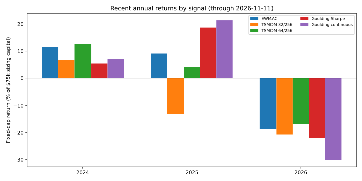

# Fixed-cap selection signal audit: November 11, 2026

This audit compares the completed November 11 fixed-cap runs: multi-speed
EWMAC (`20261111_141909`), return TSMOM 32/256 (`20261111_143654`) and 64/256
(`20261111_142840`), Goulding Sharpe (`20261111_140659`), and Goulding
continuous (`20261111_154229`). All use $75,000 initial fixed sizing capital,
20% target volatility, yearly reviews, and the same class/subclass and
feasibility limits. The 14:58 Goulding continuous directory contains only
screen and candidate artifacts and is not treated as a completed run.

## Full-history results

The portfolio curves run through 2026-11-11. The first valid return is
1973-01-02 for EWMAC/Goulding and 1975-01-02 for return TSMOM. Annualized
arithmetic returns and volatility below use the saved daily `port_net_pct`
with 256 trading days; Sharpe is their ratio. Fixed-cap returns are measured
against the fixed sizing capital and are not reinvested CAGR.

| Signal | Net equity at end | Net P&L | Ann. mean | Ann. vol. | Sharpe | Fixed-cap adjusted Calmar* | Max DD (pct of prior peak) | Max DD ($) |
|---|---:|---:|---:|---:|---:|---:|---:|---:|
| EWMAC | $935,169 | $860,169 | 21.0% | 18.9% | 1.11 | 1.82 | −11.5% | −$20,339 |
| TSMOM 32/256 | $920,525 | $845,525 | 21.4% | 21.0% | 1.02 | 1.68 | −12.7% | −$11,164 |
| TSMOM 64/256 | $940,408 | $865,408 | 21.9% | 19.5% | 1.12 | 1.59 | −13.8% | −$11,749 |
| Goulding Sharpe | $670,869 | $595,869 | 14.5% | 19.0% | 0.77 | 0.97 | −14.9% | −$44,005 |
| Goulding continuous | $526,845 | $451,845 | 11.0% | 17.2% | 0.64 | 0.91 | −12.1% | −$23,017 |

*Fixed-cap adjusted Calmar is annualized arithmetic mean return divided by
absolute maximum drawdown. It is a fixed-cap risk/return ratio, not standard
Calmar, because daily returns are contributions against fixed sizing capital
and are not reinvested.

On these fixed-cap outputs, TSMOM 64/256 has the highest annualized mean and
EWMAC nearly matches its Sharpe with lower realized volatility. Both Goulding
variants lag in annualized mean and Sharpe. Goulding Sharpe improves the mean
and Sharpe over continuous mode, but has the deepest maximum drawdown, both in
percentage and dollar terms. Drawdown percentage uses the cumulative net equity
curve; the largest dollar drawdown is also shown because the denominator
grows as fixed-cap profits accumulate.

| Signal | Max drawdown peak → trough | 2024 | 2025 | 2026 through Nov 11 |
|---|---|---:|---:|---:|
| EWMAC | 1974-02-26 → 1974-07-03 | +0.9% | +0.7% | −1.5% |
| TSMOM 32/256 | 1975-05-05 → 1976-01-14 | +0.5% | −1.1% | −1.6% |
| TSMOM 64/256 | 1975-06-16 → 1975-11-07 | +1.0% | +0.3% | −1.3% |
| Goulding Sharpe | 1980-01-21 → 1981-03-20 | +0.6% | +2.1% | −2.4% |
| Goulding continuous | 1974-02-26 → 1974-03-27 | +1.0% | +3.0% | −4.1% |

These calendar-year figures sum the fixed-cap daily return contributions. All
five are down in 2026 to date; losses are most pronounced in Goulding
continuous and Sharpe. All remain near flat over 2024–2026 through November
11: EWMAC +0.8%, TSMOM 32/256 −2.2%, TSMOM 64/256 +0.0%, Goulding Sharpe
+0.3%, and Goulding continuous −0.1% (daily fixed-cap return contributions
summed).

## Calendar-year OOS results

Each row is labeled by its actual observation year and uses only that calendar year's observations for OOS return, drawdown, Sharpe, Calmar, gross P&L, and fees. There is no next-year shift. The compounding table additionally carries cumulative return and ending capital through the same row year. These are yearly slices of the saved backtests, not separate reruns or parameter refits. 2026 is partial through each run's latest saved date.

Fixed-cap cells show **OOS return / OOS max DD / OOS Sharpe / OOS Calmar / OOS gross P&L / OOS fees**. OOS return is that year’s net P&L divided by the fixed $75,000 sizing capital (equivalently the sum of daily return contributions). Fees are trade plus roll costs shown as positive amounts. Calmar uses annualized arithmetic return.

| OOS year | EWMAC | TSMOM 32/256 | TSMOM 64/256 | Goulding Sharpe | Goulding continuous |
|---|---:|---:|---:|---:|---:|
| 1973 | 82.8% / -6.8% / 4.10 / 12.43 / $62.98k / $880 | — | — | 72.7% / -9.3% / 3.49 / 8.02 / $55.44k / $888 | 92.0% / -9.5% / 3.83 / 9.90 / $70.02k / $1.02k |
| 1974 | 53.0% / -11.5% / 2.18 / 4.66 / $40.70k / $984 | — | — | 52.9% / -13.1% / 2.19 / 4.12 / $40.24k / $579 | 79.5% / -12.1% / 2.86 / 6.65 / $60.30k / $653 |
| 1975 | -0.4% / -7.6% / -0.03 / -0.05 / $868 / $1.17k | 4.0% / -12.5% / 0.36 / 0.32 / $5.52k / $2.54k | 2.2% / -13.8% / 0.21 / 0.16 / $3.11k / $1.47k | -2.0% / -5.3% / -0.16 / -0.38 / -$169 / $1.34k | -4.8% / -3.0% / -0.55 / -1.63 / -$2.44k / $1.18k |
| 1976 | 9.5% / -4.0% / 0.78 / 2.42 / $8.15k / $989 | 8.7% / -7.9% / 0.74 / 1.11 / $8.76k / $2.25k | 5.5% / -10.8% / 0.48 / 0.52 / $5.97k / $1.85k | 6.8% / -9.6% / 0.45 / 0.73 / $6.52k / $1.40k | 15.5% / -3.3% / 1.36 / 4.74 / $12.78k / $1.11k |
| 1977 | 42.4% / -2.5% / 2.79 / 17.08 / $33.41k / $1.60k | 29.0% / -5.8% / 2.48 / 5.09 / $24.28k / $2.51k | 26.3% / -6.6% / 2.20 / 4.05 / $21.85k / $2.12k | 26.6% / -2.6% / 2.39 / 10.54 / $21.30k / $1.36k | 2.2% / -2.0% / 0.38 / 1.09 / $2.23k / $608 |
| 1978 | 67.2% / -5.5% / 2.23 / 12.48 / $51.33k / $961 | 80.4% / -9.4% / 2.43 / 8.69 / $62.97k / $2.63k | 59.1% / -12.7% / 2.00 / 4.74 / $45.83k / $1.48k | 39.5% / -7.3% / 1.43 / 5.52 / $30.69k / $1.09k | 15.5% / -6.0% / 0.90 / 2.65 / $12.52k / $859 |
| 1979 | 100.9% / -2.7% / 4.14 / 37.94 / $76.60k / $887 | 78.9% / -5.5% / 3.33 / 14.63 / $60.38k / $1.17k | 80.8% / -6.2% / 3.51 / 13.19 / $61.61k / $975 | 51.4% / -7.2% / 2.05 / 7.25 / $39.39k / $831 | 80.1% / -3.4% / 3.33 / 24.14 / $60.70k / $654 |
| 1980 | 38.7% / -6.2% / 1.61 / 6.38 / $29.47k / $468 | 46.1% / -3.8% / 1.82 / 12.40 / $35.63k / $1.03k | 18.4% / -11.3% / 0.78 / 1.66 / $14.56k / $772 | -6.2% / -14.9% / -0.26 / -0.42 / -$4.14k / $513 | 12.9% / -11.0% / 0.46 / 1.20 / $10.18k / $483 |
| 1981 | 52.7% / -3.7% / 1.83 / 14.53 / $40.45k / $909 | 34.7% / -5.1% / 1.28 / 6.82 / $28.45k / $2.44k | 36.9% / -5.3% / 1.70 / 7.07 / $29.29k / $1.64k | 14.0% / -6.1% / 0.62 / 2.32 / $11.30k / $816 | 16.5% / -3.0% / 1.07 / 5.50 / $13.38k / $1.00k |
| 1982 | 34.2% / -3.2% / 1.38 / 10.69 / $26.51k / $838 | 15.7% / -5.6% / 0.68 / 2.83 / $13.86k / $2.05k | 22.9% / -4.2% / 1.04 / 5.52 / $18.78k / $1.60k | 29.3% / -3.1% / 1.69 / 9.50 / $22.81k / $837 | 39.5% / -3.1% / 1.90 / 12.70 / $30.39k / $746 |
| 1983 | -5.4% / -2.8% / -0.63 / -1.99 / -$3.58k / $496 | -9.1% / -4.7% / -0.86 / -1.94 / -$5.52k / $1.27k | -6.1% / -5.3% / -0.64 / -1.16 / -$3.89k / $718 | -13.5% / -5.1% / -1.51 / -2.70 / -$9.62k / $522 | -19.3% / -6.8% / -1.58 / -2.89 / -$14.08k / $374 |
| 1984 | 39.7% / -1.8% / 1.88 / 21.78 / $30.95k / $1.15k | 41.7% / -3.1% / 2.01 / 13.48 / $33.45k / $2.16k | 47.8% / -2.9% / 2.20 / 16.91 / $37.27k / $1.41k | 27.1% / -3.1% / 1.44 / 8.72 / $21.29k / $961 | 5.6% / -2.0% / 0.51 / 2.89 / $4.74k / $520 |
| 1985 | 20.0% / -3.1% / 1.10 / 6.48 / $16.02k / $1.01k | 45.0% / -4.0% / 1.81 / 11.48 / $36.35k / $2.63k | 46.7% / -3.9% / 2.14 / 12.09 / $36.50k / $1.48k | 22.5% / -4.6% / 1.06 / 4.93 / $18.08k / $1.18k | 1.4% / -3.4% / 0.11 / 0.42 / $1.79k / $732 |
| 1986 | 32.8% / -2.8% / 1.38 / 11.89 / $25.77k / $1.13k | 30.3% / -3.8% / 1.52 / 7.99 / $24.38k / $1.67k | 25.1% / -2.2% / 1.39 / 11.49 / $19.66k / $838 | 33.4% / -2.8% / 1.71 / 11.70 / $25.85k / $785 | -3.8% / -4.8% / -0.27 / -0.79 / -$2.06k / $812 |
| 1987 | 37.2% / -2.1% / 1.67 / 17.96 / $28.87k / $986 | 34.2% / -3.8% / 1.33 / 8.93 / $27.80k / $2.14k | 44.8% / -3.0% / 1.83 / 15.07 / $35.08k / $1.51k | 19.8% / -4.6% / 0.88 / 4.27 / $15.81k / $979 | 3.1% / -4.2% / 0.21 / 0.75 / $3.14k / $801 |
| 1988 | -11.5% / -2.0% / -0.98 / -5.74 / -$7.74k / $910 | -0.8% / -3.1% / -0.05 / -0.25 / $1.59k / $2.17k | -12.1% / -3.6% / -1.01 / -3.37 / -$7.67k / $1.39k | -15.9% / -4.8% / -1.02 / -3.28 / -$10.74k / $1.16k | -20.8% / -5.5% / -1.59 / -3.78 / -$14.62k / $977 |
| 1989 | 23.3% / -1.9% / 1.08 / 12.57 / $19.07k / $1.61k | 33.8% / -3.0% / 1.45 / 11.13 / $28.26k / $2.93k | 31.5% / -2.4% / 1.42 / 12.94 / $25.80k / $2.20k | 11.6% / -3.6% / 0.59 / 3.24 / $10.42k / $1.74k | 10.0% / -2.4% / 0.67 / 4.20 / $8.59k / $1.12k |
| 1990 | 16.3% / -1.6% / 0.98 / 10.26 / $13.44k / $1.19k | 56.4% / -2.7% / 2.15 / 21.06 / $44.71k / $2.41k | 45.1% / -3.1% / 1.93 / 14.50 / $35.51k / $1.66k | 28.9% / -3.9% / 1.36 / 7.28 / $23.01k / $1.35k | 31.0% / -4.4% / 1.46 / 6.98 / $24.07k / $842 |
| 1991 | 20.7% / -2.3% / 1.20 / 8.89 / $16.95k / $1.45k | 14.1% / -3.3% / 0.82 / 4.20 / $13.21k / $2.67k | 11.9% / -3.3% / 0.73 / 3.61 / $10.85k / $1.94k | 16.6% / -1.6% / 1.16 / 10.58 / $13.84k / $1.36k | -2.8% / -2.4% / -0.28 / -1.18 / -$1.10k / $987 |
| 1992 | -9.4% / -3.0% / -0.59 / -3.14 / -$5.70k / $1.37k | 3.7% / -3.5% / 0.19 / 1.06 / $5.97k / $3.18k | -6.9% / -3.9% / -0.42 / -1.76 / -$2.66k / $2.48k | -2.4% / -4.4% / -0.12 / -0.54 / -$372 / $1.46k | -2.7% / -1.6% / -0.29 / -1.63 / -$1.20k / $823 |
| 1993 | 21.7% / -2.4% / 1.11 / 9.02 / $17.68k / $1.40k | 25.1% / -1.8% / 1.24 / 13.66 / $22.47k / $3.63k | 45.1% / -1.9% / 2.16 / 22.96 / $35.95k / $2.12k | 52.7% / -1.8% / 2.63 / 29.52 / $41.08k / $1.54k | 9.1% / -2.5% / 0.86 / 3.64 / $7.76k / $958 |
| 1994 | 5.9% / -1.7% / 0.39 / 3.40 / $5.76k / $1.35k | 5.0% / -2.3% / 0.26 / 2.18 / $6.86k / $3.13k | 2.4% / -2.3% / 0.15 / 1.00 / $3.88k / $2.10k | -12.2% / -3.4% / -0.64 / -3.52 / -$7.65k / $1.53k | -16.3% / -4.5% / -1.40 / -3.54 / -$11.17k / $1.06k |
| 1995 | 21.1% / -1.1% / 1.11 / 18.49 / $17.09k / $1.26k | 10.7% / -2.2% / 0.53 / 4.83 / $11.35k / $3.34k | 17.0% / -1.8% / 0.94 / 9.60 / $14.76k / $1.99k | 17.0% / -1.7% / 0.92 / 9.86 / $14.35k / $1.59k | 4.9% / -1.3% / 0.58 / 3.70 / $4.67k / $982 |
| 1996 | 10.8% / -2.3% / 0.49 / 4.58 / $9.72k / $1.62k | 29.9% / -3.0% / 1.13 / 9.77 / $25.93k / $3.48k | 9.6% / -2.2% / 0.41 / 4.31 / $9.58k / $2.37k | 16.2% / -2.3% / 0.63 / 6.99 / $14.00k / $1.82k | 17.5% / -2.0% / 1.07 / 8.53 / $14.18k / $1.07k |
| 1997 | 8.0% / -1.7% / 0.41 / 4.75 / $7.21k / $1.22k | 7.9% / -2.0% / 0.38 / 3.99 / $8.77k / $2.87k | 29.1% / -1.9% / 1.38 / 15.60 / $23.71k / $1.89k | -15.2% / -4.4% / -0.80 / -3.43 / -$10.07k / $1.34k | -20.8% / -5.5% / -1.52 / -3.72 / -$14.49k / $1.10k |
| 1998 | 40.4% / -1.4% / 2.01 / 28.74 / $31.93k / $1.66k | 44.4% / -1.6% / 2.01 / 27.15 / $36.60k / $3.27k | 60.7% / -1.7% / 2.76 / 36.68 / $47.63k / $2.09k | 13.7% / -1.9% / 0.75 / 7.28 / $11.74k / $1.43k | -1.7% / -6.0% / -0.10 / -0.28 / $156 / $1.41k |
| 1999 | -35.3% / -4.6% / -1.84 / -7.59 / -$25.08k / $1.42k | -29.1% / -4.5% / -1.70 / -6.42 / -$19.21k / $2.59k | -18.2% / -4.1% / -1.01 / -4.42 / -$11.88k / $1.76k | -19.1% / -4.4% / -1.17 / -4.32 / -$13.14k / $1.16k | -11.1% / -5.8% / -0.72 / -1.89 / -$7.38k / $934 |
| 2000 | 28.2% / -1.0% / 1.62 / 27.29 / $22.41k / $1.25k | 40.1% / -1.3% / 2.10 / 31.84 / $32.39k / $2.28k | 36.7% / -1.3% / 2.12 / 27.01 / $29.12k / $1.63k | 35.9% / -1.6% / 2.06 / 21.80 / $28.26k / $1.33k | 46.7% / -2.1% / 2.63 / 22.52 / $35.88k / $833 |
| 2001 | -4.8% / -2.5% / -0.24 / -1.91 / -$2.17k / $1.45k | 10.5% / -2.1% / 0.49 / 5.03 / $10.44k / $2.57k | 4.3% / -2.6% / 0.21 / 1.65 / $5.26k / $2.06k | -11.3% / -4.1% / -0.54 / -2.73 / -$7.16k / $1.34k | -31.7% / -7.4% / -1.82 / -4.24 / -$22.58k / $1.21k |
| 2002 | 21.1% / -1.5% / 1.25 / 14.14 / $16.98k / $1.18k | 20.4% / -1.7% / 1.16 / 12.16 / $17.80k / $2.48k | 18.9% / -1.5% / 1.16 / 12.83 / $15.89k / $1.74k | 23.8% / -1.2% / 1.29 / 18.93 / $19.14k / $1.30k | -1.3% / -2.8% / -0.10 / -0.44 / $145 / $1.09k |
| 2003 | 51.1% / -2.5% / 2.15 / 19.78 / $39.71k / $1.40k | 53.1% / -2.8% / 2.08 / 18.71 / $42.24k / $2.43k | 53.7% / -2.9% / 2.04 / 18.03 / $41.97k / $1.66k | 30.3% / -4.0% / 1.24 / 7.54 / $24.09k / $1.37k | 7.9% / -5.0% / 0.42 / 1.57 / $7.07k / $1.13k |
| 2004 | 29.6% / -1.9% / 1.21 / 15.57 / $23.37k / $1.20k | 25.4% / -3.6% / 0.90 / 6.86 / $21.56k / $2.53k | 19.7% / -2.5% / 0.77 / 7.70 / $16.83k / $2.06k | 19.6% / -3.1% / 0.77 / 6.15 / $15.89k / $1.16k | 38.2% / -3.2% / 1.45 / 11.53 / $29.67k / $1.05k |
| 2005 | 23.8% / -0.8% / 1.40 / 30.54 / $19.35k / $1.51k | 52.0% / -1.1% / 2.27 / 45.09 / $41.51k / $2.48k | 31.2% / -0.9% / 1.82 / 32.53 / $25.24k / $1.87k | 29.9% / -1.2% / 1.85 / 25.47 / $23.82k / $1.37k | 33.1% / -1.3% / 2.19 / 24.93 / $25.73k / $922 |
| 2006 | 59.8% / -2.0% / 2.51 / 30.18 / $45.89k / $1.06k | 65.0% / -2.2% / 2.58 / 29.85 / $50.90k / $2.16k | 50.7% / -1.8% / 2.20 / 27.53 / $39.31k / $1.30k | 52.4% / -2.7% / 2.36 / 19.28 / $40.40k / $1.07k | 56.3% / -2.8% / 2.43 / 20.01 / $43.05k / $821 |
| 2007 | 12.2% / -1.8% / 0.52 / 6.82 / $10.25k / $1.14k | 3.4% / -2.0% / 0.15 / 1.65 / $4.46k / $1.92k | 0.7% / -1.6% / 0.04 / 0.41 / $1.76k / $1.25k | -4.9% / -2.3% / -0.26 / -2.10 / -$2.75k / $915 | 0.4% / -2.1% / 0.02 / 0.20 / $979 / $656 |
| 2008 | 39.9% / -1.4% / 1.56 / 27.63 / $30.70k / $745 | 28.7% / -2.7% / 1.05 / 10.37 / $22.64k / $1.09k | 22.9% / -2.1% / 1.02 / 10.82 / $17.89k / $735 | 14.4% / -4.6% / 0.62 / 3.05 / $11.33k / $526 | 22.7% / -5.4% / 0.70 / 4.16 / $17.74k / $700 |
| 2009 | -17.0% / -2.7% / -0.80 / -6.14 / -$11.97k / $790 | -19.1% / -3.4% / -0.90 / -5.53 / -$12.48k / $1.86k | 15.9% / -1.7% / 0.78 / 9.40 / $13.10k / $1.17k | 10.5% / -1.9% / 0.54 / 5.56 / $8.71k / $819 | 30.3% / -3.5% / 1.25 / 8.54 / $23.57k / $813 |
| 2010 | 28.7% / -1.2% / 1.66 / 23.36 / $22.37k / $860 | 39.5% / -1.3% / 1.96 / 31.07 / $31.35k / $1.70k | 35.7% / -1.4% / 1.84 / 24.74 / $28.04k / $1.25k | 5.0% / -2.5% / 0.25 / 1.99 / $4.59k / $850 | 7.8% / -3.3% / 0.40 / 2.35 / $6.62k / $767 |
| 2011 | 39.0% / -1.1% / 1.91 / 34.77 / $30.04k / $800 | 11.8% / -1.9% / 0.57 / 6.14 / $10.60k / $1.72k | 21.4% / -1.2% / 1.08 / 17.50 / $17.27k / $1.22k | 11.2% / -2.3% / 0.59 / 4.81 / $9.26k / $847 | 3.3% / -4.2% / 0.19 / 0.78 / $3.15k / $646 |
| 2012 | -6.7% / -1.5% / -0.57 / -4.52 / -$4.35k / $681 | -2.2% / -2.0% / -0.14 / -1.09 / $56 / $1.72k | 4.7% / -1.7% / 0.33 / 2.76 / $4.61k / $1.08k | 6.5% / -1.3% / 0.38 / 4.94 / $5.86k / $946 | -12.9% / -3.1% / -0.80 / -4.06 / -$8.90k / $786 |
| 2013 | 23.6% / -1.4% / 1.46 / 16.59 / $18.73k / $1.04k | 14.6% / -2.0% / 0.96 / 7.01 / $12.98k / $2.06k | 13.0% / -1.0% / 1.06 / 13.37 / $11.40k / $1.62k | 13.5% / -1.4% / 0.90 / 9.17 / $11.41k / $1.30k | 18.2% / -1.7% / 1.44 / 10.35 / $14.42k / $746 |
| 2014 | 20.8% / -0.5% / 1.50 / 38.63 / $16.85k / $1.26k | 32.5% / -0.6% / 2.17 / 50.44 / $27.07k / $2.71k | 26.7% / -0.8% / 1.75 / 34.41 / $21.83k / $1.78k | 30.9% / -1.3% / 2.09 / 23.22 / $24.52k / $1.32k | 8.8% / -1.3% / 0.89 / 6.47 / $7.16k / $582 |
| 2015 | 17.3% / -1.3% / 1.06 / 13.43 / $14.29k / $1.32k | 52.9% / -1.7% / 1.28 / 29.91 / $42.06k / $2.41k | 60.6% / -1.1% / 1.49 / 55.41 / $47.42k / $1.94k | 13.9% / -1.1% / 0.75 / 12.43 / $11.59k / $1.19k | 12.1% / -1.4% / 0.73 / 8.70 / $10.10k / $1.01k |
| 2016 | -6.3% / -1.8% / -0.48 / -3.47 / -$3.47k / $1.23k | -13.2% / -2.1% / -0.94 / -6.25 / -$7.37k / $2.53k | -4.1% / -1.7% / -0.26 / -2.43 / -$1.05k / $2.04k | -6.2% / -3.3% / -0.45 / -1.87 / -$3.22k / $1.42k | -3.6% / -1.9% / -0.29 / -1.82 / -$1.30k / $1.38k |
| 2017 | 30.2% / -0.8% / 2.02 / 38.28 / $24.53k / $1.86k | 12.9% / -0.8% / 0.87 / 16.69 / $13.45k / $3.74k | 15.8% / -0.6% / 1.14 / 27.37 / $14.52k / $2.70k | 10.4% / -1.0% / 0.72 / 10.67 / $9.78k / $1.99k | 10.1% / -1.6% / 0.73 / 6.24 / $9.35k / $1.77k |
| 2018 | -12.3% / -2.7% / -1.02 / -4.46 / -$7.43k / $1.76k | -20.3% / -3.0% / -1.57 / -6.68 / -$11.28k / $3.92k | -12.4% / -2.5% / -0.89 / -4.79 / -$6.24k / $3.08k | -11.3% / -2.8% / -0.84 / -4.01 / -$6.81k / $1.70k | -16.6% / -3.6% / -1.39 / -4.58 / -$10.87k / $1.60k |
| 2019 | -8.7% / -1.5% / -0.82 / -5.49 / -$4.61k / $1.88k | -5.9% / -1.4% / -0.51 / -4.06 / -$1.27k / $3.14k | 4.0% / -1.0% / 0.37 / 4.08 / $5.09k / $2.09k | 4.2% / -1.9% / 0.29 / 2.22 / $5.38k / $2.20k | -14.9% / -3.3% / -1.46 / -4.50 / -$9.29k / $1.92k |
| 2020 | 18.8% / -0.6% / 1.30 / 29.10 / $15.59k / $1.51k | 50.9% / -1.0% / 2.24 / 47.37 / $40.97k / $2.82k | 49.3% / -1.1% / 2.31 / 45.22 / $38.96k / $2.02k | 40.8% / -1.5% / 1.91 / 27.46 / $32.28k / $1.65k | 39.2% / -2.1% / 1.81 / 18.21 / $31.42k / $1.99k |
| 2021 | 20.9% / -0.9% / 1.12 / 23.89 / $16.85k / $1.18k | 6.8% / -1.5% / 0.33 / 4.36 / $8.02k / $2.91k | 30.3% / -1.0% / 1.48 / 29.83 / $24.83k / $2.10k | 2.8% / -2.1% / 0.13 / 1.33 / $3.71k / $1.58k | 16.9% / -2.4% / 0.81 / 6.89 / $14.00k / $1.35k |
| 2022 | 24.2% / -1.1% / 1.46 / 19.21 / $19.25k / $1.10k | 38.3% / -1.5% / 1.62 / 23.46 / $30.79k / $2.03k | 23.3% / -1.4% / 1.14 / 15.19 / $18.94k / $1.46k | 7.7% / -2.7% / 0.38 / 2.60 / $6.89k / $1.11k | 10.0% / -3.1% / 0.41 / 2.92 / $8.87k / $1.36k |
| 2023 | -5.6% / -1.3% / -0.35 / -3.42 / -$2.37k / $1.79k | 15.5% / -1.3% / 0.79 / 10.28 / $13.92k / $2.29k | 5.4% / -1.2% / 0.31 / 3.88 / $5.65k / $1.59k | -4.1% / -1.6% / -0.26 / -2.24 / -$1.45k / $1.62k | -9.3% / -2.5% / -0.58 / -3.69 / -$5.19k / $1.80k |
| 2024 | 11.5% / -0.8% / 0.76 / 14.06 / $9.98k / $1.35k | 6.7% / -1.2% / 0.41 / 5.47 / $7.71k / $2.68k | 12.7% / -1.3% / 0.71 / 9.66 / $11.57k / $2.04k | 5.4% / -1.7% / 0.31 / 2.66 / $5.45k / $1.38k | 7.0% / -2.1% / 0.44 / 2.71 / $6.21k / $951 |
| 2025 | 9.1% / -0.9% / 0.58 / 7.95 / $7.91k / $1.09k | -13.2% / -1.4% / -0.82 / -7.70 / -$7.34k / $2.59k | 4.1% / -0.8% / 0.25 / 4.38 / $4.78k / $1.70k | 18.7% / -0.9% / 1.12 / 16.78 / $15.00k / $984 | 21.4% / -1.3% / 1.08 / 13.87 / $17.33k / $1.26k |
| 2026 | -18.6% / -1.7% / -1.59 / -12.24 / -$12.88k / $1.05k | -20.7% / -1.8% / -1.70 / -13.08 / -$13.47k / $2.05k | -16.8% / -1.5% / -1.36 / -11.48 / -$11.17k / $1.43k | -22.0% / -2.9% / -1.68 / -8.80 / -$15.32k / $1.19k | -30.1% / -4.3% / -2.32 / -7.24 / -$20.94k / $1.63k |

Compounding-cap cells show **cumulative return / OOS return / OOS max DD / OOS Sharpe / OOS Calmar / OOS gross P&L / OOS fees / cumulative ending capital**. Cumulative return uses the initial $75,000 denominator: `(year-end capital / $75,000) - 1`. OOS return uses the different, rolling denominator: `(year-end capital / prior year-end capital) - 1`. Fees are trade plus roll costs shown as positive amounts, and Calmar uses the OOS year’s geometric annualized return.

| OOS year | EWMAC | TSMOM 32/256 | TSMOM 64/256 | Goulding Sharpe | Goulding continuous |
|---|---:|---:|---:|---:|---:|
| 1973 | 100.8% / 100.8% / -15.9% / 3.83 / 6.53 / $76.98k / $1.39k / cap $150.59k | — | — | 71.8% / 71.8% / -14.6% / 2.87 / 5.08 / $54.97k / $1.09k / cap $128.88k | 99.3% / 99.3% / -14.6% / 3.10 / 7.05 / $75.92k / $1.45k / cap $149.47k |
| 1974 | 212.2% / 55.5% / -18.6% / 2.39 / 3.03 / $85.90k / $2.37k / cap $234.13k | — | — | 140.5% / 40.0% / -25.2% / 1.63 / 1.61 / $52.95k / $1.43k / cap $180.41k | 164.1% / 32.5% / -28.4% / 1.32 / 1.17 / $50.26k / $1.68k / cap $198.05k |
| 1975 | 205.5% / -2.1% / -15.9% / -0.13 / -0.14 / -$1.24k / $3.74k / cap $229.14k | -1.4% / -1.4% / -16.3% / -0.07 / -0.08 / $1.96k / $2.98k / cap $73.98k | 1.5% / 1.5% / -16.2% / 0.20 / 0.10 / $2.81k / $1.67k / cap $76.14k | 143.3% / 1.2% / -8.0% / 0.16 / 0.15 / $5.08k / $3.00k / cap $182.49k | 146.5% / -6.7% / -10.8% / -0.72 / -0.62 / -$10.34k / $2.84k / cap $184.86k |
| 1976 | 269.4% / 20.9% / -13.6% / 1.55 / 1.56 / $51.75k / $3.86k / cap $277.03k | 8.5% / 10.0% / -9.5% / 0.84 / 1.07 / $10.05k / $2.62k / cap $81.41k | 11.2% / 9.5% / -11.0% / 0.83 / 0.88 / $9.31k / $2.06k / cap $83.39k | 158.5% / 6.2% / -20.9% / 0.48 / 0.30 / $14.62k / $3.22k / cap $193.89k | 179.1% / 13.2% / -11.9% / 1.19 / 1.13 / $26.64k / $2.19k / cap $209.31k |
| 1977 | 489.1% / 59.5% / -6.5% / 3.13 / 9.23 / $171.29k / $6.49k / cap $441.83k | 57.0% / 44.7% / -7.5% / 3.05 / 6.06 / $39.65k / $3.29k / cap $117.77k | 47.4% / 32.6% / -5.4% / 2.53 / 6.15 / $29.84k / $2.69k / cap $110.54k | 260.0% / 39.2% / -6.9% / 2.93 / 5.78 / $79.87k / $3.79k / cap $269.97k | 232.6% / 19.2% / -3.9% / 2.13 / 4.94 / $42.38k / $2.24k / cap $249.45k |
| 1978 | 880.7% / 66.5% / -24.9% / 1.87 / 2.74 / $304.18k / $10.49k / cap $735.52k | 178.4% / 77.3% / -27.6% / 1.97 / 2.87 / $96.32k / $5.28k / cap $208.81k | 148.7% / 68.7% / -21.5% / 2.01 / 3.27 / $79.02k / $3.06k / cap $186.51k | 337.6% / 21.6% / -26.4% / 0.88 / 0.84 / $63.40k / $5.14k / cap $328.23k | 280.1% / 14.3% / -21.0% / 0.78 / 0.70 / $39.35k / $3.70k / cap $285.10k |
| 1979 | 2007.0% / 114.8% / -9.7% / 3.73 / 12.16 / $856.28k / $11.55k / cap $1.58M | 496.1% / 114.1% / -12.2% / 3.25 / 9.56 / $244.00k / $5.77k / cap $447.04k | 402.2% / 101.9% / -11.2% / 3.34 / 9.33 / $193.85k / $3.74k / cap $376.62k | 650.1% / 71.4% / -17.2% / 2.38 / 4.23 / $238.87k / $4.53k / cap $562.57k | 636.5% / 93.8% / -13.6% / 3.12 / 7.03 / $270.42k / $3.14k / cap $552.39k |
| 1980 | 2368.2% / 17.1% / -29.9% / 0.80 / 0.58 / $287.97k / $17.04k / cap $1.85M | 727.9% / 38.9% / -14.6% / 1.54 / 2.72 / $183.95k / $10.06k / cap $620.93k | 468.0% / 13.1% / -29.2% / 0.65 / 0.46 / $54.81k / $5.39k / cap $426.03k | 558.1% / -12.3% / -42.5% / -0.36 / -0.29 / -$64.51k / $4.46k / cap $493.60k | 593.1% / -5.9% / -38.0% / -0.06 / -0.16 / -$27.96k / $4.58k / cap $519.85k |
| 1981 | 3994.3% / 65.9% / -17.1% / 1.89 / 3.90 / $1.25M / $28.10k / cap $3.07M | 1033.1% / 36.9% / -18.5% / 1.34 / 2.02 / $241.97k / $13.10k / cap $849.79k | 757.8% / 51.0% / -19.5% / 1.71 / 2.65 / $225.70k / $8.38k / cap $643.35k | 713.5% / 23.6% / -16.7% / 1.03 / 1.43 / $122.70k / $6.14k / cap $610.15k | 825.9% / 33.6% / -12.8% / 1.49 / 2.67 / $180.98k / $6.39k / cap $694.44k |
| 1982 | 5085.3% / 26.6% / -16.4% / 1.28 / 1.65 / $856.60k / $38.38k / cap $3.89M | 1353.6% / 28.3% / -15.2% / 1.38 / 1.89 / $257.33k / $16.89k / cap $1.09M | 953.4% / 22.8% / -13.7% / 1.22 / 1.69 / $158.24k / $11.53k / cap $790.07k | 996.3% / 34.8% / -13.7% / 1.66 / 2.57 / $219.30k / $7.24k / cap $822.21k | 1174.3% / 37.6% / -13.4% / 1.74 / 2.85 / $268.71k / $7.39k / cap $955.76k |
| 1983 | 4520.4% / -10.9% / -20.3% / -1.05 / -0.54 / -$395.86k / $27.79k / cap $3.47M | 1215.6% / -9.5% / -19.1% / -0.80 / -0.50 / -$84.73k / $18.81k / cap $986.69k | 838.6% / -10.9% / -21.6% / -1.09 / -0.51 / -$76.59k / $9.52k / cap $703.96k | 784.3% / -19.3% / -27.0% / -1.69 / -0.72 / -$152.79k / $6.18k / cap $663.24k | 926.9% / -19.4% / -28.2% / -1.43 / -0.70 / -$179.19k / $6.43k / cap $770.15k |
| 1984 | 6371.8% / 40.1% / -10.3% / 1.69 / 3.96 / $1.45M / $57.62k / cap $4.85M | 1877.0% / 50.3% / -10.8% / 2.05 / 4.70 / $523.81k / $27.77k / cap $1.48M | 1398.9% / 59.7% / -10.3% / 2.31 / 5.89 / $433.62k / $13.42k / cap $1.12M | 1116.8% / 37.6% / -10.9% / 1.80 / 3.50 / $257.93k / $8.59k / cap $912.58k | 1073.5% / 14.3% / -9.7% / 0.99 / 1.49 / $117.27k / $7.28k / cap $880.14k |
| 1985 | 8240.5% / 28.9% / -15.8% / 1.47 / 1.82 / $1.48M / $76.41k / cap $6.26M | 2658.9% / 39.6% / -17.1% / 1.70 / 2.35 / $637.12k / $50.67k / cap $2.07M | 2029.7% / 42.1% / -15.0% / 1.99 / 2.84 / $499.42k / $26.30k / cap $1.60M | 1469.3% / 29.0% / -16.8% / 1.48 / 1.75 / $280.39k / $16.01k / cap $1.18M | 1178.4% / 8.9% / -12.1% / 0.72 / 0.75 / $89.06k / $10.37k / cap $958.83k |
| 1986 | 10607.3% / 28.4% / -18.9% / 1.23 / 1.49 / $1.91M / $134.17k / cap $8.03M | 3606.3% / 34.3% / -16.6% / 1.50 / 2.06 / $777.83k / $67.31k / cap $2.78M | 2777.7% / 35.1% / -14.0% / 1.59 / 2.51 / $596.61k / $35.61k / cap $2.16M | 1832.4% / 23.1% / -17.4% / 1.10 / 1.33 / $292.80k / $20.47k / cap $1.45M | 1388.2% / 16.4% / -12.9% / 1.08 / 1.26 / $170.40k / $13.08k / cap $1.12M |
| 1987 | 14435.0% / 35.7% / -18.7% / 1.51 / 1.90 / $3.02M / $154.10k / cap $10.90M | 5773.2% / 58.5% / -21.6% / 1.78 / 2.70 / $1.74M / $114.78k / cap $4.40M | 4569.0% / 62.2% / -21.0% / 2.03 / 2.95 / $1.40M / $59.90k / cap $3.50M | 2678.5% / 43.8% / -22.7% / 1.63 / 1.92 / $660.36k / $25.74k / cap $2.08M | 1681.7% / 19.7% / -19.3% / 1.08 / 1.02 / $234.51k / $14.39k / cap $1.34M |
| 1988 | 12961.8% / -10.1% / -15.0% / -0.80 / -0.67 / -$976.95k / $128.00k / cap $9.80M | 5830.8% / 1.0% / -9.6% / 0.14 / 0.10 / $152.02k / $108.81k / cap $4.45M | 4434.1% / -2.9% / -10.2% / -0.21 / -0.28 / -$39.19k / $62.03k / cap $3.40M | 2356.9% / -11.6% / -18.7% / -0.84 / -0.62 / -$213.10k / $28.16k / cap $1.84M | 1453.4% / -12.8% / -14.0% / -1.23 / -0.91 / -$156.17k / $15.07k / cap $1.17M |
| 1989 | 14676.1% / 13.1% / -12.1% / 0.83 / 1.08 / $1.48M / $189.78k / cap $11.08M | 7903.2% / 34.9% / -11.2% / 1.66 / 3.13 / $1.72M / $167.82k / cap $6.00M | 5547.8% / 24.6% / -14.0% / 1.36 / 1.75 / $922.54k / $87.19k / cap $4.24M | 2426.8% / 2.8% / -16.8% / 0.25 / 0.17 / $87.77k / $35.32k / cap $1.90M | 1465.2% / 0.8% / -13.7% / 0.12 / 0.06 / $25.29k / $16.39k / cap $1.17M |
| 1990 | 16508.2% / 12.4% / -14.4% / 0.68 / 0.86 / $1.56M / $184.82k / cap $12.46M | 9971.0% / 25.8% / -13.8% / 1.33 / 1.87 / $1.71M / $157.18k / cap $7.55M | 6307.9% / 13.5% / -13.9% / 0.83 / 0.96 / $650.27k / $80.23k / cap $4.81M | 2633.8% / 8.2% / -16.2% / 0.55 / 0.50 / $182.04k / $26.79k / cap $2.05M | 1664.7% / 12.7% / -9.9% / 0.93 / 1.29 / $162.79k / $13.20k / cap $1.32M |
| 1991 | 18314.3% / 10.9% / -13.3% / 0.81 / 0.81 / $1.56M / $201.41k / cap $13.81M | 10644.7% / 6.7% / -12.1% / 0.48 / 0.55 / $746.40k / $241.09k / cap $8.06M | 6902.4% / 9.3% / -9.4% / 0.70 / 0.99 / $553.87k / $107.95k / cap $5.25M | 2877.6% / 8.9% / -9.3% / 0.73 / 0.95 / $219.83k / $36.96k / cap $2.23M | 1646.8% / -1.0% / -9.1% / -0.04 / -0.11 / $6.24k / $19.65k / cap $1.31M |
| 1992 | 15895.6% / -13.1% / -20.9% / -1.05 / -0.63 / -$1.60M / $212.40k / cap $12.00M | 10163.4% / -4.5% / -17.9% / -0.23 / -0.25 / -$88.52k / $272.46k / cap $7.70M | 6099.3% / -11.5% / -19.4% / -0.87 / -0.59 / -$481.75k / $120.59k / cap $4.65M | 2572.0% / -10.3% / -17.8% / -0.72 / -0.57 / -$196.14k / $33.05k / cap $2.00M | 1530.5% / -6.7% / -13.7% / -0.79 / -0.48 / -$74.56k / $12.68k / cap $1.22M |
| 1993 | 22231.9% / 39.6% / -9.5% / 2.06 / 4.11 / $5.01M / $257.70k / cap $16.75M | 15251.7% / 49.6% / -10.8% / 2.30 / 4.52 / $4.19M / $370.66k / cap $11.51M | 8883.1% / 44.9% / -9.6% / 2.26 / 4.60 / $2.23M / $146.79k / cap $6.74M | 4594.9% / 75.7% / -6.8% / 3.31 / 10.96 / $1.56M / $46.70k / cap $3.52M | 2191.7% / 40.6% / -6.8% / 2.97 / 5.92 / $515.92k / $20.04k / cap $1.72M |
| 1994 | 21056.6% / -5.3% / -13.6% / -0.28 / -0.38 / -$619.35k / $262.16k / cap $15.87M | 13173.0% / -13.5% / -24.3% / -0.80 / -0.55 / -$1.17M / $385.28k / cap $9.95M | 7937.9% / -10.5% / -19.7% / -0.64 / -0.53 / -$553.51k / $155.39k / cap $6.03M | 3812.8% / -16.7% / -24.9% / -1.01 / -0.66 / -$528.70k / $57.87k / cap $2.93M | 1823.0% / -16.1% / -21.7% / -1.51 / -0.73 / -$251.63k / $24.90k / cap $1.44M |
| 1995 | 28308.3% / 34.3% / -7.9% / 1.81 / 4.30 / $5.75M / $309.69k / cap $21.31M | 16162.2% / 22.5% / -8.8% / 1.22 / 2.53 / $2.66M / $420.62k / cap $12.20M | 10255.7% / 28.8% / -8.8% / 1.61 / 3.27 / $1.91M / $168.39k / cap $7.77M | 5307.2% / 38.2% / -7.5% / 2.00 / 5.04 / $1.19M / $65.76k / cap $4.06M | 2131.1% / 16.0% / -5.0% / 1.39 / 3.21 / $256.33k / $25.22k / cap $1.67M |
| 1996 | 35784.0% / 26.3% / -11.9% / 1.26 / 2.17 / $6.06M / $456.81k / cap $26.91M | 21178.6% / 30.8% / -12.9% / 1.32 / 2.36 / $4.23M / $464.99k / cap $15.96M | 13554.0% / 31.8% / -13.2% / 1.41 / 2.37 / $2.68M / $206.38k / cap $10.24M | 6434.5% / 20.8% / -12.3% / 0.96 / 1.67 / $935.00k / $89.49k / cap $4.90M | 2685.4% / 24.8% / -8.0% / 1.50 / 3.04 / $442.95k / $27.27k / cap $2.09M |
| 1997 | 43734.6% / 22.2% / -12.1% / 1.14 / 1.81 / $6.44M / $478.76k / cap $32.88M | 27150.3% / 28.1% / -13.4% / 1.25 / 2.08 / $5.05M / $568.61k / cap $20.44M | 16564.1% / 22.0% / -10.9% / 1.14 / 2.00 / $2.51M / $254.02k / cap $12.50M | 6348.6% / -1.3% / -15.5% / 0.01 / -0.08 / $14.24k / $78.67k / cap $4.84M | 2373.3% / -11.2% / -16.9% / -0.77 / -0.66 / -$206.82k / $27.25k / cap $1.85M |
| 1998 | 61078.8% / 39.6% / -15.7% / 1.54 / 2.50 / $13.68M / $676.28k / cap $45.88M | 48308.1% / 77.6% / -11.2% / 2.57 / 6.85 / $16.73M / $863.52k / cap $36.31M | 27707.7% / 66.9% / -12.4% / 2.41 / 5.32 / $8.75M / $393.80k / cap $20.86M | 7457.1% / 17.2% / -18.4% / 0.86 / 0.93 / $924.44k / $93.07k / cap $5.67M | 2272.3% / -4.1% / -23.6% / -0.15 / -0.17 / -$41.72k / $33.98k / cap $1.78M |
| 1999 | 51520.8% / -15.6% / -26.2% / -0.73 / -0.59 / -$6.37M / $797.32k / cap $38.72M | 41576.7% / -13.9% / -26.4% / -0.84 / -0.52 / -$4.04M / $1.01M / cap $31.26M | 24614.5% / -11.1% / -24.7% / -0.51 / -0.44 / -$1.94M / $376.03k / cap $18.54M | 5951.5% / -19.9% / -34.8% / -1.03 / -0.56 / -$1.07M / $63.52k / cap $4.54M | 2228.1% / -1.9% / -22.6% / -0.04 / -0.08 / -$7.08k / $26.10k / cap $1.75M |
| 2000 | 69819.8% / 35.4% / -12.1% / 1.84 / 2.89 / $14.42M / $694.54k / cap $52.44M | 51798.6% / 24.5% / -10.7% / 1.28 / 2.28 / $8.60M / $938.14k / cap $38.92M | 34426.3% / 39.7% / -12.2% / 1.97 / 3.22 / $7.76M / $404.31k / cap $25.89M | 7890.7% / 32.0% / -11.7% / 1.74 / 2.72 / $1.53M / $71.57k / cap $5.99M | 3328.6% / 47.3% / -10.7% / 2.28 / 4.39 / $851.65k / $26.31k / cap $2.57M |
| 2001 | 86659.6% / 24.1% / -21.0% / 1.23 / 1.13 / $13.69M / $1.06M / cap $65.07M | 80543.8% / 55.4% / -12.7% / 2.36 / 4.31 / $22.74M / $1.18M / cap $60.48M | 45632.4% / 32.5% / -15.9% / 1.59 / 2.02 / $8.97M / $568.01k / cap $34.30M | 8881.8% / 12.4% / -18.4% / 0.68 / 0.67 / $843.80k / $100.53k / cap $6.74M | 3208.5% / -3.5% / -15.8% / -0.12 / -0.22 / -$58.58k / $31.49k / cap $2.48M |
| 2002 | 102991.9% / 18.8% / -11.0% / 1.16 / 1.69 / $13.22M / $973.08k / cap $77.32M | 97765.2% / 21.4% / -12.6% / 1.24 / 1.67 / $14.69M / $1.77M / cap $73.40M | 53352.0% / 16.9% / -12.0% / 1.09 / 1.39 / $6.45M / $661.64k / cap $40.09M | 10683.2% / 20.1% / -10.6% / 1.19 / 1.87 / $1.46M / $105.92k / cap $8.09M | 3425.7% / 6.6% / -14.4% / 0.49 / 0.45 / $195.90k / $32.99k / cap $2.64M |
| 2003 | 139575.3% / 35.5% / -19.8% / 1.62 / 1.76 / $28.99M / $1.55M / cap $104.76M | 131739.9% / 34.7% / -19.9% / 1.54 / 1.71 / $27.97M / $2.49M / cap $98.88M | 73237.1% / 37.2% / -24.0% / 1.51 / 1.52 / $15.80M / $885.22k / cap $55.00M | 13440.6% / 25.6% / -21.0% / 1.22 / 1.20 / $2.21M / $140.29k / cap $10.16M | 4138.2% / 20.2% / -21.0% / 1.09 / 0.95 / $578.49k / $44.09k / cap $3.18M |
| 2004 | 195670.3% / 40.2% / -11.0% / 1.55 / 3.56 / $44.05M / $1.98M / cap $146.83M | 187817.3% / 42.5% / -13.2% / 1.49 / 3.15 / $45.12M / $3.07M / cap $140.94M | 105774.6% / 44.4% / -10.9% / 1.63 / 3.98 / $25.71M / $1.31M / cap $79.41M | 18188.3% / 35.1% / -14.4% / 1.45 / 2.38 / $3.72M / $160.38k / cap $13.72M | 5870.2% / 40.9% / -13.2% / 1.49 / 3.02 / $1.35M / $52.61k / cap $4.48M |
| 2005 | 236860.6% / 21.0% / -11.0% / 1.12 / 1.89 / $33.39M / $2.49M / cap $177.72M | 259534.4% / 38.2% / -8.5% / 1.75 / 4.43 / $58.50M / $4.71M / cap $194.73M | 145973.0% / 38.0% / -9.4% / 1.83 / 3.98 / $32.05M / $1.90M / cap $109.55M | 28400.3% / 55.8% / -8.4% / 2.34 / 6.55 / $7.87M / $206.19k / cap $21.38M | 9183.9% / 55.5% / -11.0% / 2.29 / 4.96 / $2.54M / $52.96k / cap $6.96M |
| 2006 | 350904.2% / 48.1% / -22.7% / 1.85 / 2.08 / $88.73M / $3.19M / cap $263.25M | 378496.8% / 45.8% / -25.8% / 1.67 / 1.74 / $95.86M / $6.63M / cap $283.95M | 206584.6% / 41.5% / -25.9% / 1.60 / 1.57 / $48.14M / $2.69M / cap $155.01M | 39484.6% / 38.9% / -23.5% / 1.52 / 1.63 / $8.66M / $349.44k / cap $29.69M | 11419.6% / 24.1% / -21.9% / 0.98 / 1.08 / $1.76M / $81.70k / cap $8.64M |
| 2007 | 383391.7% / 9.3% / -18.5% / 0.51 / 0.49 / $27.89M / $3.53M / cap $287.62M | 427162.9% / 12.9% / -15.0% / 0.64 / 0.84 / $43.73M / $7.23M / cap $320.45M | 249236.4% / 20.6% / -19.2% / 0.96 / 1.06 / $34.93M / $2.95M / cap $187.00M | 42370.3% / 7.3% / -20.0% / 0.42 / 0.36 / $2.51M / $341.43k / cap $31.85M | 11480.0% / 0.5% / -16.1% / 0.12 / 0.03 / $117.10k / $71.75k / cap $8.69M |
| 2008 | 692198.8% / 80.5% / -16.7% / 2.28 / 4.70 / $235.81M / $4.20M / cap $519.22M | 743900.9% / 74.1% / -17.9% / 1.88 / 4.03 / $243.98M / $6.43M / cap $558.00M | 415474.6% / 66.7% / -23.0% / 1.79 / 2.83 / $127.30M / $2.62M / cap $311.68M | 61189.8% / 44.3% / -26.0% / 1.38 / 1.67 / $14.45M / $331.78k / cap $45.97M | 15978.7% / 38.8% / -29.2% / 1.13 / 1.30 / $3.45M / $79.85k / cap $12.06M |
| 2009 | 637359.1% / -7.9% / -25.7% / -0.29 / -0.30 / -$35.31M / $5.82M / cap $478.09M | 622572.6% / -16.3% / -28.4% / -0.90 / -0.56 / -$82.33M / $8.66M / cap $467.00M | 409888.1% / -1.3% / -20.8% / 0.02 / -0.06 / -$149.07k / $4.04M / cap $307.49M | 68131.7% / 11.3% / -15.1% / 0.67 / 0.74 / $5.71M / $504.53k / cap $51.17M | 17352.4% / 8.5% / -21.6% / 0.47 / 0.39 / $1.17M / $141.68k / cap $13.09M |
| 2010 | 854930.7% / 34.1% / -14.6% / 1.72 / 2.30 / $169.87M / $6.69M / cap $641.27M | 780958.5% / 25.4% / -14.0% / 1.27 / 1.78 / $128.67M / $9.88M / cap $585.79M | 584329.3% / 42.5% / -11.9% / 2.20 / 3.50 / $136.47M / $5.64M / cap $438.32M | 87307.9% / 28.1% / -14.9% / 1.46 / 1.86 / $15.11M / $722.90k / cap $65.56M | 20281.1% / 16.8% / -20.1% / 0.83 / 0.82 / $2.31M / $113.78k / cap $15.29M |
| 2011 | 877753.4% / 2.7% / -14.5% / 0.24 / 0.18 / $23.39M / $6.27M / cap $658.39M | 684144.3% / -12.4% / -18.7% / -0.79 / -0.65 / -$63.18M / $9.43M / cap $513.18M | 578777.1% / -1.0% / -13.4% / 0.01 / -0.07 / $1.23M / $5.39M / cap $434.16M | 82386.4% / -5.6% / -18.7% / -0.27 / -0.30 / -$3.09M / $597.77k / cap $61.86M | 17498.6% / -13.7% / -24.4% / -0.81 / -0.55 / -$1.96M / $123.31k / cap $13.20M |
| 2012 | 839525.6% / -4.4% / -14.3% / -0.30 / -0.30 / -$21.55M / $7.12M / cap $629.72M | 729587.9% / 6.6% / -17.6% / 0.51 / 0.37 / $46.62M / $12.54M / cap $547.27M | 584392.8% / 1.0% / -16.5% / 0.14 / 0.06 / $11.43M / $7.22M / cap $438.37M | 79592.3% / -3.4% / -15.2% / -0.12 / -0.22 / -$1.32M / $775.59k / cap $59.77M | 16834.2% / -3.8% / -11.9% / -0.24 / -0.31 / -$376.56k / $121.77k / cap $12.70M |
| 2013 | 897250.0% / 6.9% / -15.3% / 0.69 / 0.44 / $51.73M / $8.44M / cap $673.01M | 861291.7% / 18.0% / -14.5% / 1.38 / 1.22 / $111.91M / $13.13M / cap $646.04M | 646108.4% / 10.6% / -12.1% / 0.95 / 0.86 / $55.14M / $8.85M / cap $484.66M | 86749.9% / 9.0% / -10.8% / 0.80 / 0.82 / $6.28M / $916.54k / cap $65.14M | 20546.9% / 21.9% / -5.7% / 1.97 / 3.74 / $2.92M / $139.69k / cap $15.49M |
| 2014 | 1537747.7% / 71.4% / -3.7% / 4.58 / 19.07 / $493.28M / $12.91M / cap $1.15B | 1393218.5% / 61.8% / -6.8% / 3.81 / 8.83 / $416.07M / $17.13M / cap $1.04B | 1083757.3% / 67.7% / -4.0% / 4.39 / 16.33 / $339.17M / $10.94M / cap $812.89M | 146909.4% / 69.3% / -6.7% / 4.00 / 10.05 / $46.28M / $1.16M / cap $110.26M | 29061.4% / 41.2% / -4.2% / 3.48 / 9.71 / $6.57M / $183.27k / cap $21.87M |
| 2015 | 1789464.4% / 16.4% / -12.9% / 0.98 / 1.24 / $207.38M / $18.59M / cap $1.34B | 1654526.2% / 18.8% / -15.9% / 0.93 / 1.16 / $221.88M / $25.90M / cap $1.24B | 1343133.8% / 23.9% / -11.0% / 1.23 / 2.14 / $210.24M / $15.71M / cap $1.01B | 168050.6% / 14.4% / -11.8% / 0.89 / 1.20 / $17.57M / $1.71M / cap $126.11M | 32615.7% / 12.2% / -12.6% / 0.85 / 0.95 / $2.92M / $258.21k / cap $24.54M |
| 2016 | 1677752.9% / -6.2% / -16.3% / -0.45 / -0.38 / -$60.24M / $23.55M / cap $1.26B | 1513584.8% / -8.5% / -17.8% / -0.56 / -0.47 / -$67.66M / $38.05M / cap $1.14B | 1232721.0% / -8.2% / -14.6% / -0.59 / -0.56 / -$61.33M / $21.48M / cap $924.62M | 159092.9% / -5.3% / -14.0% / -0.40 / -0.37 / -$4.82M / $1.90M / cap $119.39M | 31540.3% / -3.3% / -11.9% / -0.22 / -0.27 / -$428.33k / $378.22k / cap $23.73M |
| 2017 | 1764551.7% / 5.2% / -7.9% / 0.52 / 0.65 / $95.76M / $30.66M / cap $1.32B | 1603452.4% / 5.9% / -8.1% / 0.53 / 0.72 / $115.49M / $48.09M / cap $1.20B | 1391330.1% / 12.9% / -7.7% / 1.05 / 1.65 / $152.28M / $33.32M / cap $1.04B | 161905.1% / 1.8% / -8.8% / 0.21 / 0.20 / $5.19M / $3.08M / cap $121.50M | 36307.5% / 15.1% / -7.1% / 1.29 / 2.09 / $4.07M / $497.12k / cap $27.31M |
| 2018 | 1543772.1% / -12.5% / -24.9% / -1.08 / -0.49 / -$139.69M / $25.89M / cap $1.16B | 1221535.7% / -23.8% / -33.7% / -1.97 / -0.70 / -$248.03M / $38.41M / cap $916.23M | 1097870.5% / -21.1% / -30.3% / -1.79 / -0.69 / -$193.23M / $26.86M / cap $823.48M | 141184.8% / -12.8% / -23.0% / -0.96 / -0.55 / -$12.95M / $2.59M / cap $105.96M | 33351.4% / -8.1% / -20.4% / -0.63 / -0.39 / -$1.69M / $530.24k / cap $25.09M |
| 2019 | 1838141.9% / 19.1% / -13.0% / 1.38 / 1.45 / $253.42M / $32.65M / cap $1.38B | 1243004.8% / 1.8% / -11.8% / 0.21 / 0.15 / $50.99M / $34.89M / cap $932.33M | 1160041.7% / 5.7% / -11.0% / 0.51 / 0.50 / $67.23M / $20.60M / cap $870.11M | 170798.8% / 21.0% / -9.6% / 1.37 / 2.14 / $25.73M / $3.52M / cap $128.17M | 35958.0% / 7.8% / -10.5% / 0.65 / 0.73 / $2.70M / $749.38k / cap $27.04M |
| 2020 | 2162136.2% / 17.6% / -15.7% / 1.01 / 1.09 / $269.12M / $26.12M / cap $1.62B | 1866433.0% / 50.2% / -13.5% / 2.00 / 3.64 / $505.65M / $38.08M / cap $1.40B | 1626036.4% / 40.2% / -13.6% / 1.86 / 2.87 / $372.29M / $22.80M / cap $1.22B | 221283.8% / 29.5% / -14.5% / 1.38 / 1.99 / $40.67M / $2.81M / cap $166.04M | 56005.2% / 55.6% / -11.4% / 2.20 / 4.72 / $15.79M / $756.47k / cap $42.08M |
| 2021 | 1975118.0% / -8.6% / -25.6% / -0.38 / -0.33 / -$109.50M / $30.76M / cap $1.48B | 1906083.2% / 2.1% / -16.1% / 0.20 / 0.13 / $66.15M / $36.41M / cap $1.43B | 1586098.5% / -2.5% / -17.3% / -0.02 / -0.14 / -$3.83M / $26.13M / cap $1.19B | 230588.5% / 4.2% / -17.6% / 0.32 / 0.23 / $9.34M / $2.36M / cap $173.02M | 63728.4% / 13.8% / -13.5% / 0.73 / 1.00 / $6.79M / $997.38k / cap $47.87M |
| 2022 | 2311403.7% / 17.0% / -19.2% / 0.88 / 0.81 / $276.40M / $24.18M / cap $1.73B | 2150287.1% / 12.8% / -25.0% / 0.68 / 0.46 / $216.49M / $33.34M / cap $1.61B | 1833673.5% / 15.6% / -26.1% / 0.85 / 0.54 / $205.93M / $20.25M / cap $1.38B | 272672.1% / 18.2% / -26.2% / 0.94 / 0.63 / $34.49M / $2.93M / cap $204.58M | 65957.4% / 3.5% / -26.8% / 0.26 / 0.12 / $2.81M / $1.14M / cap $49.54M |
| 2023 | 2545796.5% / 10.1% / -6.8% / 0.89 / 1.21 / $199.80M / $24.01M / cap $1.91B | 2279985.4% / 6.0% / -11.5% / 0.49 / 0.43 / $139.86M / $42.59M / cap $1.71B | 1927915.9% / 5.1% / -8.6% / 0.46 / 0.59 / $93.32M / $22.64M / cap $1.45B | 295200.2% / 8.3% / -10.9% / 0.64 / 0.62 / $21.34M / $4.45M / cap $221.48M | 65127.8% / -1.3% / -17.0% / -0.02 / -0.06 / $316.40k / $938.54k / cap $48.92M |
| 2024 | 2331804.5% / -8.4% / -12.6% / -0.74 / -0.56 / -$142.05M / $18.44M / cap $1.75B | 2326933.8% / 2.1% / -12.7% / 0.21 / 0.15 / $84.11M / $48.90M / cap $1.75B | 1812937.9% / -6.0% / -16.5% / -0.34 / -0.30 / -$62.88M / $23.35M / cap $1.36B | 260820.2% / -11.6% / -20.3% / -0.96 / -0.56 / -$22.71M / $3.08M / cap $195.69M | 61332.6% / -5.8% / -18.9% / -0.35 / -0.26 / -$2.26M / $591.38k / cap $46.07M |
| 2025 | 2358113.6% / 1.1% / -17.2% / 0.14 / 0.05 / $30.29M / $10.56M / cap $1.77B | 2854344.9% / 22.7% / -8.4% / 1.30 / 2.16 / $410.56M / $15.00M / cap $2.14B | 1819651.5% / 0.4% / -19.4% / 0.10 / 0.02 / $15.73M / $10.69M / cap $1.36B | 295561.2% / 13.3% / -8.7% / 0.83 / 1.24 / $27.97M / $1.91M / cap $221.75M | 75644.2% / 23.3% / -12.3% / 1.26 / 1.52 / $11.17M / $432.44k / cap $56.81M |
| 2026 | 2460529.7% / 4.3% / -12.5% / 0.35 / 0.36 / $85.25M / $8.44M / cap $1.85B | 2755276.6% / -3.5% / -16.5% / -0.10 / -0.24 / -$62.01M / $12.15M / cap $2.07B | 2032127.3% / 11.7% / -10.5% / 0.70 / 1.15 / $166.62M / $7.26M / cap $1.52B | 265372.4% / -10.2% / -20.4% / -0.73 / -0.51 / -$20.72M / $1.93M / cap $199.10M | 69457.7% / -8.2% / -20.8% / -0.49 / -0.40 / -$3.72M / $915.14k / cap $52.17M |

For both tables, within-year max drawdown is measured from the prior year-end equity baseline. Sharpe annualizes valid daily `port_net_pct` observations using 256 trading days. A dash means the signal has no valid returns that year. The chart below repeats the 2024–2026 fixed-cap OOS return field from the first annual table on the same percentage scale.

| Signal | Forecast-eligible markets / 170 | Active markets at reviews 2022, 2023, 2024, 2025, 2026 |
|---|---:|---|
| EWMAC | 169 | 18, 13, 18, 17, 17 |
| TSMOM 32/256 | 162 | 17, 14, 16, 20, 19 |
| TSMOM 64/256 | 162 | 17, 14, 17, 21, 16 |
| Goulding Sharpe | 162 | 16, 12, 24, 22, 18 |
| Goulding continuous | 162 | 15, 12, 25, 21, 14 |

The eight ineligible TSMOM/Goulding markets fail the valid-forecast-observation
gate; EWMAC excludes one. Goulding Sharp and continuous have the same eligible
universe, while their later books diverge, so their review differences arise
after eligibility.

## Fixed cap versus compounding runs

Closest prior compounding-cap runs with the same signal parameters are
EWMAC `20261110_203706`, TSMOM 32/256 `20261110_205549`, TSMOM 64/256
`20261110_211651`, Goulding Sharpe `20261110_230706`, and Goulding continuous
`20261110_151448`.

| Signal | Fixed-cap ending equity | Compounding ending equity | Fixed ann. mean | Compounding CAGR | Fixed-cap max DD | Compounding max DD | Fixed-cap adjusted Calmar | Compounding Calmar (standard) | Fixed-cap active book max / avg |
|---|---:|---:|---:|---:|---:|---:|---:|---:|---:|
| EWMAC | $0.94M | $1.85B | 21.0% | 20.2% | −11.5% | −29.9% | 1.82 | 0.67 | 23 / 17.0 |
| TSMOM 32/256 | $0.92M | $2.07B | 21.4% | 21.3% | −12.7% | −38.9% | 1.68 | 0.55 | 23 / 16.9 |
| TSMOM 64/256 | $0.94M | $1.52B | 21.9% | 20.7% | −13.8% | −37.5% | 1.59 | 0.55 | 24 / 17.0 |
| Goulding Sharpe | $0.67M | $199.1M | 14.5% | 15.5% | −14.9% | −43.2% | 0.97 | 0.36 | 24 / 17.1 |
| Goulding continuous | $0.53M | $52.2M | 11.0% | 12.6% | −12.1% | −38.0% | 0.91 | 0.33 | 25 / 16.8 |

Fixed annualized mean is the arithmetic mean of daily fixed-cap return
contributions times 256; it is not CAGR. Compounding CAGR is the geometric
growth from initial to ending net equity, annualized over 256 valid trading
days per year. Compounding Calmar divides that CAGR by absolute maximum
drawdown. Fixed-cap adjusted Calmar instead divides fixed annualized mean by
absolute maximum drawdown. The return and Calmar columns therefore use
different conventions across cap modes and should not be treated as identical
measures.

The compounding runs grow into accounts far beyond $75,000, so terminal equity
and drawdown dollars are not directly comparable to the fixed-cap runs. The
fixed-cap regime holds sizing capital at $75,000 while accumulating P&L;
compounding sizing reinvests equity growth and changes later feasibility,
contract counts, market participation, and the books selected at annual
reviews. Thus the enormous terminal-equity differences are primarily account
sizing-path effects, not evidence of a signal-quality multiple. The fixed-cap
book also ends smaller than the compounding books (23–25 active markets versus
32 in the closest compounding runs), confirming a selection-feasibility
difference.

## Integrity and cost checks

The checks below cover all five fixed-cap runs and their five matched
compounding runs. All ten have zero duplicate portfolio dates, zero duplicate
cash `(symbol, date)` keys, and zero active instrument rows with invalid P&L.
All ten also have zero invalid portfolio returns on dates with an active book.
Fixed-cap outputs run through November 11. The compounding outputs run through
November 10, except Goulding Sharpe, which runs through November 11.

| Signal | Cap mode | Gross P&L | Trade fees | Roll fees | Total fees | Net P&L | Fees / net P&L | Recon. residual* | Integrity exceptions† |
|---|---|---:|---:|---:|---:|---:|---:|---:|---:|
| EWMAC | Fixed | $924.6k | $42.5k | $21.9k | $64.4k | $860.2k | 7.5% | $2.11 | 0 / 0 / 0 |
| EWMAC | Compounding | $2.191B | $192.28M | $153.22M | $345.50M | $1.845B | 18.7% | $0.19 | 0 / 0 / 0 |
| TSMOM 32/256 | Fixed | $972.5k | $104.5k | $22.5k | $127.0k | $845.5k | 15.0% | $3.01 | 0 / 0 / 0 |
| TSMOM 32/256 | Compounding | $2.589B | $402.14M | $120.38M | $522.52M | $2.066B | 25.3% | −$0.45 | 0 / 0 / 0 |
| TSMOM 64/256 | Fixed | $953.9k | $66.7k | $21.7k | $88.5k | $865.4k | 10.2% | $2.77 | 0 / 0 / 0 |
| TSMOM 64/256 | Compounding | $1.834B | $210.21M | $99.29M | $309.50M | $1.524B | 20.3% | −$1.67 | 0 / 0 / 0 |
| Goulding Sharpe | Fixed | $661.9k | $44.8k | $21.2k | $66.0k | $595.9k | 11.1% | $0.97 | 0 / 0 / 0 |
| Goulding Sharpe | Compounding | $238.55M | $22.87M | $16.66M | $39.52M | $199.03M | 19.9% | −$0.38 | 0 / 0 / 0 |
| Goulding continuous | Fixed | $506.4k | $34.0k | $20.6k | $54.6k | $451.8k | 12.1% | $0.84 | 0 / 0 / 0 |
| Goulding continuous | Compounding | $61.92M | $5.20M | $4.63M | $9.83M | $52.09M | 18.9% | $0.09 | 0 / 0 / 0 |

*Reconciliation residual is gross P&L less positive trade and roll fees less
net P&L. The largest portfolio-curve residual is $3.01, consistent with saved
report rounding. Instrument cash P&L also reconciles: its largest residual is
$6.63, and its net total differs from the portfolio curve by at most $0.65.

†Integrity exceptions are portfolio-date duplicates / cash `(symbol, date)`
duplicates / active-invalid cash observations.

Trade and roll fees are reconstructed as positive amounts from the negative
cost columns. Compounding fees are much larger in dollars because positions
scale with the growing account; they also consume a larger share of net P&L
than in the fixed runs. Within both cap modes, TSMOM 32/256 has the highest
trade-fee burden. Its weaker Sharpe versus 64/256 is therefore not explained by
roll fees alone.

## Conclusion

With sizing fixed at $75,000, EWMAC and TSMOM 64/256 are the strongest by
Sharpe (1.11 and 1.12), while TSMOM 64/256 has the highest annualized mean
(21.9%). TSMOM 32/256 takes more risk and incurs substantially higher trade
costs without improving Sharpe. Goulding Sharpe beats Goulding continuous on
mean return and Sharpe but carries a larger maximum drawdown. The apparent
multi-order-of-magnitude spread in compounding terminal equity is dominated by
the capital path and changing feasible books; use the fixed-cap comparison to
compare signal behavior at approximately comparable risk and size.

Primary artifacts are each run's `portfolio_curve`, `cash_pnl`,
`review_instruments`, `forecast_audit`, `reviews`, and
`review_final_allocations` Parquet files under
`/home/dev/data/fin/misc/results/selection_v1/{ewmac,return_tsmom,goulding}/`.
This report audits the saved runs and does not regenerate them.
