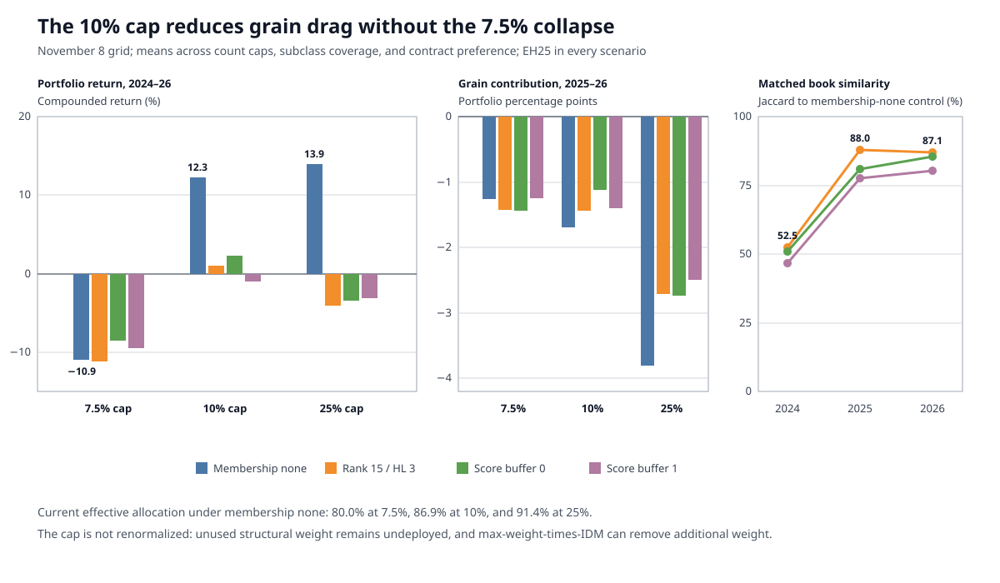

# Selection concentration grid audit: November 8, 2026

## Scope and validity

This audit covers `selection_grid_20261108_150959`, a 96-scenario annual
selection grid through November 6, 2026. All scenarios completed without an
error and share grid-input fingerprint
`74cb8edc8446a989fef5caba4ae3c91430d33d40b6cb9bb8544c6ea257b3d565`.
The grid varies:

- economic-subclass weight caps of 7.5%, 10%, and 25%;
- maximum instruments per economic subclass of three and five;
- economic-subclass minimum coverage off versus one;
- full-contract preference off versus on; and
- membership hysteresis `none`, rank 15% with a three-review count half-life,
  or score with a 0% or 1% score buffer.

Every scenario retains 25% eligibility hysteresis. Therefore, `membership
none` means no *membership* buffer; it is not a complete no-hysteresis control.
The grid cannot measure the marginal effect of eligibility hysteresis because
it contains no `EH0` scenario.

Common settings include 20% target volatility, 20% instrument margin, 50% book
margin, 20% weight-times-IDM, a 0.85 score threshold, one instrument per
feasible asset class, a 15-instrument minimum book, a 50% class cap, and a
31-day maximum selection-history gap.

## Verdict

The 10% subclass cap is the only useful concentration setting in this grid,
but it is not a free improvement.

- The 25% cap remains inactive as a subclass ceiling in recent books. Under the
  representative membership-none path, the largest effective subclass is
  16.68% and grains receive 8.34%.
- The 10% cap produces a materially broader current book, limits every
  effective subclass to 10%, and reduces grains to 4.77%. Its representative
  membership-none, three-per-subclass, full-preference path returns 18.16%
  from 2024 through November 6, 2026, versus 13.95% for the matched 25% path.
- The 7.5% cap is too restrictive under the present non-redistribution policy.
  It leaves 20% of structural weight unused, realizes only about 9% annualized
  net volatility after 2023, and loses 13.31% in the representative recent
  path.
- Membership hysteresis again fails to improve the whole portfolio. At the
  10% cap, the matched representative path returns 18.16% with membership
  buffering off, 9.99% with rank, 10.01% with score-0, and 5.02% with score-1.
- A three-instrument subclass cap is a reasonable compact-book setting, but it
  does not itself cap subclass risk. At the matched 10% configuration it beats
  the five-instrument setting after 2023 and incurs less cost, while the full
  grid shows sufficiently large interactions that this is not a universal
  ranking.
- Full-contract preference behaves as intended. In the representative 2026
  book it replaces `MCL` with `CL` and `BTS` with `UB`, reducing current micro
  usage from two contracts to one. Its median matched performance and cost
  effects are close to zero, so it is best treated as an execution preference,
  not an alpha feature.



## Subclass-cap response

The first table uses membership-none, no subclass minimum, three instruments
per subclass, and full-contract preference. Returns are compounded; Sharpe is
the arithmetic daily Sharpe annualized with 256 business days.

| Subclass cap | Ending equity | Full Sharpe | 2024–26 return | 2024–26 Sharpe | 2025–26 return | 2025–26 Sharpe | Recent cost | 2026 book | Effective allocation | Grain allocation |
|---:|---:|---:|---:|---:|---:|---:|---:|---:|---:|---:|
| 7.5% | $43.41M | 0.988 | -13.31% | -0.432 | -10.49% | -0.502 | 2.278 pp | 33 | 79.96% | 4.17% |
| 10% | $150.06M | 1.048 | 18.16% | 0.502 | 12.93% | 0.536 | 1.584 pp | 32 | 87.13% | 4.77% |
| 25% | $1,778.97M | 1.101 | 13.95% | 0.365 | 9.62% | 0.361 | 1.207 pp | 24 | 91.40% | 8.34% |

The ending equities are not comparable risk-normalized scores. The caps apply
through the full history, and dynamic capital compounds their different risk
and return paths. The 25% path earned much more in every pre-2024 regime,
especially when the universe was small:

| Window | 7.5% cap | 10% cap | 25% cap |
|---|---:|---:|---:|
| 1973–82 | 653% / 2.020 / 12.5 | 1,123% / 2.057 / 12.9 | 5,085% / 1.997 / 12.9 |
| 1983–92 | 68% / 0.559 / 19.7 | 94% / 0.613 / 19.7 | 208% / 0.732 / 19.7 |
| 1993–02 | 301% / 1.180 / 23.4 | 356% / 1.122 / 23.4 | 544% / 1.095 / 23.4 |
| 2003–12 | 481% / 1.108 / 28.3 | 571% / 1.096 / 28.3 | 647% / 1.042 / 27.5 |
| 2013–23 | 127% / 0.633 / 29.9 | 134% / 0.632 / 28.2 | 170% / 0.711 / 26.7 |
| 2024–26 | -13.31% / -0.432 / 25.8 | 18.16% / 0.502 / 25.6 | 13.95% / 0.365 / 18.9 |

Each cell reports compounded return, Sharpe, and average daily book count. The
10% cap is therefore a recent concentration/performance compromise, not a
full-history optimum.

### What the cap actually does

The cap is applied to the sizing weight and capped weight is deliberately left
unused. It is not applied to the normalized structural `weight`, and the
remaining instruments are not renormalized back to 100%. For the representative
2026 10% book:

| Asset class | Instruments | Raw structural weight | Effective sizing weight |
|---|---:|---:|---:|
| Agriculture | 9 | 14.31% | 14.31% |
| Bonds | 5 | 14.28% | 14.28% |
| Equities | 6 | 14.28% | 14.28% |
| Metals | 4 | 14.28% | 14.28% |
| Crypto | 2 | 14.28% | 10.00% |
| Energy | 3 | 14.28% | 9.99% |
| FX | 3 | 14.28% | 9.99% |
| **Allocated** | **32** | **100.00%** | **87.13%** |

The reported `unalloc_weight` is 12.86% at the 10% cap and 20% at the 7.5%
cap. The 25% subclass cap leaves no group weight unallocated, but the separate
weight-times-IDM instrument cap still reduces the representative effective sum
to 91.40%.

Grains are not directly clipped by the 10% ceiling: their raw and effective
weight are already 4.77%. The lower grain allocation arises because the capped
selection path retains seven asset classes and all three agricultural
subclasses. Thus the cap changes the selected hierarchy as well as clipping
large subclasses.

## Hysteresis response

The following representative paths fix the 10% subclass cap, three instruments
per subclass, no subclass minimum, and full-contract preference:

| Membership policy | Ending equity | Full Sharpe | 2024–26 return | 2024–26 Sharpe | 2025–26 return | 2025–26 Sharpe | Grain contribution | 2026 book |
|---|---:|---:|---:|---:|---:|---:|---:|---:|
| None (EH25 remains) | $150.06M | 1.048 | 18.16% | 0.502 | 12.93% | 0.536 | -1.771 pp | 32 |
| Rank 15%, HL 3 | $142.14M | 1.039 | 9.99% | 0.316 | 15.28% | 0.609 | -1.738 pp | 33 |
| Score buffer 0% | $142.13M | 1.037 | 10.01% | 0.316 | 15.29% | 0.610 | -1.739 pp | 33 |
| Score buffer 1% | $127.43M | 1.026 | 5.02% | 0.191 | 10.02% | 0.431 | -1.734 pp | 32 |

Rank and score-0 happen to produce the same 2024–2026 books in this
representative configuration, but they are not generally equivalent: none of
the 24 matched rank/score-0 pairs has an exactly identical full annual book
path or daily equity curve.

Across all matched structural configurations, hysteresis similarity to the
membership-none book is:

| Membership policy | Mean full-history Jaccard | 2024–26 mean | 2024 | 2025 | 2026 | Own year-over-year Jaccard | Mean unchanged transitions | Mean symbol churn |
|---|---:|---:|---:|---:|---:|---:|---:|---:|---:|
| Rank 15%, HL 3 | 97.4% | 75.9% | 52.5% | 88.0% | 87.1% | 71.3% | 2.2 | 568.7 |
| Score buffer 0% | 94.5% | 72.4% | 50.8% | 81.0% | 85.4% | 73.3% | 6.8 | 529.0 |
| Score buffer 1% | 89.8% | 68.2% | 46.7% | 77.7% | 80.3% | 76.7% | 17.1 | 467.8 |

Score-1 gives the most stasis, but it also has the weakest representative
recent result. As in the November 7 audit, the main damage begins with the
2024 book divergence. There is no evidence here to increase membership
hysteresis. If hysteresis is retained, rank 15% is the least aggressive tested
choice; membership-none remains the performance benchmark.

## Grain loss after 2024

For the representative 10%/three/full-preference/membership-none path, the
grain sleeve is much smaller than in the preceding 25%-cap audit:

| Year | Grain gross P&L | Trade cost | Roll cost | Grain net P&L | Portfolio contribution |
|---:|---:|---:|---:|---:|---:|
| 2025 | -$0.263M | -$0.047M | -$0.011M | -$0.321M | -0.308 pp |
| 2026 through Nov 6 | -$2.281M | -$0.049M | -$0.012M | -$2.341M | -1.463 pp |
| **Total** | **-$2.543M** | **-$0.096M** | **-$0.023M** | **-$2.662M** | **-1.771 pp** |

Costs are $0.119M, or 4.5% of the net loss. This remains a correlated signal
loss rather than a cost problem. Instrument attribution is `RS` -$1.218M,
`ZW` -$0.622M, `ZS` -$0.433M, `ZC` -$0.363M, and transition `ZM` -$0.026M.
The worst grain day is March 16, 2026, when `RS`, `ZS`, and `ZW` lose $0.986M
or 0.636 portfolio percentage points together. No recent grain observation has
an invalid P&L flag, omitted gap P&L, or source-gap flag.

The matched 25%/three/full-preference/membership-none path loses $65.52M and
3.565 percentage points in grains over the same period. Dollar magnitude is
amplified by its much larger capital path, but normalized contribution is also
roughly twice as bad. The 25%/five path loses $66.16M and 3.622 points. By
comparison, the preceding seven-grain-instrument, 25%-cap audit lost $46.34M
and 2.696 points. Reducing only the instrument count did not repair grain
concentration; the weight and hierarchy change did.

## Count, coverage, and contract-preference effects

Matched comparisons show strong interaction effects:

| Change | Mean 2024–26 return change | Median change | Mean 2025–26 return change | Median change | Mean current book-count change |
|---|---:|---:|---:|---:|---:|
| Three to five per subclass | -0.24 pp | +1.90 pp | +0.57 pp | +3.31 pp | +12.65 |
| Subclass minimum off to one | -2.51 pp | -1.75 pp | +0.33 pp | +0.16 pp | -0.06 |
| Full preference off to on | +0.33 pp | +0.00 pp | +0.78 pp | +0.00 pp | -0.02 |

The ranges are wide, so the means do not support general causal rankings. In
the representative 10%/membership-none path, however, three versus five
instruments returns 18.16% versus 6.77% after 2023 and reduces 2025–2026 cost
from 1.832 to 1.584 percentage points.

The subclass minimum does not solve hard coverage. All 96 final books have
`coverage_satisfied=false`; the 15-instrument book requirement is always met,
but one to three asset-class slots remain unavailable behind hard feasibility
gates. When subclass coverage is enabled, up to five subclass slots also remain
unfilled. Because it adds no reliable breadth or performance benefit, keep it
off until the underlying feasibility exclusions are reviewed.

Full-contract preference reduces the current number of micros by 1.29 per
matched scenario on average, with a median reduction of one. Its mean
2025–2026 cost reduction is 0.015 percentage points and its median reduction
is effectively zero. It should remain enabled for executable contract choice,
while performance claims should not be based on its noisy path-dependent
return differences.

## Book similarity and selection-path sensitivity

The concentration controls alter far more than the final weight assigned to a
fixed book:

| Matched comparison | Mean full-history Jaccard | Mean 2024–26 Jaccard |
|---|---:|---:|
| 7.5% cap versus 25% | 74.7% | 33.9% |
| 10% cap versus 25% | 84.2% | 52.5% |
| Three versus five per subclass | 76.2% | 61.9% |
| Subclass minimum off versus one | 97.4% | 78.1% |
| Full preference off versus on | 93.2% | 82.1% |

The greedy selection path is therefore sensitive to every tested control.
Neither the 10% result nor the full-contract result should be interpreted as a
simple post-selection reweighting of the old book.

For the representative 10% path, recent book similarity to membership-none is:

| Review | Rank | Score 0% | Score 1% |
|---:|---:|---:|---:|
| 2024 | 30.2% | 30.2% | 30.2% |
| 2025 | 100.0% | 100.0% | 87.9% |
| 2026 | 75.7% | 75.7% | 73.0% |

## Recommendation

Use the following as the next compact production candidate, not yet as a
final policy:

```text
--max-subclass-weight-pct 10
--max-instr-per-subclass 3
--selection-prefer-full-contracts
--selection-membership-hysteresis none
```

Omit `--min-instr-per-subclass` to leave subclass minimum coverage disabled in
the direct selection command.

Keep `--selection-eligibility-hysteresis-pct 25` only if incumbent exit
relaxation is already a desired live policy. The next small validation should
be a matched `EH0/EH25` pair on this single configuration; the present grid did
not run that control.

Before adopting the 10% cap, decide whether 12.86% unused structural weight is
intentional. If the goal is to preserve portfolio target risk, the allocator
needs a constrained redistribution policy that fills uncapped classes and
subclasses without allowing any subclass to exceed 10%. Simply normalizing the
capped weights would violate the cap. The current leave-unused behavior is
internally consistent and auditable, but it changes both concentration and
total risk deployment.
