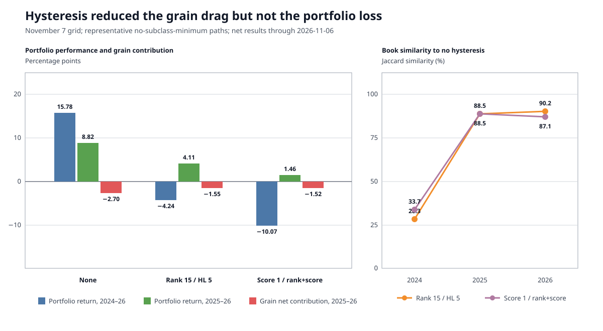

# Selection coverage and hysteresis grid audit: November 7, 2026

## Scope

This audit covers `selection_grid_20261107_215652`, an 80-scenario annual
selection grid through November 6, 2026. All scenarios completed and share the
same frozen history inputs. The grid fixes eligibility hysteresis at 25%,
requires at least one instrument per feasible class and a 15-instrument book,
uses full-contract preference, and varies:

- economic-subclass coverage off versus one instrument per feasible subclass;
- membership mode `none`, `rank`, `score`, or `rank_score`;
- rank buffers of 10%, 15%, and 25%;
- rank-count EWMA half-lives of 3, 5, and 10 annual reviews; and
- score buffers of 0%, 1%, and 2%.

The common construction settings are 20% target volatility, 20% instrument
margin cap, 50% book margin cap, 20% weight-times-IDM cap, score threshold
0.85, class/subclass count caps of 20/15, class/subclass weight caps of 50%/25%,
and a 31-day maximum selection-history gap. Every scenario has
`sel_pref_full_cons=true`, so this grid cannot estimate the marginal effect of
full-contract preference.

## Verdict

The rank and score components do not provide independent improvements in this
grid.

- Rank widths and count half-lives are non-binding over the tested surface.
  Within each subclass-coverage setting, all nine rank combinations produce the
  same recent performance and grain attribution.
- Every `rank_score` scenario is exactly identical to its matched `score`
  scenario in both the daily portfolio curve and every annual selected set.
  Rank buffer 10/15/25 and half-life 3/5/10 therefore add no effect once score
  hysteresis is active.
- A zero score buffer does not disable score hysteresis because the transition
  cost hurdle remains. Score buffers 0% and 1% are nearly indistinguishable
  after 2024; 2% creates more stasis and is worse, especially when subclass
  coverage is required.
- Hysteresis reduces the grain sleeve from 8.33% to 4.76% by preserving broader
  class and subclass representation. That cuts the 2025-2026 grain drag from
  about 2.70 percentage points to 1.52-1.55 points.
- The grain improvement does **not** translate into a better whole portfolio.
  The no-membership path returns 15.78% in 2024-2026 and 8.82% in 2025-2026;
  representative rank returns -4.24% and 4.11%, while score returns -10.07%
  and 1.46% over those same windows.

The 2024 book divergence is the central event. Rank and score retain books that
are only 28.3% and 33.7% similar to the no-membership book. Their books converge
again in 2025 and 2026, but not soon enough to recover the foregone performance.

## Hysteresis parameter response

The table uses the no-subclass-minimum variants unless stated otherwise.
Recent return and Sharpe cover January 2025 through November 6, 2026. Grain
contribution is the sum of daily grain `net_pct`, in portfolio percentage
points; it is not the grain sleeve's standalone return.

| Policy | Ending equity | Full Sharpe | 2025-26 return | Recent Sharpe | Grain net | Grain contribution | 2026 book | Grain weight |
|---|---:|---:|---:|---:|---:|---:|---:|---:|
| Membership off | $1,695.40M | 1.095 | 8.82% | 0.350 | -$46.34M | -2.696 pp | 56 | 8.33% |
| Rank, any tested width/half-life | $1,361.57M | 1.076 | 4.11% | 0.205 | -$21.58M | -1.545 pp | 60 | 4.76% |
| Score 0% / matched rank+score | $1,130.57M | 1.052 | 1.45% | 0.116 | -$17.87M | -1.522 pp | 60 | 4.76% |
| Score 1% / matched rank+score | $1,139.09M | 1.051 | 1.46% | 0.117 | -$18.01M | -1.523 pp | 60 | 4.76% |
| Score 2% / matched rank+score | $948.04M | 1.029 | 0.50% | 0.085 | -$15.13M | -1.525 pp | 59 | 4.76% |

The lower score-2 dollar loss is not a better grain result. Its normalized
grain contribution is marginally worse, while its capital base is much lower
because of earlier path differences.

Adding the one-per-subclass minimum barely changes normalized grain outcomes,
but it makes the score-2 recent portfolio result worse:

| Policy with subclass minimum | Ending equity | 2025-26 return | Grain net | Grain contribution | 2026 book |
|---|---:|---:|---:|---:|---:|
| Membership off | $1,683.36M | 8.83% | -$46.04M | -2.697 pp | 56 |
| Rank, any tested width/half-life | $1,360.22M | 4.12% | -$21.56M | -1.545 pp | 60 |
| Score 0% / rank+score | $1,214.11M | 1.39% | -$19.18M | -1.522 pp | 60 |
| Score 1% / rank+score | $1,219.10M | 1.06% | -$19.25M | -1.522 pp | 60 |
| Score 2% / rank+score | $1,007.30M | -0.63% | -$16.04M | -1.525 pp | 58 |

Subclass coverage is not responsible for the grain loss: grains were already
represented in every recent book. Nor does it repair the remaining class
deficits, which are blocked by hard feasibility gates.

## Grain loss after 2024

The designated grid baseline is the no-membership, no-subclass-minimum path.
It enters 2025 with $1.558B of net equity and ends 2026 at $1.695B. Dollar P&L
must therefore be read together with percentage-point contribution.

| Year | Grain gross P&L | Trade cost | Roll cost | Grain net P&L | Portfolio contribution | Whole-portfolio net P&L |
|---:|---:|---:|---:|---:|---:|---:|
| 2025 | -$18.61M | -$0.90M | -$0.34M | -$19.85M | -1.288 pp | +$17.64M |
| 2026 through Nov 6 | -$25.26M | -$0.90M | -$0.33M | -$26.49M | -1.407 pp | +$119.73M |
| Total | -$43.87M | -$1.80M | -$0.67M | -$46.34M | -2.696 pp | +$137.37M |

Costs explain $2.47M, or 5.3%, of the $46.34M net grain loss. This is primarily
a market-direction loss, not an execution-cost failure.

The instrument attribution is:

| Instrument | 2025-26 net P&L |
|---|---:|
| ZC | -$14.42M |
| RS | -$10.45M |
| ZS | -$8.82M |
| ZM | -$7.79M |
| ZW | -$5.29M |
| KE | -$3.90M |
| YK transition residue | -$0.07M |
| ZL | +$4.39M |

The losses are correlated trend misses. On March 16, 2026, all seven active
grain systems were long while the complex fell; the sleeve lost $14.62M that
day, led by ZL, RS, and ZS. On July 27 the same broad long-versus-falling-market
pattern lost $9.47M. Conversely, the January 10, 2025 loss occurred while most
grain systems were short into a broad price rise. These are synchronized signal
failures inside one economic sleeve, not independent instrument events.

The grain replay is internally sound. The seven active grain series have 3,155
post-2024 rows, no invalid P&L observations, no omitted gap P&L, and no source
gap flags. Their instrument-level cash P&L reconciles to portfolio P&L within
report rounding.

### Why hysteresis cuts the grain loss

The no-membership 2025-2026 book contains six represented asset classes and no
FX class. Agriculture receives 16.68%, and the grains subclass receives 8.33%
across seven instruments. The representative hysteresis books retain FX and
livestock, producing seven represented classes, 14.28% agriculture, and 4.76%
grains. They retain the same seven active grain contracts; the improvement is
dilution through broader hierarchy coverage, not better grain selection.

The 25% subclass cap is therefore inactive. At the baseline's 2026 equity and
IDM 2.5, the 8.33% grain weight corresponds to roughly $65.7M of annualized
risk budget. A $26.49M annual loss is material but not surprising relative to
that budget. The troubling feature is the daily co-movement: one correlated
grain shock can consume a large fraction of expected whole-portfolio daily
risk.

## Book similarity

The representative policies below all omit the optional subclass minimum.
Score 1% and rank 15% / half-life 5 / score 1% are exact duplicates, so the
combined mode is not repeated as a separate book.

| Policy | Mean Jaccard to no-membership book | Mean year-over-year Jaccard | Unchanged annual transitions | Symbol churn |
|---|---:|---:|---:|---:|
| Membership off | 100.0% | 83.6% | 5 | 515 |
| Rank 15%, half-life 5 | 97.3% | 85.0% | 7 | 467 |
| Score 1% / matched rank+score | 92.4% | 87.6% | 21 | 373 |

Score hysteresis creates much more stasis, but the average similarity hides the
large 2024 discontinuity:

| Review | Policy | Book n | Common with baseline | Added versus baseline | Removed versus baseline | Jaccard |
|---:|---|---:|---:|---:|---:|---:|
| 2024 | Rank 15 / HL5 | 60 | 26 | 34 | 32 | 28.3% |
| 2024 | Score 1 / rank+score | 61 | 30 | 31 | 28 | 33.7% |
| 2025 | Rank 15 / HL5 | 59 | 54 | 5 | 2 | 88.5% |
| 2025 | Score 1 / rank+score | 59 | 54 | 5 | 2 | 88.5% |
| 2026 | Rank 15 / HL5 | 60 | 55 | 5 | 1 | 90.2% |
| 2026 | Score 1 / rank+score | 60 | 54 | 6 | 2 | 87.1% |

The compact changed-book audit after the 2024 divergence is:

| Review | Rank 15 / HL5 versus baseline | Score 1 / rank+score versus baseline |
|---:|---|---|
| 2025 | Add `C, CHF, HE, LE, XINA50`; remove `CC, DAX` | Add `CHF, HE, LE, NZD, XINA50`; remove `MNTPX, SI` |
| 2026 | Add `CHF, GF, HE, LE, XIN0I`; remove `MXEA` | Add `CHF, GF, HE, IXE, LE, XIN0I`; remove `ESTX50, MXEA` |

The full recent books are retained here for reproduction:

| Review | Policy | Instruments |
|---:|---|---|
| 2024 | Membership off | `BTP, BTS, C, CSC, CT, D, DAX, ES, ETHUSDRR, GBL, GBM, GBS, GBX, GC, HE, HH, HHI.HK, HSI, I, IBXXIBHY, IXE, IXR, IXU, JGB, KC, KE, MCA, MNTPX, MXEA, N225M, NOK, NQ, OAT, R, RS, SONIA.N, SRFXON3, SSG, SX6P, SXQP, TN, TSEMOTHR, TSEREIT, TSR20, TWN, UB, V2TX, W, XIN0I, YK, Z, Z3N, ZB, ZC, ZL, ZM, ZT, ZW` |
| 2024 | Rank 15 / HL5 | `6M, AIGCI, AUD, BRE, CAD, CC, CHF, CSC, CT, D, DA, DJUSRE, DX, EMD, ES, EUR, GBP, GF, HE, HP, HSI, IXB, IXE, IXI, IXR, IXU, IXV, JPY, KC, KE, LE, MBT, NOK, NQ, NZD, PA, RF, RS, RSV, RTY, RY, SEK, SIXM, SIXRE, SONIA.N, SX6P, TSEMOTHR, TSEREIT, V2TX, W, YK, YM, Z, ZAR, ZC, ZL, ZM, ZO, ZR, ZW` |
| 2024 | Score 1 / rank+score | `6M, AIGCI, AUD, BRE, BTP, CAD, CHF, CSC, CT, DA, DAX, DJUSRE, DX, EMD, ES, ESTX50, EUR, GBP, GBS, GBX, GC, HE, HP, IXE, IXU, J7, KC, KE, MBT, MHI, MXEA, NOK, NQ, NZD, OAT, PA, PL, RS, RTY, RY, SB, SCI, SIXM, SIXRE, SSG, SX6P, TN, TSEMOTHR, UB, V2TX, YC, YK, YM, Z, ZAR, ZB, ZF, ZL, ZM, ZN, ZW` |
| 2025 | Membership off | `BTP, BTS, BZ, CC, CL, CT, D, DAX, EMD, ES, ESTX50, ETHUSDRR, GBL, GBM, GBS, GBX, GC, HG, HHI.HK, HSI, IBEX35, JGB, KC, KE, MCA, MNTPX, MXEA, N225M, NQ, OAT, PA, R, RB, RS, RTY, SB, SCI, SI, SMI, SSG, SX7E, TN, TWN, UB, XIN0I, YM, Z, ZB, ZC, ZF, ZL, ZM, ZN, ZS, ZT, ZW` |
| 2025 | Rank 15 / HL5 | `BTP, BTS, BZ, C, CHF, CL, CT, D, EMD, ES, ESTX50, ETHUSDRR, GBL, GBM, GBS, GBX, GC, HE, HG, HHI.HK, HSI, IBEX35, JGB, KC, KE, LE, MCA, MNTPX, MXEA, N225M, NQ, OAT, PA, R, RB, RS, RTY, SB, SCI, SI, SMI, SSG, SX7E, TN, TWN, UB, XIN0I, XINA50, YM, Z, ZB, ZC, ZF, ZL, ZM, ZN, ZS, ZT, ZW` |
| 2025 | Score 1 / rank+score | `BTP, BTS, BZ, CC, CHF, CL, CT, D, DAX, EMD, ES, ESTX50, ETHUSDRR, GBL, GBM, GBS, GBX, GC, HE, HG, HHI.HK, HSI, IBEX35, JGB, KC, KE, LE, MCA, MXEA, N225M, NQ, NZD, OAT, PA, R, RB, RS, RTY, SB, SCI, SMI, SSG, SX7E, TN, TWN, UB, XIN0I, XINA50, YM, Z, ZB, ZC, ZF, ZL, ZM, ZN, ZS, ZT, ZW` |
| 2026 | Membership off | `BTP, BTS, BZ, CC, CL, CT, D, DAX, EMD, ES, ESTX50, ETHUSDRR, GBL, GBM, GBS, GBX, GC, HG, HHI.HK, HSI, IBEX35, JGB, KC, KE, MCA, MNTPX, MXEA, N225M, NQ, OAT, PA, R, RB, RS, RTY, SB, SCI, SI, SMI, SSG, SX7E, TN, TWN, UB, XINA50, YM, Z, ZB, ZC, ZF, ZL, ZM, ZN, ZS, ZT, ZW` |
| 2026 | Rank 15 / HL5 | `BTP, BTS, BZ, CC, CHF, CL, CT, D, DAX, EMD, ES, ESTX50, ETHUSDRR, GBL, GBM, GBS, GBX, GC, GF, HE, HG, HHI.HK, HSI, IBEX35, JGB, KC, KE, LE, MCA, MNTPX, N225M, NQ, OAT, PA, R, RB, RS, RTY, SB, SCI, SI, SMI, SSG, SX7E, TN, TWN, UB, XIN0I, XINA50, YM, Z, ZB, ZC, ZF, ZL, ZM, ZN, ZS, ZT, ZW` |
| 2026 | Score 1 / rank+score | `BTP, BTS, BZ, CC, CHF, CL, CT, D, DAX, EMD, ES, ETHUSDRR, GBL, GBM, GBS, GBX, GC, GF, HE, HG, HHI.HK, HSI, IBEX35, IXE, JGB, KC, KE, LE, MCA, MNTPX, N225M, NQ, OAT, PA, R, RB, RS, RTY, SB, SCI, SI, SMI, SSG, SX7E, TN, TWN, UB, XIN0I, XINA50, YM, Z, ZB, ZC, ZF, ZL, ZM, ZN, ZS, ZT, ZW` |

## Performance by regime

Each cell reports compounded net return, arithmetic Sharpe, average daily book
count, and mean annual Jaccard similarity to the no-membership book. The final
window is the partial January 2024 through November 6, 2026 period.

| Window | Membership off | Rank 15 / HL5 | Score 1 / matched rank+score |
|---|---:|---:|---:|
| 1973-82 | 5,264% / 1.988 / 14.3 / 100% | 5,264% / 1.988 / 14.3 / 100% | 4,935% / 1.944 / 13.9 / 95.5% |
| 1983-92 | 233% / 0.763 / 23.7 / 100% | 233% / 0.763 / 23.7 / 100% | 243% / 0.780 / 23.5 / 99.1% |
| 1993-02 | 574% / 1.159 / 34.9 / 100% | 574% / 1.159 / 34.9 / 100% | 590% / 1.166 / 33.7 / 97.0% |
| 2003-12 | 582% / 0.990 / 56.6 / 100% | 582% / 0.990 / 56.6 / 100% | 578% / 0.986 / 54.5 / 88.4% |
| 2013-23 | 138% / 0.631 / 67.7 / 100% | 131% / 0.614 / 66.9 / 95.0% | 109% / 0.547 / 67.0 / 89.3% |
| 2024-26 | 15.78% / 0.408 / 45.3 / 100% | -4.24% / -0.047 / 48.4 / 69.0% | -10.07% / -0.189 / 49.0 / 69.8% |

Rank matches the no-membership path through 2012 and begins diverging only in
the later capital-dependent books. Score hysteresis changes books earlier and
more persistently. Neither improves 2013-2023, and both are materially worse in
2024-2026 despite reducing grain exposure after 2024.

## Coverage and concentration implications

Coverage remains unresolved in all representative recent books. The
no-membership path reports three final class deficits in both 2025 and 2026;
rank and score report two. Each has `coverage_satisfied=false` with
`coverage_unmet_hard_feasibility_gate`. Hysteresis happens to retain FX and
livestock, but it is not a reliable substitute for explicit feasible coverage.

The current 50% class and 25% subclass caps are inactive in the recent books.
For a direct concentration test, the next grid should sweep subclass caps near
the observed exposure, such as 5%, 7.5%, and 10%. A lower maximum instrument
count per subclass, for example 3-5 instead of 15, tests duplication and cost
inside grains; it does not by itself guarantee a lower total grain weight.

The policy conclusion remains conservative:

1. Do not select `rank_score`; it is redundant with score in all 54 matched
   scenarios.
2. Do not infer an optimum rank width or half-life from this grid; all tested
   combinations are the same over the measured recent window.
3. Do not adopt score hysteresis from its lower grain loss. It achieves that by
   holding a broader but stale 2024 book and materially reduces whole-portfolio
   performance.
4. Treat the no-membership path as the current benchmark while separately
   testing binding class/subclass concentration limits and the hard coverage
   failures.
5. Run a matched `full0/full1` grid before attributing any performance or cost
   difference to full-contract preference.
